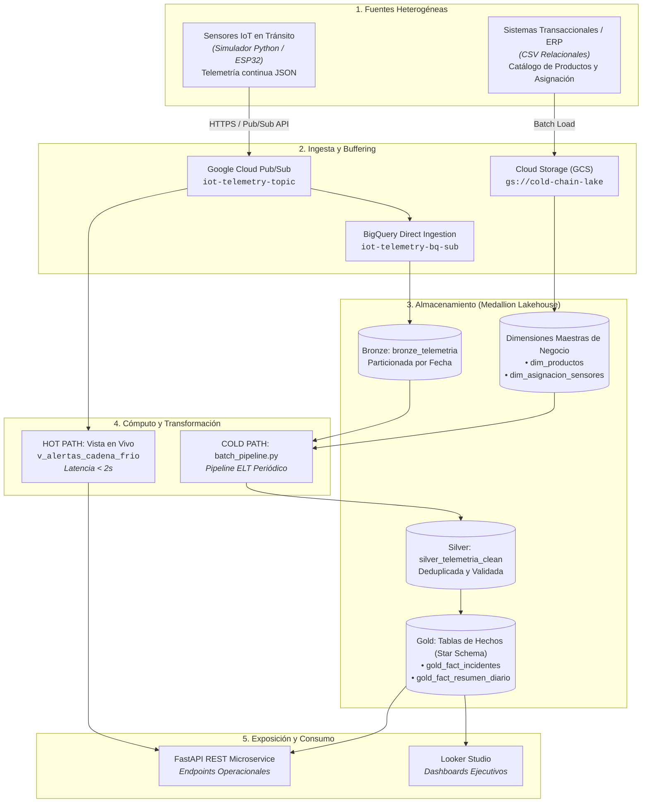

# ❄️ Smart Cold Chain IoT: Arquitectura End-to-End en Google Cloud Platform

[](https://console.cloud.google.com/)
[]()
[]()
[]()

> **Proyecto Final de Curso:** Big Data 2026
> **Autor:** Guillermo Soto  
> **Fecha:** Noviembre 2026  

---

## 📋 Tabla de Contenidos
1. [Descripción del Proyecto](#-descripción-del-proyecto)
2. [Arquitectura de Datos End-to-End](#-arquitectura-de-datos-end-to-end)
3. [Estructura del Repositorio](#-estructura-del-repositorio)
4. [Instalación y Prerrequisitos](#-instalación-y-prerrequisitos)
5. [Capa de Exposición y Servicios (REST API)](#-capa-de-exposición-y-servicios-rest-api)
6. [Demostración Funcional End-to-End](#-demostración-funcional-end-to-end)
7. [Análisis de Costos y Facturación Real](#-análisis-de-costos-y-facturación-real)
8. [Documentación y Diapositivas de Sustentación](#-documentación-y-diapositivas-de-sustentación)

---

## 🎯 Descripción del Proyecto

Este proyecto implementa una plataforma de datos **Data Lakehouse** basada en el patrón de diseño **Medallion (Bronze ➔ Silver ➔ Gold)** sobre **Google Cloud Platform (GCP)** para la monitorización en tiempo real y la valorización financiera de mermas en la cadena de frío de productos farmacéuticos y alimenticios perecederos.

### Características Principales:
* **Ingesta Streaming Serverless:** Captura elástica mediante **Cloud Pub/Sub** y **BigQuery Direct Ingestion** sin middleware intermedio.
* **Procesamiento Híbrido:**
  * **Hot Path (< 2s):** Detección inmediata de anomalías térmicas en tiempo real vía `v_alertas_cadena_frio`.
  * **Cold Path (Batch ELT):** Deduplicación analítica con `ROW_NUMBER()`, filtro de valores espurios y cálculo monetario de pérdidas en dólares (`gold_fact_incidentes`).
* **Capa de Exposición (REST API):** Microservicio en **FastAPI** que sirve endpoints operacionales y analíticos para tableros de control y WMS.
* **Modelo Dimensional Star Schema:** Tablas analíticas optimizadas para **Looker Studio** particionadas por fecha y clusterizadas por sensor.

---

## 🏛 Arquitectura de Datos End-to-End



---

## 📂 Estructura del Repositorio

```text
iot-coldchain/
├── .gitignore                     # Exclusión de claves y entornos virtuales
├── README.md                      # Documentación maestra del repositorio
├── requirements.txt               # Dependencias de producción Python
├── api/
│   └── main.py                    # Capa de Exposición: REST API con FastAPI
├── data/
│   ├── productos.csv              # Catálogo maestro y reglas térmicas
│   └── asignacion_sensores.csv    # Mapeo de sensores, vehículos y choferes
├── demo/
│   └── demo_e2e.py                # Script interactivo de demostración End-to-End
├── informe/
│   ├── INFORME_FINAL_PROYECTO_IOT.md   # Informe técnico formal maestro (>920 líneas)
│   ├── INFORME_FINAL_PROYECTO_IOT.html # Versión web del informe con Mermaid
│   ├── SLIDES_SUSTENTACION.md         # Diapositivas de sustentación en Markdown
│   └── SLIDES_SUSTENTACION.html       # Presentación interactiva de diapositivas
├── iot_simulator.py               # Simulador de sensores IoT con inyección de anomalías
├── pipelines/
│   ├── batch_pipeline.py          # Orquestador Python de transformaciones ELT
│   ├── batch_transformations.sql  # Sentencias SQL para Bronze -> Silver -> Gold
│   └── stream_processor.py        # Listener de baja latencia para Pub/Sub
└── tests/
    └── test_api.py                # Pruebas unitarias de la API de exposición
```

---

## ⚙️ Instalación y Prerrequisitos

### 1. Clonar el Repositorio
```bash
git clone https://github.com/gsoto1872-blip/iot-coldchain.git
cd iot-coldchain
```

### 2. Configurar el Entorno Virtual
```bash
python3 -m venv .venv
source .venv/bin/activate
pip install -r requirements.txt
```

### 3. Autenticación en GCP
```bash
gcloud auth login
gcloud config set project myfirstproject-508413
gcloud auth application-default login
```

---

## 🌐 Capa de Exposición y Servicios (REST API)

La API proporciona acceso estandarizado a los datos procesados en BigQuery y un gateway de ingesta HTTP alternativo:

### Iniciar el Servidor de la API
```bash
python -m uvicorn api.main:app --host 0.0.0.0 --port 8000 --reload
```

### Endpoints Disponibles:
* `GET /health`: Estado del servicio y conectividad con BigQuery.
* `GET /api/v1/telemetry/live`: Estado en tiempo real de los sensores (Hot Path).
* `GET /api/v1/incidents`: Incidentes térmicos históricos y pérdida financiera en USD (Gold).
* `GET /api/v1/kpis/daily`: Resumen diario y salud de baterías de los sensores.
* `GET /api/v1/products`: Catálogo maestro de productos y tolerancias.
* `POST /api/v1/telemetry/ingest`: Gateway HTTP para ingesta de sensores hacia Pub/Sub.

Documentación interactiva disponible en: `http://localhost:8000/docs` (Swagger UI).

---

## 🎬 Demostración Funcional End-to-End

Para ejecutar la demostración guiada del flujo completo en vivo:

```bash
python demo/demo_e2e.py
```

### Flujo de la Demostración:
1. **Inyección:** SENSOR-02 emite 13.5°C en transporte de Carne Fresca (límite 4.0°C).
2. **Ingesta Pub/Sub:** Mensaje confirmado asíncronamente con Message ID de GCP.
3. **Persistencia Directa:** Almacenado en `bronze_telemetria` en &lt; 2.5 segundos.
4. **Alerta en Vivo (Hot Path):** Vista SQL detecta infracción (+9.5°C de exceso).
5. **Cómputo ELT (Cold Path):** Deduplica en Silver y valoriza en Gold.
6. **Exposición REST:** Endpoint `/api/v1/incidents` devuelve HTTP 200 con pérdida liquidada de **$1,187.50 USD**.
7. **Decisión Prescriptiva:** Alerta al chofer, desvío prescriptivo a cámara de contingencia y cuarentena en WMS.

---

## 💰 Análisis de Costos y Facturación Real

| Escenario Operacional | Dispositivos | Mensajes / Mes | Costo Mensual GCP | Costo Anual Proyectado |
| :--- | :--- | :--- | :--- | :--- |
| **Laboratorio / Académico** | 3 sensores | 2.59 millones | **$0.00 USD (Free Tier)** | **$0.00 USD** |
| **Producción Pyme** | 100 sensores | 25.92 millones | **$0.92 USD / mes** | **$11.04 USD / año** |
| **Producción Masiva** | 1,000 sensores | 259.2 millones | **$3.67 USD / mes** | **$44.04 USD / año** |
| **Alternativa Clúster Spark** | 100 sensores | 25.92 millones | **$96.00 USD / mes** | **$1,152.00 USD / año** |

> **Ahorro de TCO:** La arquitectura Serverless en GCP reduce los costos en un **99.04%** (\$11.04 USD vs \$1,152.00 USD anuales).

---

## 📑 Documentación y Diapositivas de Sustentación

En la carpeta [`informe/`](informe/) se encuentran los documentos finales para evaluación y defensa:

* **[INFORME_FINAL_PROYECTO_IOT.md](informe/INFORME_FINAL_PROYECTO_IOT.md):** Memoria técnica formal de más de 920 líneas con marco regulatorio (OMS / FDA 21 CFR Part 11), diccionario de datos y evidencias.
* **[SLIDES_SUSTENTACION.md](informe/SLIDES_SUSTENTACION.md):** Diapositivas de sustentación en Markdown con los 10 bullets solicitados.
* **[SLIDES_SUSTENTACION.html](informe/SLIDES_SUSTENTACION.html):** Pitch deck interactivo navegable con flechas de teclado y listo para proyectar o imprimir en PDF.

---

### Instrucciones para Descargar desde Cloud Shell:
```bash
# Descargar el informe técnico:
cloudshell download /home/gsoto1872/iot-coldchain/informe/INFORME_FINAL_PROYECTO_IOT.md

# Descargar las diapositivas de sustentación:
cloudshell download /home/gsoto1872/iot-coldchain/informe/SLIDES_SUSTENTACION.md

# Descargar las diapositivas interactivas en HTML:
cloudshell download /home/gsoto1872/iot-coldchain/informe/SLIDES_SUSTENTACION.html
```
