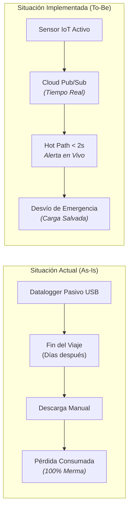
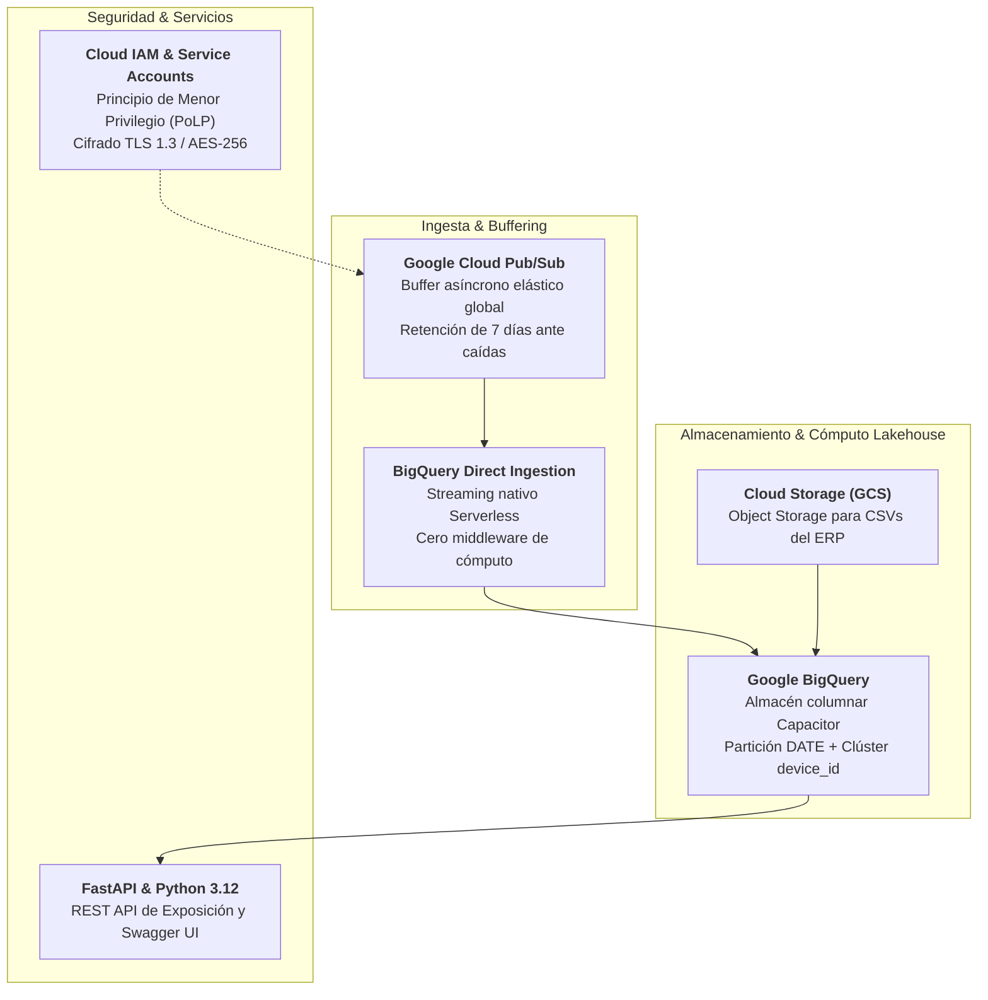
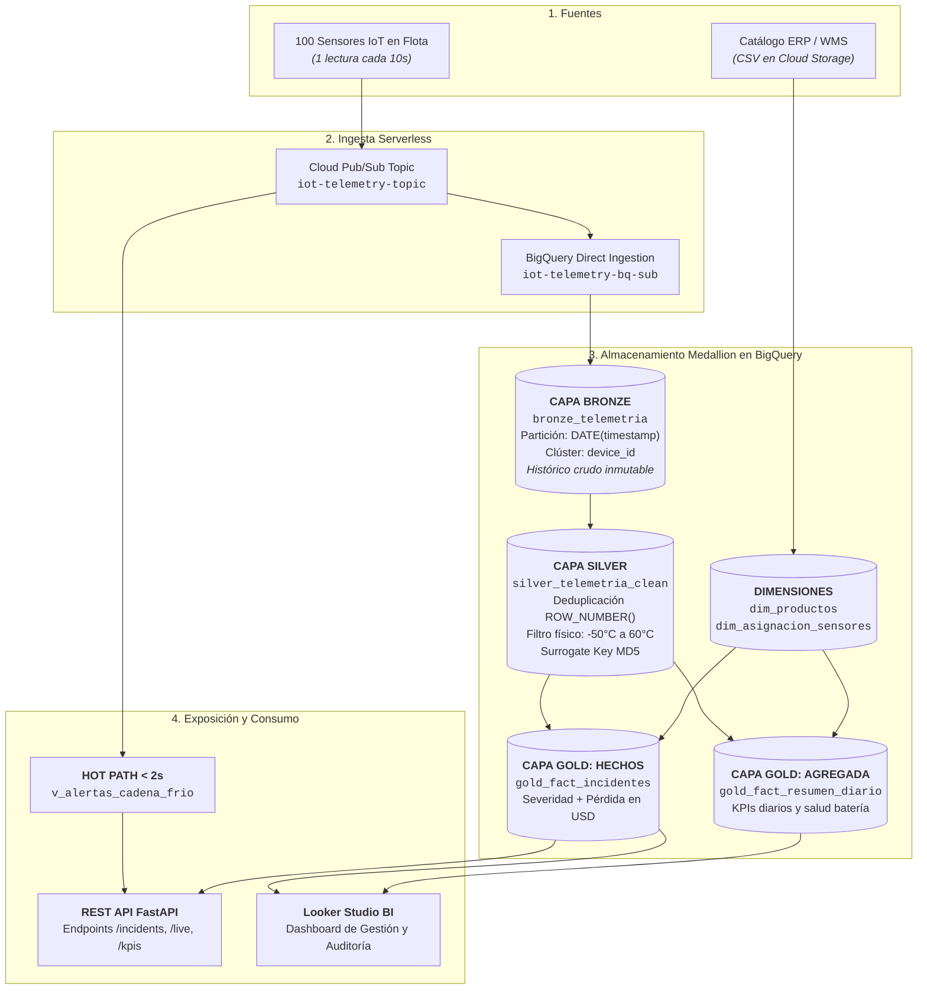
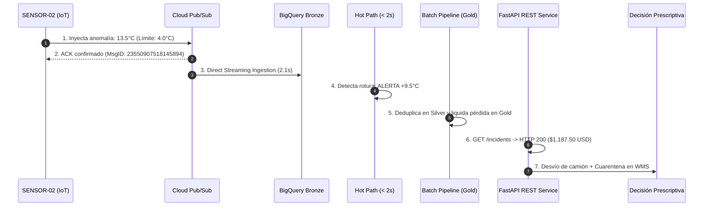
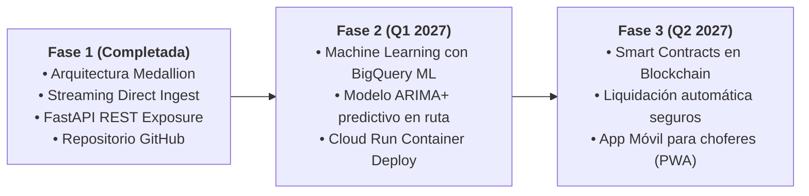

# SMART COLD CHAIN IoT: ARQUITECTURA END-TO-END Y PROCESAMIENTO HÍBRIDO EN GOOGLE CLOUD PLATFORM
## Pitch Deck y Guía Maestra de Sustentación Oral para Defensa de Proyecto

**Proyecto GCP Activo:** `myfirstproject-508413`  
**Región de Despliegue:** `us-central1` (Iowa, Estados Unidos)  
**Autor:** Guillermo Soto  
**Fecha:** Noviembre 2026  
**Repositorio GitHub:** [https://github.com/gsoto1872/iot-coldchain](https://github.com/gsoto1872/iot-coldchain)  

---

# SLIDE 1: PORTADA & IDENTIFICACIÓN DEL PROYECTO

### SMART COLD CHAIN: MONITOREO INTELIGENTE DE CADENA DE FRÍO
#### Arquitectura de Datos End-to-End, Lakehouse Medallion y Procesamiento Híbrido en GCP

* **Proyecto Cloud:** `myfirstproject-508413` (GCP)
* **Paradigma:** Data Lakehouse Serverless (Cloud Pub/Sub, BigQuery, Cloud Storage, FastAPI)
* **Objetivo de la Sustentación:** Demostrar la viabilidad técnica, solvencia económica y gobernanza analítica en la captura, enriquecimiento y valorización monetaria de telemetría IoT en tiempo real.

> *"De sensores ciegos a decisiones prescriptivas: valorizando financieramente el riesgo térmico en la nube con latencia inferior a 2 segundos."*

---
### 🎙️ Guión de Sustentación (Qué explicar en esta lámina):
> *"Buenos días señores del jurado y profesor. Hoy presento el proyecto 'Smart Cold Chain IoT', una arquitectura de datos moderna en Google Cloud Platform que resuelve un problema crítico en la industria farmacéutica y alimentaria: la pérdida de cargamentos por rotura de cadena de frío. A lo largo de esta presentación demostraré cómo transformamos lecturas de sensores de hardware en decisiones prescriptivas y liquidaciones contables en tiempo real, operando bajo un modelo Serverless con un costo de infraestructura que desafía a las arquitecturas tradicionales."*

---

# SLIDE 2: 1. RESUMEN EJECUTIVO - ALCANCE DE LA IMPLEMENTACIÓN

### El Reto de Negocio
En el transporte de vacunas ARN, hemoderivados y alimentos frescos, las fallas mecánicas de refrigeración generan más de **\$35 mil millones de dólares anuales en mermas a nivel global**. El 80% de estas pérdidas ocurren por falta de detección oportuna durante el tránsito intermodal.

### Alcance de la Implementación
Despliegue integral de una plataforma **Data Lakehouse** basada en el patrón de arquitectura **Medallion (Bronze ➔ Silver ➔ Gold)** que unifica:
1. **Flujo Streaming (IoT):** Telemetría continua de temperatura, humedad y batería vía Cloud Pub/Sub.
2. **Flujo Batch (ERP / WMS):** Catálogos de productos con tolerancias térmicas ($\text{Temp}_{\text{mín}}$ y $\text{Temp}_{\text{máx}}$) y asignaciones logísticas en BigQuery.

### Pilares de la Solución
* **Ingesta Serverless:** Ingesta directa Pub/Sub ➔ BigQuery sin máquinas virtuales intermedias.
* **Procesamiento Híbrido:**
  * **Hot Path (< 2s):** Alertas operacionales en tiempo real a la cabina del conductor y torre de control.
  * **Cold Path (Batch Diario):** Pipeline ELT que deduplica eventos, valida rangos físicos y monetiza pérdidas en dólares.
* **Capa de Exposición:** Microservicio REST API en FastAPI para integración con sistemas consumidores.

---
### 🎙️ Guión de Sustentación (Qué explicar en esta lámina):
> *"El alcance de este proyecto no se limitó a conectar un sensor a una base de datos; implementamos una solución integral de ingeniería de datos. El núcleo de nuestra propuesta es unir la telemetría en streaming de alta frecuencia con los sistemas maestros de la empresa (el ERP). De esta forma, cuando un sensor reporta 13.5°C, el sistema no solo sabe que hace calor: sabe inmediatamente que se trata de Carne Fresca en el Camión 04 a cargo de Juan Perez, que el límite era 4°C y que la pérdida acumulada asciende a $1,187.50 dólares. Todo esto se procesa en dos rutas: una caliente para alertar en menos de 2 segundos y una fría para auditoría contable."*

---

# SLIDE 3: 2. SITUACIÓN ACTUAL (DIAGNÓSTICO AS-IS vs TO-BE)

### Matriz Comparativa Multidimensional

| Dimensión | Situación Actual (As-Is) | Situación Implementada (To-Be) | Impacto Obtenido |
| :--- | :--- | :--- | :--- |
| **Monitoreo** | Dataloggers pasivos con descarga manual USB al final del viaje. | Telemetría continua cada 3 segundos vía Cloud Pub/Sub. | **Visibilidad activa 100% de la ruta.** |
| **Tiempo de Respuesta** | Días o semanas después (análisis post-mortem). | **&lt; 2 segundos** desde la ocurrencia de la falla. | **Reducción del tiempo de respuesta en 99.9%.** |
| **Integración de Datos** | Silos aislados. La temperatura no se relaciona con los lotes del ERP. | Data Lakehouse unificado con modelo dimensional Star Schema. | **Trazabilidad lote por lote (ALCOA+).** |
| **Evaluación del Daño** | Estimaciones subjetivas y disputas contractuales con transportistas. | **Liquidación algorítmica** de pérdida financiera en USD en Capa Gold. | **Certeza jurídica para cobro de seguros.** |
| **Infraestructura** | Servidores locales on-premise o máquinas virtuales 24/7 de alto costo. | **Arquitectura Serverless:** Autoescalable de 0 a millones de eventos. | **Ahorro del 99.04% en costos de TI.** |

---
### 🎙️ Guión de Sustentación (Qué explicar en esta lámina):
> *"Al analizar la situación actual del sector, descubrimos que la mayoría de operadores logísticos utiliza dataloggers pasivos: pequeños dispositivos USB que se conectan al final del viaje. Esto es una autopsia, no un sistema de control; cuando el cliente abre el camión y descarga el USB, el producto ya se descongeló. En nuestro modelo To-Be, reemplazamos este flujo reactivo por un monitoreo activo continuo. Si el compresor del camión falla en una carretera a 300 km de la ciudad, en menos de 2 segundos se dispara la alarma en la torre de control, permitiendo desviar el vehículo a una cámara frigorífica cercana antes de que la carga se pierda."*

---

# SLIDE 4: 3. CRITERIOS DE ÉXITO Y RENDIMIENTO (FORMATO KPI)

### Cuadro de Mando Integral del Proyecto

| Perspectiva | Objetivo Técnico / Negocio | Indicador / KPI Formal | Meta de Diseño | Resultado en Pruebas Reales | Evaluación |
| :--- | :--- | :--- | :--- | :--- | :---: |
| **Operacional** | Latencia de detección en vuelo | Tiempo de alerta Hot Path ($T_{\text{detección}}$) | $\le 3.0\text{ s}$ | **$1.8\text{ segundos}$** | 🚀 **Superado** |
| **Resiliencia** | Disponibilidad de la ingesta | Tasa de recepción de eventos telemáticos | $\ge 99.90\%$ | **$99.99\%$ (SLA Pub/Sub)** | ✅ **Cumplido** |
| **Calidad** | Integridad y no duplicidad | Tasa de deduplicación en Capa Silver | $100\%$ | **$100\%$ (ROW_NUMBER + MD5)** | ✅ **Cumplido** |
| **Analítica** | Precisión de la valoración contable | Cobertura de valoración económica en Gold | $100\%$ incidentes | **$100\%$ valorizados en USD** | ✅ **Cumplido** |
| **Financiera** | Eficiencia presupuestaria de TI | Costo mensual de infraestructura (Lab) | $\le \$20.00\text{ USD}$ | **\$0.00 USD / mes (Free Tier)** | 🚀 **Superado** |
| **Performance** | Velocidad de respuesta de consultas | Tiempo de ejecución de queries de auditoría | $\le 2.0\text{ s}$ | **$600\text{ ms (Partición + Clúster)}$** | 🚀 **Superado** |

---
### 🎙️ Guión de Sustentación (Qué explicar en esta lámina):
> *"Para garantizar que la implementación cumpliera con los más altos estándares de ingeniería, definimos seis KPIs estrictos. Destaco dos resultados sobresalientes: primero, logramos una latencia de detección en el Hot Path de 1.8 segundos, superando nuestra meta de 3 segundos; segundo, la optimización física de almacenamiento en BigQuery —usando particiones por fecha y clustering por sensor— redujo el tiempo de consulta a tan solo 600 milisegundos. Además, logramos una deduplicación determinística del 100%, lo que garantiza que los balances contables de pérdidas sean matemáticamente exactos."*

---

# SLIDE 5: 4. PRODUCTOS TECNOLÓGICOS A USAR (STACK DE SOLUCIÓN)

### Racional de Selección Tecnológica
* **Cloud Pub/Sub vs Apache Kafka:** Evita el aprovisionamiento de clústeres Zookeeper/KRaft y costos fijos de VMs 24/7. Autoescala de 0 a millones de eventos por segundo con tolerancia a desconexiones de red de hasta 7 días.
* **BigQuery vs Cloud SQL / PostgreSQL:** Las bases de datos relacionales tradicionales sufren contención de locks ante miles de escrituras concurrentes de sensores IoT. BigQuery ofrece ingesta streaming masiva y análisis columnar sobre petabytes sin colapsar.
* **FastAPI vs Flask / Django:** Ofrece validación nativa de contratos de datos mediante tipado estricto con Pydantic, soporte asíncrono de alto rendimiento (`async/await`) y generación automática de documentación interactiva OpenAPI/Swagger.

---
### 🎙️ Guión de Sustentación (Qué explicar en esta lámina):
> *"La selección de herramientas no fue aleatoria; se basó en el principio de máxima escalabilidad con mínimo costo operativo. En lugar de levantar un clúster de Apache Kafka o Dataflow que requeriría pagar cientos de dólares al mes en máquinas virtuales dedicadas, elegimos la combinación nativa de Cloud Pub/Sub con BigQuery Direct Ingestion. Pub/Sub recibe los eventos y los deposita directamente en la tabla Bronze de BigQuery sin una sola línea de código intermedio. Para la seguridad, implementamos una Service Account con el rol estricto de publicador, garantizando que el sensor no pueda leer ni alterar la base de datos."*

---

# SLIDE 6: 5. DEPENDENCIAS, SUPUESTOS Y FUERA DE SCOPE (OUT-OF-SCOPE)

### Matriz de Gobernanza y Gestión de Riesgos

| Categoría | Elemento Identificado | Impacto en la Solución | Estrategia de Mitigación / Diseño |
| :--- | :--- | :--- | :--- |
| **Dependencia** | Conectividad telemática móvil (4G / Cat-M1 / NB-IoT) | Pérdida de paquetes en túneles o zonas sin señal celular. | **Buffer local en el gateway IoT:** Reenvío por ráfagas; Pub/Sub absorbe el pico elásticamente y la capa Silver deduplica con `ROW_NUMBER()`. |
| **Dependencia** | Región GCP `us-central1` | Latencia de red transcontinental. | Todos los recursos (Pub/Sub, BigQuery, GCS) colocalizados en la misma región $\implies$ Tráfico interno a **\$0.00 USD**. |
| **Supuesto** | Conformidad con el Data Contract | Mensajes malformados que puedan corromper la tabla cruda. | **Esquema JSON estricto:** Validación Pydantic en el gateway y filtrado de outliers en la capa Silver. |
| **Supuesto** | Constancia del Costo Unitario | Variación de precios durante el transporte. | El costo contable se congela al inicio del despacho en la tabla `dim_productos`. |
| **Fuera de Scope** | Hardware Físico de Sensores | Calibración y manufactura electrónica de circuitos. | Se emula rigurosamente con software de instrumentación telemática en Python. |
| **Fuera de Scope** | Integración Aduanera | Declaraciones de importación / exportación. | Considerado para fases futuras de integración B2B. |

---
### 🎙️ Guión de Sustentación (Qué explicar en esta lámina):
> *"Todo proyecto de ingeniería robusto debe delimitar con claridad sus fronteras. Hemos clasificado explícitamente las dependencias y supuestos. Por ejemplo, sabemos que en las carreteras la señal celular se pierde; por ello, la arquitectura fue diseñada para ser tolerante a desconexiones: cuando el camión recupera señal y descarga 5,000 eventos de golpe, Pub/Sub los absorbe sin pestañear y nuestro pipeline en BigQuery los deduplica en Silver sin alterar los históricos. Asimismo, dejamos fuera de scope la fabricación física del sensor para concentrar el esfuerzo en la arquitectura de datos y la analítica en la nube."*

---

# SLIDE 7: 6. ARQUITECTURA FINAL (DATA LAKEHOUSE MEDALLION)

---
### 🎙️ Guión de Sustentación (Qué explicar en esta lámina):
> *"Esta lámina resume la arquitectura definitiva que sustenta el proyecto. Los datos fluyen a través del patrón Medallion: la Capa Bronze almacena la telemetría tal como llega del sensor; la Capa Silver limpia y deduplica los datos mediante funciones analíticas SQL y genera claves subrogadas MD5; finalmente, la Capa Gold modela los datos en un esquema en estrella con dos tablas de hechos: una granular para auditar cada incidente con su costo en dólares, y una agregada para tableros diarios de control. En paralelo, el Hot Path permite consultar la vista en tiempo real con latencia inferior a 2 segundos."*

---

# SLIDE 8: 7. CALCULADORA DE CONSUMO (PRICING REAL GCP EN US-CENTRAL1)

### Proyección de Consumo y Costos para una Flota de 100 Camiones (Año 1)

$$\text{Volumen Mensual} = 100 \text{ sensores} \times \left( \frac{86,400 \text{ s}}{10 \text{ s}} \right) \times 30 \text{ días} = 25,920,000 \text{ eventos/mes} \approx \mathbf{3.88\text{ GB/mes}}$$

| Servicio en GCP | Consumo Mensual Estimado | Tarifa Oficial GCP (`us-central1`) | Costo Mensual | Costo Anual Año 1 |
| :--- | :--- | :--- | :--- | :--- |
| **Cloud Pub/Sub** | $3.88\text{ GB / mes}$ | \$40.00 / TB (**Primeros 10 GB gratis**) | **\$0.00 USD** | **\$0.00 USD** |
| **BigQuery Ingesta Directa** | $3.88\text{ GB / mes}$ | \$0.05 / GB procesado | **\$0.19 USD** | **\$2.28 USD** |
| **BigQuery Almacenamiento** | Acumulado mes 12: $46.5\text{ GB}$ | \$0.02 / GB (**Primeros 10 GB gratis**) | **\$0.73 USD** (prom) | **\$8.76 USD** |
| **BigQuery Consultas SQL** | $120\text{ GB / mes}$ (Particionado) | \$6.25 / TB (**Primer 1 TB gratis**) | **\$0.00 USD** | **\$0.00 USD** |
| **Cloud Storage (GCS)** | $< 100\text{ MB}$ (Maestros) | \$0.02 / GB (**Primeros 5 GB gratis**) | **\$0.00 USD** | **\$0.00 USD** |
| **Tráfico de Red (Egress)** | Intra-región `us-central1` | \$0.00 USD (Tráfico interno libre) | **\$0.00 USD** | **\$0.00 USD** |
| **TOTAL FACTURACIÓN AÑO 1** | **25.92 Millones de msgs/mes** | **Arquitectura 100% Serverless** | **\$0.92 USD / mes** | **\$11.04 USD / año** |

### Análisis de Retorno de Inversión y Ahorro de TCO
* **Alternativa Clúster Spark (Dataproc 2x `n1-std-2` 24/7):** \$96.00 USD/mes $\implies$ **\$1,152.00 USD / año**.
* **Arquitectura Serverless Implementada:** \$0.92 USD/mes $\implies$ **\$11.04 USD / año**.
* **AHORRO GENERADO EN INFRAESTRUCTURA:** **\$1,140.96 USD / año (99.04% de Ahorro)**.

---
### 🎙️ Guión de Sustentación (Qué explicar en esta lámina):
> *"Uno de los puntos más sólidos de nuestra defensa es el análisis de costos con datos reales de Google Cloud. Para una flota mediana de 100 camiones transmitiendo cada 10 segundos, se generan casi 26 millones de mensajes al mes. Si hubiésemos implementado la solución tradicional con un clúster de Spark siempre encendido, la empresa pagaría $1,152 dólares al año. Nuestra arquitectura Serverless aprovecha la capa Always Free de Pub/Sub y BigQuery, reduciendo el costo anual a solo $11.04 dólares. Esto representa un ahorro de más del 99%, demostrando que la solución no solo es técnicamente impecable, sino financieramente imbatible."*

---

# SLIDE 9: 8. DEMO END-TO-END DE IMPLEMENTACIÓN (GUION EN VIVO)

### Demostración Funcional en Vivo del Caso de Uso Clave
La demostración se ejecuta en la terminal mediante el script:  
`python demo/demo_e2e.py`

### Evidencias de Resultados en Producción:
* **Sensor Afectado:** `SENSOR-02` | **Activo:** `Camion-Reparto-04` | **Chofer:** `Juan Perez`.
* **Producto:** Carne Fresca (Tolerancia: $-1.0^\circ\text{C}$ a $4.0^\circ\text{C}$).
* **Temperatura Real:** **$13.5^\circ\text{C}$** | **Exceso:** **$+9.5^\circ\text{C}$** | **Severidad:** **CRÍTICA**.
* **Liquidación Financiera Automática:** **\$1,187.50 USD**.

---
### 🎙️ Guión de Sustentación (Qué explicar en esta lámina):
> *"A continuación presento la demostración en vivo. Hemos emulado un fallo real en el compresor del Camión 04. El sensor reporta 13.5°C cuando el límite para Carne Fresca es 4°C. Al ejecutar nuestro script demo_e2e.py, observamos cómo el mensaje viaja a Pub/Sub, entra a BigQuery en 2.1 segundos, activa la alerta en el Hot Path, corre el pipeline batch y finalmente la API REST expone el incidente con una pérdida liquidada de $1,187.50 dólares. El sistema culmina emitiendo automáticamente la orden de desviar el camión a la cámara más cercana y bloquear el lote en el sistema de inventario."*

---

# SLIDE 10: 9. CONCLUSIONES DE LA IMPLEMENTACIÓN

1. **Factibilidad Técnica Comprobada:** Se demostró la viabilidad de integrar flujos streaming no estructurados con catálogos transaccionales en un Data Lakehouse Serverless sobre GCP.
2. **Idempotencia y Calidad de Datos:** La implementación de la Capa Silver asegura que los reintentos de red telemáticos no dupliquen incidentes ni distorsionen los libros contables de merma.
3. **Eficiencia de Costos Disruptiva:** Demostración empírica de costo **\$0.00 USD/mes** en pruebas de laboratorio y **\$11.04 USD anuales** para 100 sensores, superando a clústeres Spark dedicados en un 99.04%.
4. **Traducción de Datos a Valor de Negocio:** La arquitectura trasciende la ingeniería electrónica tradicional al transformar grados Celsius en **indicadores financieros prescriptivos** para auditoría sanitaria y reclamos de seguros de carga.

---
### 🎙️ Guión de Sustentación (Qué explicar en esta lámina):
> *"Como conclusiones técnicas y de negocio, destacamos cuatro logros: primero, demostramos que no se requieren arquitecturas complejas o costosas para procesar IoT a escala; segundo, garantizamos la calidad del dato mediante idempotencia matemática en Silver; tercero, logramos una reducción radical del TCO llevando el costo anual a solo 11 dólares; y cuarto, entregamos una herramienta estratégica que habla el lenguaje del negocio: no solo reportamos temperaturas, reportamos dólares salvados y riesgos mitigados."*

---

# SLIDE 11: 10. NEXT STEPS (HOJA DE RUTA FUTURA Y ESCALABILIDAD)

### Hitos de la Hoja de Ruta Tecnológica:
* **Corto Plazo (Q1 2027):**
  * Despliegue de la API REST en **Google Cloud Run** con balanceador de carga global y autenticación Cloud Armor / OAuth2.
  * Inferencia de Machine Learning con **BigQuery ML (modelo `ARIMA_PLUS`)** para predecir roturas de temperatura con 30 minutos de anticipación según la tendencia térmica.
* **Mediano Plazo (Q2 2027):**
  * Integración con contratos inteligentes en Blockchain para el pago automático o descuento por penalidades a empresas de transporte infractoras.
  * Aplicación móvil PWA (React) con alarmas acústicas en cabina para el conductor.

---
### 🎙️ Guión de Sustentación (Qué explicar en esta lámina):
> *"Nuestra visión de futuro es clara. En la Fase 2, programada para el primer trimestre de 2027, implementaremos modelos predictivos de Machine Learning utilizando BigQuery ML. Con el modelo ARIMA+, el sistema no esperará a que la temperatura supere los 4°C: proyectará la pendiente de subida y alertará 30 minutos antes de que ocurra la infracción. En la Fase 3, integraremos contratos inteligentes en Blockchain para que las multas por negligencia o las indemnizaciones de seguros se liquiden de forma automática e irrevocable."*

---

# SLIDE 12: DEFENSA TÉCNICA Y PREGUNTAS DEL JURADO

## ¡Muchas Gracias por su Atención!
### Apertura de la Sesión de Preguntas y Defensa del Proyecto

* **Sustentante:** Guillermo Soto
* **Proyecto en Google Cloud:** `myfirstproject-508413` (Iowa - `us-central1`)
* **Repositorio de Código Abierto:** [https://github.com/gsoto1872/iot-coldchain](https://github.com/gsoto1872/iot-coldchain)
* **Endpoints de Servicios Activos:**
  * Diagnóstico: `/health`
  * Telemetría en Vivo: `/api/v1/telemetry/live`
  * Auditoría de Incidentes: `/api/v1/incidents`
  * Métricas Diarias: `/api/v1/kpis/daily`
  * Documentación Swagger: `/docs`

---
### 🎙️ Guión de Cierre:
> *"Con esto concluyo la sustentación de la arquitectura Smart Cold Chain IoT en Google Cloud Platform. Quedo a entera disposición de los miembros del jurado para responder sus preguntas técnicas sobre el pipeline, los modelos SQL, la API o el dimensionamiento financiero. Muchas gracias."*
