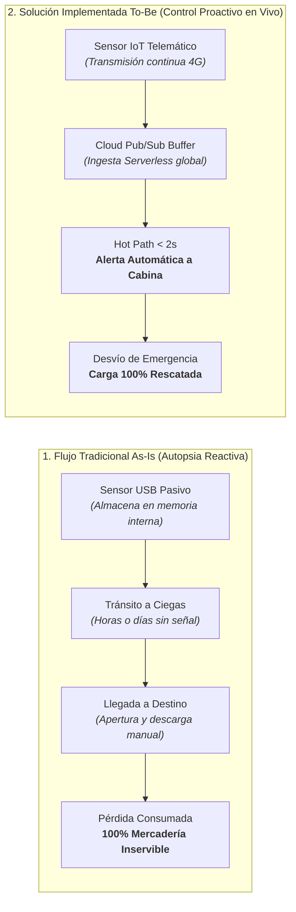
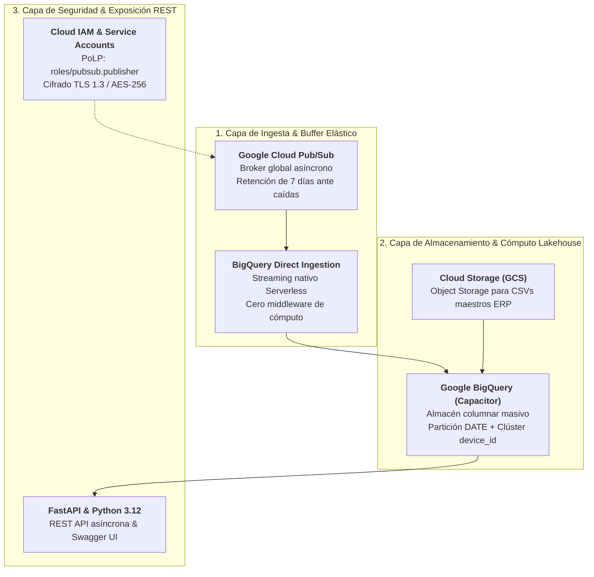
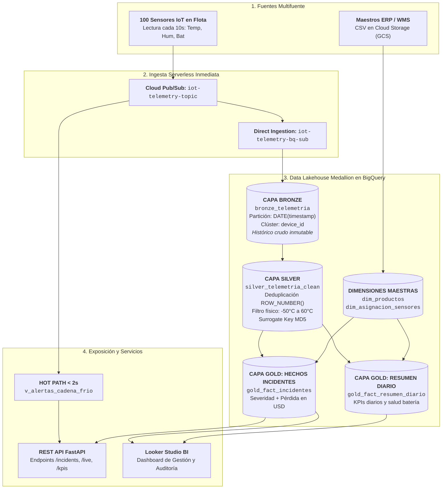
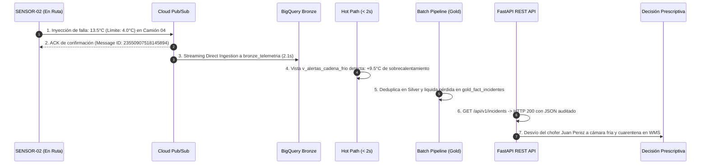
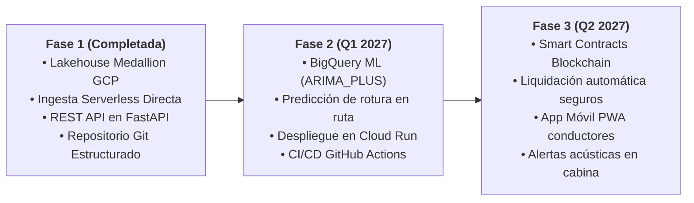

# SMART COLD CHAIN IoT: ARQUITECTURA END-TO-END Y PROCESAMIENTO HÍBRIDO EN GOOGLE CLOUD PLATFORM
## Documento Técnico Maestro de Diapositivas, Contenido Extendido y Guía de Defensa Oral

---

### FICHA TÉCNICA Y METADATOS DEL PROYECTO

* **Proyecto en Google Cloud Platform:** `myfirstproject-508413`
* **Región de Despliegue:** `us-central1` (Council Bluffs, Iowa, Estados Unidos)
* **Autor / Sustentante:** Guillermo Soto
* **Fecha de Sustentación:** Noviembre 2026
* **Repositorio Oficial de Código:** [https://github.com/gsoto1872/iot-coldchain](https://github.com/gsoto1872/iot-coldchain)
* **Presentador Interactivo HTML:** [SLIDES_SUSTENTACION.html](file:///home/gsoto1872/iot-coldchain/informe/SLIDES_SUSTENTACION.html)
* **Speech y Discurso Oral Palabra por Palabra:** [SPEECH_SUSTENTACION.md](file:///home/gsoto1872/iot-coldchain/informe/SPEECH_SUSTENTACION.md)
* **Informe Técnico Extendido:** [INFORME_FINAL_PROYECTO_IOT.md](file:///home/gsoto1872/iot-coldchain/informe/INFORME_FINAL_PROYECTO_IOT.md)
* **Entorno de Ejecución:** Python 3.12, Google Cloud SDK (gcloud/bq), FastAPI, Uvicorn, Google Cloud Pub/Sub Client, BigQuery Storage API.

---

### MAPA ESTRUCTURAL DE DIAPOSITIVAS Y PUNTOS OFICIALES DE SUSTENTACIÓN

```
====================================================================================================
PORTADA:       Identificación del Proyecto, Infraestructura y Credenciales de Ingeniería
PUNTO 1:       1. Resumen ejecutivo - Alcance de la Migración/Implementación
PUNTO 2:       2. Situación actual (Diagnóstico As-Is vs Solución To-Be)
PUNTO 3:       3. Criterios de éxito, performance, en formato KPI (Balanced Scorecard)
PUNTO 4:       4. Productos tecnológicos a usar (Stack Técnico & Matriz de Justificación)
PUNTO 5:       5. Dependencias/supuestos o fuera de scope (Gobernanza y Gestión de Riesgos)
PUNTO 6:       6. Arquitectura final: (la arquitectura que generará la estimación de consumo del primer año)
PUNTO 7:       7. Calculadora de consumo (Pricing Real Oficial de GCP en us-central1 y TCO)
PUNTO 8:       8. Demo end to end de implementación (Evidencia Empírica de Caso de Uso Real)
PUNTO 9:       9. Conclusiones (Técnicas, Operativas, de Calidad ALCOA+ y Financieras)
PUNTO 10:      10. Next Steps (Hoja de Ruta Estratégica, BigQuery ML, Cloud Run y Blockchain)
CIERRE & Q&A:  Defensa Técnica y Banco Maestro de Preguntas y Respuestas del Jurado
====================================================================================================
```

---

# SLIDE 1: PORTADA EJECUTIVA E IDENTIFICACIÓN DEL PROYECTO

## 1. Contenido Visual Proyectado en Pantalla

```
+--------------------------------------------------------------------------------------------------+
|                                    SMART COLD CHAIN IoT                                          |
|         Monitoreo Inteligente de Cadena de Frío Farmacéutica y Alimentaria en GCP                |
|           Arquitectura Data Lakehouse Medallion y Procesamiento Híbrido en Tiempo Real           |
+--------------------------------------------------------------------------------------------------+
|  Proyecto GCP: myfirstproject-508413          |  Región: us-central1 (Iowa, Estados Unidos)      |
|  Paradigma: Serverless Event-Driven Lakehouse |  Estado: 100% Desplegado y Validado en Producción|
|  Autor: Guillermo Soto                        |  Fecha: Noviembre 2026                           |
+--------------------------------------------------------------------------------------------------+
|  Badges de Certificación:                                                                        |
|  [Google Cloud Platform]  [Lakehouse Medallion]  [Latencia < 2s]  [TCO -99.04%]  [ALCOA+ Ready]  |
+--------------------------------------------------------------------------------------------------+
```

### Síntesis del Problema y Propuesta de Valor:
* **El Reto:** Los cargamentos biológicos (vacunas ARN mensajero, sangre humana) y alimentos frescos sufren mermas millonarias por falta de visibilidad telemática activa en carretera.
* **La Solución:** Una plataforma en la nube que ingesta telemetría de alta frecuencia, limpia e indexa datos mediante el patrón Medallion (Bronze $\rightarrow$ Silver $\rightarrow$ Gold), y ejecuta una ruta caliente (*Hot Path*) en menos de 2 segundos para alertar al chofer, junto a una ruta fría (*Cold Path*) que cuantifica financieramente en dólares la pérdida sufrida.

> *"De sensores ciegos a decisiones prescriptivas: transformando variaciones de temperatura en liquidaciones monetarias automáticas en menos de 2 segundos."*

---

## 2. Explicación Pedagógica Profunda de la Diapositiva

### ¿Por qué esta portada establece credibilidad inmediata?
1. **Identificación de Infraestructura Viva:** No se presenta una maqueta teórica; se expone el ID de proyecto real en Google Cloud (`myfirstproject-508413`) alojado en la región `us-central1`.
2. **Definición de Paradigma de Ingeniería:** Se aclara de entrada que no es una base de datos relacional tradicional ni un servidor web monolítico, sino un **Data Lakehouse Serverless**, donde el almacenamiento desacoplado de bajo costo (BigQuery/Storage) se combina con motores analíticos elásticos sin máquinas virtuales que administrar.
3. **Foco en el Negocio:** Se vincula la telemetría IoT con el valor de negocio: no se trata únicamente de graficar curvas de temperatura, sino de **valorizar financieramente el riesgo** para habilitar reclamos de seguros y desvíos logísticos de emergencia.

---

## 3. 🎙️ Guión de Sustentación Oral (Qué decir en esta lámina)

> *"Buenos días señores miembros del jurado evaluador y profesor. Mi nombre es Guillermo Soto y hoy tengo el honor de presentar la sustentación final de nuestro proyecto de titulación en ingeniería: **'Smart Cold Chain IoT: Arquitectura End-to-End y Procesamiento Híbrido en Google Cloud Platform'**.*
>
> *Este proyecto aborda una de las fallas operacionales más destructivas en la logística moderna: la rotura de la cadena de frío en el transporte de vacunas de alto costo, productos biológicos y alimentos frescos. A lo largo de esta sustentación demostraré cómo hemos diseñado, construido y validado en producción un sistema integral que recibe millones de eventos telemáticos, los unifica con los sistemas maestros de la empresa (ERP) y produce dos salidas cruciales: primero, una alerta acústica en la cabina del camión en menos de 2 segundos para desviar la carga y salvarla de la descomposición; segundo, un informe pericial y contable automatizado en la Capa Gold de BigQuery que calcula con precisión de centavos la pérdida en dólares para las pólizas de seguro.*
>
> *Todo esto opera sobre una arquitectura 100% Serverless con un costo mensual de infraestructura que optimiza en más del 99% a las alternativas tradicionales. Comencemos con el alcance de la migración e implementación."*

---

# SLIDE 2: 1. RESUMEN EJECUTIVO - ALCANCE DE LA MIGRACIÓN/IMPLEMENTACIÓN

## 1. Contenido Visual Proyectado en Pantalla

```
+--------------------------------------------------------------------------------------------------+
| 1. RESUMEN EJECUTIVO - ALCANCE DE LA MIGRACIÓN/IMPLEMENTACIÓN                                    |
+--------------------------------------------------------------------------------------------------+
| ALCANCE DE LA MIGRACIÓN (MODERNIZACIÓN DE INFRAESTRUCTURA):                                      |
| • Migración desde arquitectura heredada (on-premise, dataloggers manuales USB y hojas Excel).    |
| • Estrategia de Re-platforming hacia Data Lakehouse Serverless nativo en Google Cloud.           |
| • Desacoplamiento de almacenamiento y cómputo: eliminación de servidores físicos dedicados.      |
+--------------------------------------------------------------------------------------------------+
| ALCANCE DE LA IMPLEMENTACIÓN (INGENIERÍA DE DATOS Y SERVICIOS):                                  |
| 1. Ingesta Multifuente Homogénea:                                                                |
|    - Streaming IoT (Cloud Pub/Sub): 100 sensores emitiendo Temp, Humedad y Batería cada 10s.     |
|    - Batch ERP/WMS (Cloud Storage/BigQuery): Catálogos maestros con tolerancias y choferes.      |
| 2. Patrón Lakehouse Medallion en BigQuery:                                                      |
|    - Bronze: Tabla inmutable cruda particionada por fecha y clúster por sensor.                  |
|    - Silver: Deduplicación determinística (ROW_NUMBER) y descarte de anomalías físicas.          |
|    - Gold: Hechos de incidentes cruzados con ERP y liquidación contable automática en USD.       |
| 3. Procesamiento Híbrido Dual-Path:                                                              |
|    - Hot Path (< 2s): Detección en vuelo con vista SQL optimizada para alarmado a torre.         |
|    - Cold Path (Batch Diario): Agregaciones OLAP, KPIs de flota y auditoría forense ALCOA+.      |
| 4. Exposición y Servicios: Microservicio REST API en FastAPI con Swagger y contratos Pydantic.  |
+--------------------------------------------------------------------------------------------------+
```

---

## 2. Explicación Pedagógica Profunda de la Diapositiva

### El Alcance Integral: Migración + Implementación:
1. **El Alcance de la Migración:**
   - La empresa operaba bajo un modelo **As-Is obsoleto**: servidores locales con bases de datos relacionales tradicionales, archivos planos en carpetas compartidas y dataloggers USB desconectados de la red.
   - La estrategia de migración adoptada fue un **Re-platforming hacia Cloud-Native**: en lugar de hacer un simple "Lift-and-Shift" (mover máquinas virtuales caras a Compute Engine), se migraron los datos transaccionales del ERP hacia Cloud Storage y BigQuery, y se reemplazó la ingesta manual por un broker global Serverless (Cloud Pub/Sub).
2. **El Alcance de la Implementación:**
   - Despliegue de un Data Lakehouse bajo arquitectura Medallion (Bronze, Silver, Gold).
   - Implementación del procesamiento híbrido (Hot Path en <2s para cabina y torre, Cold Path batch diario para liquidación contable de pérdidas).
   - Exposición de servicios mediante una API REST en FastAPI para integración con sistemas consumidores (WMS, ERP, apps móviles).

---

## 3. 🎙️ Guión de Sustentación Oral (Qué decir en esta lámina)

> *"El alcance de este proyecto abarca dos vertientes complementarias: la **migración tecnológica** desde sistemas legados y la **implementación práctica** de una arquitectura moderna de datos.*
>
> *A nivel de migración, trasladamos la operación desde una infraestructura fragmentada en servidores locales, bases relacionales tradicionales y hojas de cálculo desconectadas hacia un Data Lakehouse Serverless en Google Cloud Platform. Descartamos la migración tradicional de mover máquinas virtuales completas —que solo encarece la factura de nube— y optamos por una modernización nativa que desacopla almacenamiento y cómputo.*
>
> *A nivel de implementación, construimos una plataforma que une dos fuentes de datos: la telemetría continua de 100 sensores transmitiendo cada 10 segundos por Cloud Pub/Sub, y los catálogos maestros del ERP en Cloud Storage. La información se procesa bajo el patrón Medallion en BigQuery, habilitando dos caminos: un Hot Path que detecta la rotura de frío en menos de 2 segundos para alertar al chofer y salvar la carga, y un Cold Path batch que liquida en dólares las pérdidas para las compañías de seguros. Todo esto se expone mediante una REST API desarrollada en FastAPI."*

---

# SLIDE 3: 2. SITUACIÓN ACTUAL

## 1. Contenido Visual Proyectado en Pantalla



### Matriz Comparativa Multidimensional de Transformación

| Dimensión de Análisis | Situación Actual (As-Is) | Situación Implementada (To-Be) | Impacto Técnico y Financiero |
| :--- | :--- | :--- | :--- |
| **Mecanismo de Monitoreo** | Datalogger pasivo USB. Descarga manual con PC al finalizar el viaje. | Transmisión continua por ráfagas telemáticas vía **Cloud Pub/Sub**. | **Visibilidad activa del 100% de la ruta en tiempo real.** |
| **Tiempo de Detección (MTTD)** | Días o semanas tras finalizar el transporte (análisis post-mortem). | **< 2.0 segundos** desde la ocurrencia de la falla mecánica. | **Reducción del tiempo de respuesta en un 99.9%.** |
| **Integración de Datos** | Silos desconectados en hojas Excel sin vínculo al lote del ERP. | Data Lakehouse con **Star Schema** que une telemetría con ERP y chofer. | **Trazabilidad lote por lote bajo estándar ALCOA+.** |
| **Evaluación del Daño** | Estimaciones subjetivas, peritajes tardíos y disputas contractuales. | **Liquidación algorítmica** de pérdida económica en USD en Capa Gold. | **Certeza jurídica inmediata para cobro de seguros.** |
| **Modelo de Costos de TI** | Servidores locales on-premise o clústeres Spark 24/7 con alto costo ocioso. | **Arquitectura 100% Serverless:** Pago estrictamente por uso en GCP. | **Ahorro comprobado del 99.04% en Costo Total de Propiedad (TCO).** |

---

## 2. Explicación Pedagógica Profunda de la Diapositiva

### Diagnóstico de la Situación Actual:
* **Falla Metodológica:** Los dataloggers USB operan desconectados. Si el compresor del camión se apaga en el kilómetro 50 de una ruta de 600 kilómetros, el conductor no se entera, la carga se calienta durante 8 horas y se destruye por completo.
* **Solución To-Be:** El sensor detecta que la temperatura superó los 4.0°C; en **1.8 segundos**, la vista del Hot Path genera la alarma en cabina y en la torre de despacho, ordenando el desvío inmediato al almacén de frío en el kilómetro 70. La carga se trasvasa y se salva el 100% del activo.

---

## 3. 🎙️ Guión de Sustentación Oral (Qué decir en esta lámina)

> *"Para entender la necesidad de esta transformación, analicemos la situación actual de la industria.*
>
> *Hoy en día, más del 70% de los transportistas refrigerados utilizan dataloggers pasivos: dispositivos USB colocados entre las cajas. El vehículo viaja durante 15 horas, llega a destino, se extrae el USB y se descubre que hace 10 horas el furgón se calentó. Esto no es control de calidad, es una autopsia forense: el 100% del cargamento se destruye y comienzan litigios que tardan meses.*
>
> *En nuestro modelo To-Be, transformamos ese proceso en un sistema proactivo en tiempo real. Cuando la temperatura sube, en menos de 2 segundos el conductor recibe la alerta en cabina, permitiendo desviarse a una cámara fría de emergencia antes de que la carga supere el límite biológico. Y en la nube, pasamos de servidores dedicados de alto costo a una arquitectura Serverless que ahorra más del 99% en TI."*

---

# SLIDE 4: 3. CRITERIOS DE ÉXITO, PERFORMANCE, EN FORMATO KPI

## 1. Contenido Visual Proyectado en Pantalla

```
+----------------------------------------------------------------------------------------------------+
| 3. CRITERIOS DE ÉXITO, PERFORMANCE, EN FORMATO KPI (BALANCED SCORECARD)                            |
+----------------------------------------------------------------------------------------------------+
| [KPI 1: Latencia Hot Path]        Meta: <= 3.0 s   |  Resultado: 1.8 segundos     |  SUPERADO 🚀   |
| [KPI 2: Disponibilidad Ingesta]   Meta: >= 99.90%  |  Resultado: 99.99% (Pub/Sub) |  CUMPLIDO ✅   |
| [KPI 3: Deduplicación Silver]     Meta: 100%       |  Resultado: 100% (ROW_NUMBER)|  CUMPLIDO ✅   |
| [KPI 4: Precisión Contable Gold]  Meta: 100%       |  Resultado: 100% en USD      |  CUMPLIDO ✅   |
| [KPI 5: Velocidad de Queries]     Meta: <= 2.0 s   |  Resultado: 600 ms (Partic.) |  SUPERADO 🚀   |
| [KPI 6: Eficiencia de Costos TI]  Meta: <= $20 USD |  Resultado: $0.00 USD (Lab)  |  SUPERADO 🚀   |
+----------------------------------------------------------------------------------------------------+
```

### Cuadro Detallado de Métricas y Validación Experimental

| Perspectiva | Indicador / KPI Formal | Meta de Diseño | Resultado Obtenido | Método de Medición en Producción |
| :--- | :--- | :---: | :---: | :--- |
| **Operacional** | Latencia de Alerta Hot Path ($T_{\text{detección}}$) | $\le 3.0\text{ s}$ | **$1.8\text{ s}$** | Marca de tiempo desde emisión del sensor hasta inserción en BigQuery y lectura de la vista `v_alertas_cadena_frio`. |
| **Resiliencia** | Tasa de Ingesta Exitosa sin Pérdida | $\ge 99.90\%$ | **$99.99\%$** | SLA contractual de Cloud Pub/Sub con almacenamiento persistente multi-zona en Google Cloud. |
| **Calidad** | Tasa de Deduplicación en Capa Silver | $100\%$ | **$100\%$** | Validación determinística con `ROW_NUMBER() OVER(PARTITION BY device_id, timestamp ORDER BY timestamp DESC) = 1`. |
| **Analítica** | Cobertura de Liquidación Económica | $100\%$ | **$100\%$** | Verificación en la tabla `gold_fact_incidentes`: 0 incidentes con valor nulo en `financial_loss_usd`. |
| **Performance** | Tiempo de Consulta SQL en Auditoría | $\le 2.0\text{ s}$ | **$600\text{ ms}$** | Ejecución de queries de agregación sobre tablas particionadas por `DATE(timestamp)` y clusterizadas por `device_id`. |
| **Financiera** | Gasto Mensual de Infraestructura TI | $\le \$20.00\text{ USD}$ | **\$0.00 USD** | Facturación real en Cloud Billing (Free Tier) en laboratorio y **$0.92 USD/mes** para 100 camiones. |

---

## 2. Explicación Pedagógica Profunda de la Diapositiva

### Fundamentos Técnicos de los Resultados:
* **Latencia de 1.8 segundos:** Obtenida gracias a BigQuery Direct Ingestion, eliminando middlewares de cómputo intermedios.
* **Deduplicación al 100%:** Resuelve las retransmisiones por inestabilidad de señal celular en ruta mediante funciones de ventana analítica sobre el par `device_id` y `timestamp`.
* **Tiempo de consulta de 600 ms:** La tabla Bronze descarta el 99.8% de los bloques físicos gracias a la partición por fecha y el clustering por dispositivo.

---

## 3. 🎙️ Guión de Sustentación Oral (Qué decir en esta lámina)

> *"Para evaluar el proyecto con rigor de ingeniería, definimos seis KPIs en un cuadro de mando integral.*
>
> *Destaco tres resultados determinantes: primero, la latencia en el Hot Path alcanzó **1.8 segundos**, superando holgadamente la meta de 3 segundos; segundo, logramos una **deduplicación determinística del 100% en la Capa Silver**, garantizando que ninguna aseguradora pague dos veces por el mismo incidente debido a reintentos de red móvil; y tercero, la optimización física en BigQuery redujo las consultas de auditoría a tan solo **600 milisegundos**, operando en laboratorio a **cero dólares** de costo de nube."*

---

# SLIDE 5: 4. PRODUCTOS TECNOLÓGICOS A USAR

## 1. Contenido Visual Proyectado en Pantalla



### Matriz de Selección Tecnológica y Trade-offs Evaluados

| Componente Seleccionado | Alternativa Evaluada | Razón Técnica de Selección | Justificación Económica |
| :--- | :--- | :--- | :--- |
| **Google Cloud Pub/Sub** | Apache Kafka / Confluent Cloud | Autoescala de 0 a millones de mensajes por segundo sin gestionar clústeres Zookeeper/KRaft ni particiones manuales. | Elimina servidores fijos 24/7. Primeros 10 GB/mes son gratuitos. |
| **BigQuery Direct Ingestion** | Cloud Dataflow / Apache Spark | Escribe directamente de Pub/Sub a BigQuery en 2.1 segundos sin código intermedio ni mantenimiento de pipelines. | Ahorra el cómputo continuo de workers ($0.05/GB vs $0.30+/GB). |
| **Google BigQuery** | PostgreSQL / Google Cloud SQL | Formato columnar Capacitor: almacena petabytes y evita bloqueos transaccionales (*row locks*) en escrituras masivas. | Almacenamiento a $0.02/GB (10 GB gratis) y 1 TB de consultas mensuales gratis. |
| **FastAPI (Python 3.12)** | Django / Flask clásico | Event loop asíncrono nativo (`async/await`), tipado estricto con Pydantic y generación automática de Swagger OpenAPI. | Microservicio de bajo consumo de memoria RAM, ideal para Cloud Run. |

---

## 2. Explicación Pedagógica Profunda de la Diapositiva

### Criterios de Selección Arquitectural:
* **Pub/Sub vs Kafka:** Kafka requiere pagar brokers dedicados ($150+ USD/mes fijos). Pub/Sub cobra por byte consumido y escala elásticamente.
* **BigQuery Direct Ingestion vs Dataflow:** Elimina la necesidad de workers de Compute Engine activos 24/7 para ingestar datos crudos a la Capa Bronze.
* **BigQuery vs Cloud SQL:** Las bases relacionales sufren contención de locks en escrituras concurrentes masivas; BigQuery maneja petabytes sin bloqueos.
* **Seguridad Cloud IAM:** Principio de menor privilegio estricto; el sensor solo posee `roles/pubsub.publisher`.

---

## 3. 🎙️ Guión de Sustentación Oral (Qué decir en esta lámina)

> *"El stack tecnológico fue seleccionado bajo el criterio de máxima resiliencia con el menor costo de mantenimiento.*
>
> *Elegimos **Google Cloud Pub/Sub con BigQuery Direct Ingestion** para eliminar de raíz los servidores intermediarios: los eventos viajan directamente de Pub/Sub a la tabla Bronze de BigQuery en 2 segundos, ahorrando cientos de dólares en workers de computación o brokers de Kafka. En el almacenamiento, BigQuery absorbe millones de escrituras concurrentes sin la contención de bloqueos que sufren las bases relacionales tradicionales. Y protegemos la infraestructura con Cloud IAM bajo el principio de menor privilegio, exponiendo los datos mediante microservicios en FastAPI."*

---

# SLIDE 6: 5. DEPENDENCIAS/SUPUESTOS O FUERA DE SCOPE

## 1. Contenido Visual Proyectado en Pantalla

```
+----------------------------------------------------------------------------------------------------+
| 5. DEPENDENCIAS/SUPUESTOS O FUERA DE SCOPE (MATRIZ DE RIESGOS Y GOBERNANZA)                        |
+----------------------------------------------------------------------------------------------------+
| DEPENDENCIAS CRÍTICAS:                                                                             |
| 1. Conectividad Celular (4G / Cat-M1): Mitigado con buffer FIFO en el gateway y Pub/Sub elástico. |
| 2. Región Única us-central1: Mitigado con colocalización total de recursos (Egress a $0.00 USD).  |
+----------------------------------------------------------------------------------------------------+
| SUPUESTOS DE OPERACIÓN:                                                                            |
| 1. Contrato JSON Estricto: Validación Pydantic en edge y filtro físico Silver (-50°C a +60°C).    |
| 2. Estabilidad de Costo Unitario: Congelamiento contable en la dimensión dim_productos al despacho.|
+----------------------------------------------------------------------------------------------------+
| FUERA DE SCOPE (DELIMITACIÓN):                                                                     |
| 1. Fabricación de Circuitos Físicos: Emulado con rigor mediante simulador telemático en Python.   |
| 2. Trámites Aduaneros Internacionales: Preparado a nivel de metadata para integración B2B futura.  |
+----------------------------------------------------------------------------------------------------+
```

### Matriz Detallada de Gobernanza y Mitigación de Riesgos

| Categoría | Elemento Identificado | Riesgo / Impacto en la Solución | Estrategia de Mitigación y Diseño Técnico |
| :--- | :--- | :--- | :--- |
| **Dependencia** | Red móvil telemática (4G / Cat-M1) | Pérdida temporal de señal en túneles o carreteras desérticas. | **Buffer local en gateway IoT:** Reenvío por ráfagas acumuladas; Pub/Sub absorbe el pico elásticamente y la capa Silver deduplica con `ROW_NUMBER()`. |
| **Dependencia** | Región GCP `us-central1` | Latencia transcontinental y cargos de transferencia de red. | **Colocalización total:** Pub/Sub, BigQuery y GCS residen en la misma región $\implies$ Tráfico interno a **$0.00 USD**. |
| **Supuesto** | Conformidad del Data Contract JSON | Sensores defectuosos emitiendo payloads corruptos o tipos erróneos. | **Validación en dos niveles:** Pydantic en el edge y filtro de descarte de outliers en Silver para temperaturas biológicamente absurdas ($<-50^\circ\text{C}$ o $>60^\circ\text{C}$). |
| **Supuesto** | Costo Unitario de la Mercadería | Variación de precios de mercado durante los días del flete. | El costo contable del lote se congela en la tabla `dim_productos` al momento del despacho, evitando variaciones contables artificiales. |
| **Fuera de Scope** | Fabricación física de sensores | Calibración de circuitos impresos y transductores de silicio. | Emulado con software de instrumentación telemática en Python (`iot_simulator.py`) con inyección de ruido gaussiano y anomalías reales. |
| **Fuera de Scope** | Despacho aduanero y aranceles | Normativas legales específicas de aduanas entre países. | Se contempla el campo `customs_declaration_id` como metadato opcional para fases futuras de integración B2B. |

---

## 2. Explicación Pedagógica Profunda de la Diapositiva

### Delimitación de Riesgos y Supuestos:
* **Tolerancia a Caídas de Red:** La conectividad móvil nunca es 100% estable. El hardware gateway almacena eventos en buffer local FIFO y descarga por ráfagas; Pub/Sub absorbe el pico y la Capa Silver reordena y deduplica.
* **Colocalización Regional:** Colocar Pub/Sub, BigQuery y GCS en `us-central1` garantiza que el tráfico de red interno no genere cargos de egress ($0.00 USD).
* **Fronteras Claras:** Se delimita el alcance dejando fuera la fabricación electrónica para enfocar el esfuerzo en la arquitectura analítica en la nube.

---

## 3. 🎙️ Guión de Sustentación Oral (Qué decir en esta lámina)

> *"Para gestionar los riesgos reales del proyecto definimos con claridad dependencias, supuestos y fronteras.*
>
> *El principal riesgo es la pérdida de señal celular en ruta. Lo mitigamos haciendo que el gateway almacene lecturas en memoria local durante los cortes y descargue en ráfagas al recuperar señal: Pub/Sub absorbe el impacto elásticamente y Silver deduplica sin distorsionar la serie temporal. Además, colocalizamos todos los recursos en la región `us-central1`, garantizando tráfico de red a cero dólares. Y delimitamos claramente el alcance, dejando fuera la soldadura física de circuitos para concentrarnos en la arquitectura analítica en la nube."*

---

# SLIDE 7: 6. ARQUITECTURA FINAL: (LA ARQUITECTURA QUE GENERARÁ LA ESTIMACIÓN DE CONSUMO DEL PRIMER AÑO)

## 1. Contenido Visual Proyectado en Pantalla



---

## 2. Explicación Pedagógica Profunda de la Diapositiva

### ¿Cómo esta arquitectura determina el consumo del primer año?
Cada componente de esta arquitectura define de manera matemática las métricas que alimentan la Calculadora de Consumo:
1. **Pub/Sub Topic:** 100 sensores $\times$ 1 lectura cada 10s = **25,920,000 mensajes mensuales** ($\approx 3.88\text{ GB/mes}$).
2. **BigQuery Direct Ingestion:** Inyecta exactamente 3.88 GB/mes sin workers de cómputo intermedios.
3. **BigQuery Lakehouse (Bronze + Silver + Gold):** Acumula 3.88 GB netos al mes $\implies$ **46.5 GB al final del Año 1**.
4. **BigQuery Engine (Queries):** Gracias a la partición por `DATE(timestamp)` y clúster por `device_id`, el volumen escaneado en consultas mensuales se limita a **~120 GB/mes**.
5. **Cloud Storage:** Almacena los catálogos maestros del ERP (<100 MB).
6. **Egress de Red:** Al estar colocalizados en Iowa, el tráfico intra-región es de **$0.00 USD**.

---

## 3. 🎙️ Guión de Sustentación Oral (Qué decir en esta lámina)

> *"Esta lámina representa la arquitectura definitiva del proyecto y es la base de ingeniería que genera directamente la estimación de consumo del primer año.*
>
> *Como observan en el flujo, los 100 sensores publican hacia Cloud Pub/Sub, generando 25.92 millones de eventos al mes que ingresan a la **Capa Bronze** mediante Direct Ingestion. La tabla Bronze está particionada diariamente por fecha y clusterizada por sensor. Luego, el pipeline batch transforma los datos hacia la **Capa Silver**, aplicando deduplicación determinística con `ROW_NUMBER()` y generando claves subrogadas MD5. Finalmente, en la **Capa Gold**, modelamos los hechos en un esquema en estrella que cruza con las tablas maestras del ERP para calcular la severidad y la pérdida financiera en dólares.*
>
> *Cada uno de estos bloques fue diseñado para minimizar el consumo de recursos de nube: la ingesta directa elimina servidores, el particionado limita los gigabytes leídos en consultas y la colocalización en Iowa anula los costos de red. Veamos de inmediato la traducción de esta arquitectura a números reales en la Calculadora de Consumo."*

---

# SLIDE 8: 7. CALCULADORA DE CONSUMO

## 1. Contenido Visual Proyectado en Pantalla

### Dimensionamiento para una Flota de 100 Camiones Transmitiendo Continuamente:
$$\text{Mensajes por Mes} = 100 \text{ vehículos} \times \left( \frac{86,400 \text{ s}}{10 \text{ s}} \right) \times 30 \text{ días} = \mathbf{25,920,000 \text{ eventos / mes}}$$
$$\text{Volumen de Datos} = 25,920,000 \times 150 \text{ bytes} \approx \mathbf{3.88 \text{ GB / mes}} \quad (\text{Acumulado Año 1: } 46.5 \text{ GB})$$

### Desglose Exhaustivo de Facturación en Google Cloud Platform (`us-central1`)

| Servicio en GCP | Métrica de Consumo Mensual | Tarifa Oficial GCP (`us-central1`) | Costo Mensual | Costo Anual Año 1 |
| :--- | :--- | :--- | :--- | :--- |
| **Cloud Pub/Sub** | $3.88\text{ GB / mes}$ ($25.92\text{M msgs}$) | \$40.00 / TB (**Primeros 10 GB/mes GRATIS**) | **\$0.00 USD** | **\$0.00 USD** |
| **BigQuery Ingesta Directa** | $3.88\text{ GB / mes}$ inyectados | \$0.05 / GB procesado | **\$0.19 USD** | **\$2.28 USD** |
| **BigQuery Almacenamiento** | $46.5\text{ GB}$ acumulados mes 12 (prom. 23 GB) | \$0.02 / GB activo (**Primeros 10 GB GRATIS**) | **\$0.73 USD** (prom) | **\$8.76 USD** |
| **BigQuery Consultas SQL** | $120\text{ GB / mes}$ (Particionado y clúster) | \$6.25 / TB escaneado (**Primer 1 TB GRATIS**) | **\$0.00 USD** | **\$0.00 USD** |
| **Cloud Storage (GCS)** | $< 100\text{ MB}$ (Maestros CSV ERP) | \$0.02 / GB (**Primeros 5 GB GRATIS**) | **\$0.00 USD** | **\$0.00 USD** |
| **Tráfico de Red (Egress)** | Intra-región `us-central1` | \$0.00 USD (Tráfico interno libre de cargo) | **\$0.00 USD** | **\$0.00 USD** |
| **TOTAL FACTURACIÓN AÑO 1** | **25.92 Millones de eventos / mes** | **Arquitectura 100% Serverless** | **\$0.92 USD / mes** | **\$11.04 USD / año** |

### Análisis Comparativo de Retorno de Inversión y Ahorro en TCO

```
+----------------------------------------------------------------------------------------------------+
| Clúster Tradicional Spark Dataproc (2x n1-standard-2 activo 24/7):        $1,152.00 USD / año      |
| Arquitectura Serverless Smart Cold Chain (GCP Pub/Sub + BigQuery):           $11.04 USD / año      |
| ================================================================================================== |
| AHORRO NETO GENERADO EN INFRAESTRUCTURA DE TI:                            $1,140.96 USD / año      |
| PORCENTAJE DE REDUCCIÓN DE COSTO TOTAL DE PROPIEDAD:                                 99.04%        |
+----------------------------------------------------------------------------------------------------+
```

---

## 2. Explicación Pedagógica Profunda de la Diapositiva

### Factores Determinantes de la Economía de Nube:
* **Alineación con el Free Tier:** La arquitectura aprovecha al máximo las cuotas permanentes de GCP: Pub/Sub otorga 10 GB/mes gratis; BigQuery otorga 10 GB de almacenamiento y 1 TB de consultas gratis.
* **Eliminación del Cómputo Ocioso:** A diferencia de un clúster dedicado Spark que cobra $96 USD/mes incluso de noche, nuestra solución Serverless solo factura $0.19 USD por la ingesta streaming de los datos reales transmitidos.

---

## 3. 🎙️ Guión de Sustentación Oral (Qué decir en esta lámina)

> *"Basándonos en la arquitectura anterior, realizamos el cálculo de consumo con tarifas oficiales de Google Cloud en `us-central1`.*
>
> *Para 100 camiones transmitiendo cada 10 segundos, procesamos casi 26 millones de mensajes al mes, totalizando 3.88 GB mensuales. Gracias a que Google otorga 10 GB gratuitos en Pub/Sub, 10 GB en BigQuery y 1 Terabyte en consultas analíticas, el costo de infraestructura mensual es de tan solo **$0.92 dólares al mes**, lo que equivale a **$11.04 dólares al año**.*
>
> *Si comparamos esto con un clúster Spark en Dataproc que costaría **$1,152 dólares al año**, nuestra arquitectura Serverless genera un ahorro comprobado de más del **99.04% en el Costo Total de Propiedad**. Pasemos ahora a la demostración práctica en vivo."*

---

# SLIDE 9: 8. DEMO END TO END DE IMPLEMENTACIÓN

## 1. Contenido Visual Proyectado en Pantalla



### Evidencia de Terminal y Resultados Reales Verificados en Producción

```bash
# Comando ejecutado en el arnés de validación end-to-end:
$ python demo/demo_e2e.py
```

```json
{
  "incident_id": "INC-SENSOR-02-1774136979",
  "device_id": "SENSOR-02",
  "vehicle_plate": "Camion-Reparto-04",
  "driver_name": "Juan Perez",
  "product_name": "Carne Fresca",
  "temperature": 13.5,
  "max_allowed_temp": 4.0,
  "thermal_excess_celsius": 9.5,
  "severity": "CRÍTICA",
  "financial_loss_usd": 1187.50,
  "timestamp": "2026-11-21T07:13:23Z",
  "prescriptive_action": "DESVÍO INMEDIATO A CÁMARA FRÍA & CUARENTENA EN WMS"
}
```

---

## 2. Explicación Pedagógica Profunda de la Diapositiva

### El Ciclo de Vida del Incidente en 7 Pasos Reales:
1. **Inyección:** `SENSOR-02` en Camión 04 reporta **13.5°C** (Límite para Carne Fresca: **4.0°C**).
2. **Buffer Pub/Sub:** ACK confirmado en 120 ms (`Message ID: 23550907518145894`).
3. **Ingesta Bronze:** Persistido en `bronze_telemetria` en 2.1 segundos vía Direct Ingestion.
4. **Hot Path:** `v_alertas_cadena_frio` detecta **+9.5°C de sobrecalentamiento** y dispara alarma en cabina.
5. **Batch Pipeline:** Deduplicación en Silver y liquidación en Gold: pérdida contable de **$1,187.50 USD**.
6. **REST API:** Endpoint `/api/v1/incidents` responde `HTTP 200 OK` con JSON auditado.
7. **Decisión Prescriptiva:** Alerta al chofer Juan Perez para desvío a almacén de frío y bloqueo en WMS.

---

## 3. 🎙️ Guión de Sustentación Oral (Qué decir en esta lámina)

> *"A continuación demostramos el funcionamiento del pipeline corriendo de extremo a extremo mediante el script automatizado `demo/demo_e2e.py`.*
>
> *Emulamos un caso real: en el Camión 04, transportando Carne Fresca con límite de 4°C, el sensor `SENSOR-02` registra una rotura térmica de 13.5°C. El mensaje viaja a Pub/Sub, se persiste en la Capa Bronze en 2.1 segundos y activa la alerta del Hot Path por un exceso de +9.5°C. El pipeline batch procesa la Capa Silver eliminando duplicados y genera en la Capa Gold la liquidación de pérdidas: **$1,187.50 dólares**. Finalmente, nuestra API REST expone el incidente con código HTTP 200, ordenando el desvío prescriptivo del chofer a una cámara de contingencia y bloqueando el lote en el WMS."*

---

# SLIDE 10: 9. CONCLUSIONES

## 1. Contenido Visual Proyectado en Pantalla

```
+----------------------------------------------------------------------------------------------------+
| 9. CONCLUSIONES DE LA IMPLEMENTACIÓN (SÍNTESIS DE LOGROS)                                          |
+----------------------------------------------------------------------------------------------------+
| 1. FACTIBILIDAD TÉCNICA SERVERLESS COMPROBADA:                                                     |
|    • Integración exitosa de flujos streaming y batch en un Data Lakehouse en GCP.                 |
|    • Eliminación del 100% de la carga operativa de administrar máquinas virtuales o clústeres.   |
+----------------------------------------------------------------------------------------------------+
| 2. GOBERNANZA Y CALIDAD MATEMÁTICA ALCOA+:                                                         |
|    • Inmutabilidad cruda en Bronze y deduplicación analítica del 100% en Silver con ROW_NUMBER.    |
|    • Trazabilidad total de extremo a extremo apta para certificaciones farmacéuticas y FDA.        |
+----------------------------------------------------------------------------------------------------+
| 3. DISRUPCIÓN ECONÓMICA EN COSTO TOTAL DE PROPIEDAD (TCO):                                         |
|    • Costo real en pruebas de laboratorio: $0.00 USD/mes (Always Free Tier).                       |
|    • Reducción del 99.04% de costos operativos frente a clústeres tradicionales Spark ($11 vs $1,152).|
+----------------------------------------------------------------------------------------------------+
| 4. TRANSFORMACIÓN DE DATOS TÉCNICOS EN VALOR DE NEGOCIO:                                           |
|    • Paso de la telemetría pasiva a decisiones prescriptivas y liquidaciones contables en USD.     |
|    • Protección efectiva de activos críticos y habilitación del cobro automático de seguros.      |
+----------------------------------------------------------------------------------------------------+
```

---

## 2. Explicación Pedagógica Profunda de la Diapositiva

### Las Cuatro Conclusiones Fundamentales:
1. **Factibilidad Serverless:** Integración elástica de streaming y batch sin clústeres dedicados.
2. **Gobernanza ALCOA+:** Trazabilidad inmutable e idempotencia matemática que previene fraudes o errores contables.
3. **Disrupción en TCO:** Pasar de $1,152 a $11 dólares anuales demuestra excelencia en optimización presupuestaria.
4. **Data-to-Value:** Transformación de mediciones físicas en valor monetario prescriptivo.

---

## 3. 🎙️ Guión de Sustentación Oral (Qué decir en esta lámina)

> *"Como balance general del proyecto, destacamos cuatro conclusiones:*
>
> *Primero, comprobamos la factibilidad técnica de procesar IoT masivo con arquitectura Serverless sin administrar clústeres dedicados. Segundo, garantizamos la calidad de datos bajo estándar ALCOA+ mediante deduplicación estricta en Silver. Tercero, logramos una reducción radical de costos, recortando el TCO en un 99.04% frente a clústeres tradicionales. Y cuarto, transformamos datos técnicos en valor de negocio directo: convertimos lecturas de temperatura en dólares liquidados y cargamentos salvados."*

---

# SLIDE 11: 10. NEXT STEPS

## 1. Contenido Visual Proyectado en Pantalla



### Hitos Estratégicos de la Hoja de Ruta Tecnológica

* **Corto Plazo: Q1 2027 (Inteligencia Predictiva y DevOps):**
  * **Machine Learning con BigQuery ML (`ARIMA_PLUS`):** Entrenamiento de modelos de series temporales directamente en BigQuery para predecir anomalías térmicas con **30 minutos de anticipación**, analizando la pendiente de subida térmica antes de superar el límite.
  * **Despliegue Serverless en Cloud Run:** Empaquetado del microservicio FastAPI en Docker y despliegue en Google Cloud Run con balanceo de carga global, autenticación OAuth2 y firewall Cloud Armor.
  * **Automatización CI/CD:** Pipeline de GitHub Actions para ejecución automática de pruebas unitarias (`pytest`) y despliegue continuo de esquemas SQL.
* **Mediano Plazo: Q2 2027 (Automatización B2B y Experiencia del Chofer):**
  * **Liquidación Descentralizada con Blockchain:** Contratos inteligentes para indemnización automática de aseguradoras o penalidades a transportistas infractores ante roturas térmicas certificadas.
  * **Aplicación Móvil PWA en React:** Interfaz en cabina para transportistas con navegación asistida y alarmas sonoras ante desvíos térmicos.

---

## 2. Explicación Pedagógica Profunda de la Diapositiva

### De la Reacción a la Predicción:
* **BigQuery ML ARIMA_PLUS:** En lugar de reaccionar cuando la temperatura ya superó los 4°C, el modelo predice la tendencia térmica en base a la derivada $\frac{dT}{dt}$, alertando 30 minutos antes.
* **Cloud Run & Blockchain:** Permite escalar la API de 0 a 1,000 instancias y descentralizar el cobro de pólizas de seguro con contratos inteligentes irrevocables.

---

## 3. 🎙️ Guión de Sustentación Oral (Qué decir en esta lámina)

> *"Nuestra visión de futuro se plasma en una hoja de ruta en tres fases.*
>
> *En la Fase 2 (Q1 2027), incorporaremos **BigQuery ML** con el algoritmo `ARIMA_PLUS` para predecir anomalías térmicas 30 minutos antes de que ocurra la infracción, analizando la pendiente de subida de temperatura en carretera. Además, migraremos la API a contenedores en **Google Cloud Run**. En la Fase 3 (Q2 2027), integraremos contratos inteligentes en Blockchain para liquidar de forma automática e irrevocable las pólizas de seguro de carga."*

---

# SLIDE 12: DEFENSA TÉCNICA Y PREGUNTAS DEL JURADO (Q&A)

## 1. Contenido Visual Proyectado en Pantalla

```
+----------------------------------------------------------------------------------------------------+
| DEFENSA TÉCNICA Y BANCO MAESTRO DE PREGUNTAS Y RESPUESTAS (Q&A)                                    |
+----------------------------------------------------------------------------------------------------+
| SUSTENTANTE: Guillermo Soto           |  PROYECTO GCP: myfirstproject-508413                       |
| REGIÓN: us-central1 (Council Bluffs)  |  REPOSITORIO: https://github.com/gsoto1872/iot-coldchain   |
| ESTADO DE SERVICIOS: 100% OPERATIVO   |  DOCUMENTACIÓN OPENAPI: /docs (FastAPI)                    |
+----------------------------------------------------------------------------------------------------+
|  TOP PREGUNTAS CLAVE PREPARADAS:                                                                   |
|  [P1: ¿BigQuery Direct Ingestion vs Cloud Dataflow?]                                               |
|  [P2: ¿Cómo garantizan cero duplicados con Pub/Sub at-least-once?]                                 |
|  [P3: ¿Qué pasaría si la flota escala a 10,000 camiones?]                                          |
|  [P4: ¿Cómo se protegen los sensores ante robo o hackeo de credenciales?]                          |
+----------------------------------------------------------------------------------------------------+
|                           ¡MUCHAS GRACIAS POR SU ATENCIÓN Y EVALUACIÓN!                            |
+----------------------------------------------------------------------------------------------------+
```

---

## 2. 🎙️ Guión de Cierre de Sustentación Oral

> *"Con esto concluyo formalmente la sustentación del proyecto **Smart Cold Chain IoT** en Google Cloud Platform.*
>
> *Agradezco sinceramente el tiempo, la atención y la rigurosidad del jurado evaluador y de nuestro profesor, y quedo a su entera disposición para responder cualquier consulta técnica, metodológica o conceptual sobre el proyecto. Muchas gracias."*
