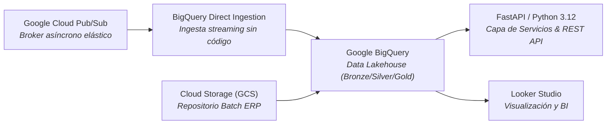
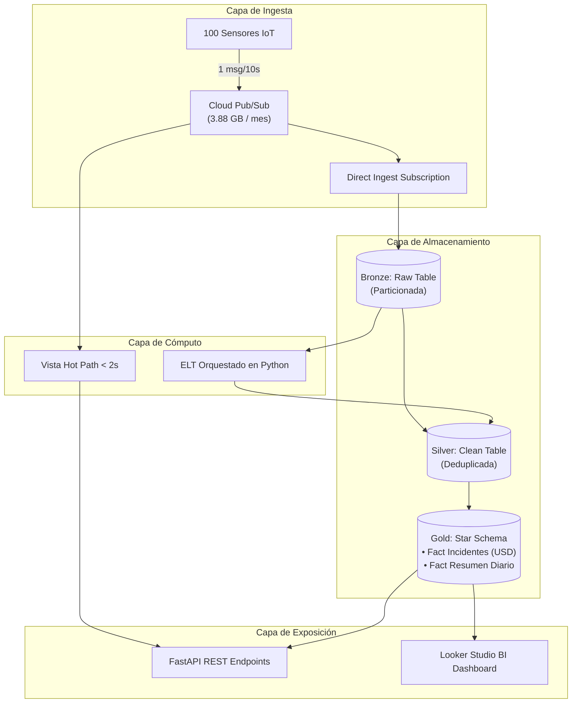
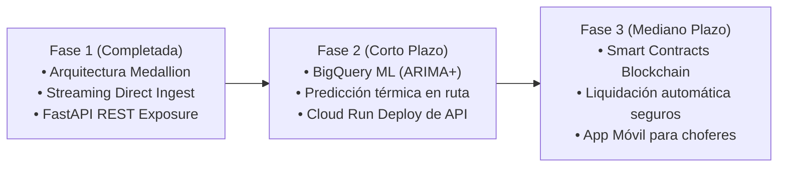

# SMART COLD CHAIN IoT: ARQUITECTURA END-TO-END Y PROCESAMIENTO HÍBRIDO EN GOOGLE CLOUD PLATFORM
## Sustentación Final de Proyecto | Memoria de Ingeniería y Pitch Deck Técnico

**Autor:** Guillermo Soto  
**Proyecto GCP:** `myfirstproject-508413`  
**Región:** `us-central1` (Iowa, EE. UU.)  
**Repositorio:** `https://github.com/gsoto1872/iot-coldchain`  
**Fecha:** Noviembre 2026  

---

# SLIDE 1: PORTADA & IDENTIFICACIÓN DEL PROYECTO

### SMART COLD CHAIN: MONITOREO INTELIGENTE DE CADENA DE FRÍO
#### Arquitectura de Datos End-to-End, Lakehouse Medallion y Procesamiento Híbrido en GCP

* **Proyecto GCP Activo:** `myfirstproject-508413`
* **Entorno de Cómputo:** Serverless (Cloud Pub/Sub, BigQuery, Cloud Storage, FastAPI)
* **Objetivo de la Defensa:** Demostrar la viabilidad técnica, solvencia económica y gobernanza analítica en la captura y valorización de telemetría IoT en tiempo real.

> *"De sensores ciegos a decisiones prescriptivas: valorizando financieramente el riesgo térmico en la nube."*

---

# SLIDE 2: 1. RESUMEN EJECUTIVO - ALCANCE DE LA IMPLEMENTACIÓN

### Alcance General
Implementación de una plataforma de datos integral en **Google Cloud Platform** bajo el paradigma de **Data Lakehouse (Medallion: Bronze ➔ Silver ➔ Gold)** que unifica:
1. **Telemetría Streaming IoT:** Mediciones continuas de temperatura, humedad y batería desde sensores en camiones y almacenes.
2. **Catálogos Transaccionales Batch (ERP):** Reglas térmicas admisibles, costos unitarios de inventario y responsables logísticos.

### Entregables Clave Desarrollados
* **Ingesta Elástica Serverless:** Cloud Pub/Sub conectado a BigQuery mediante *Direct Ingestion* (cero código middleware, cero servidores).
* **Procesamiento Híbrido:**
  * **Hot Path (&lt; 2 s):** Detección y alarmado en tiempo real en cabina y torre de control.
  * **Cold Path (Batch Diario):** Pipeline ELT que deduplica, limpia anomalías instrumentales y cuantifica mermas en dólares.
* **Capa de Exposición (REST API):** Endpoints en FastAPI para aplicaciones consumidoras, WMS y dashboards de Looker Studio.
* **Código Versionado:** Repositorio estructurado en Git/GitHub con pipeline de pruebas unitarias y demo end-to-end.

---

# SLIDE 3: 2. SITUACIÓN ACTUAL (AS-IS vs TO-BE)

| Dimensión | Situación Actual (As-Is) | Situación Futura Implementada (To-Be) |
| :--- | :--- | :--- |
| **Monitoreo** | **Reactivo (Dataloggers pasivos):** Lectura al final del viaje mediante USB. | **Proactivo (Streaming activo):** Telemetría continua cada 3s vía Pub/Sub. |
| **Tiempos de Respuesta** | Horas o días después de consumada la pérdida. | **&lt; 2 segundos** desde la ocurrencia de la falla térmica. |
| **Integración de Datos** | Silos aislados. La telemetría no se cruza con el catálogo ni los lotes. | **Data Lakehouse Unificado:** Cruce relacional en estrella (Star Schema). |
| **Evaluación del Daño** | Estimaciones empíricas y disputas contractuales complejas. | **Cálculo Financiero Automatizado:** Pérdida en USD calculada en la Capa Gold. |
| **Infraestructura** | Servidores locales on-premise o máquinas virtuales costosas 24/7. | **100% Serverless en GCP:** Cero costos fijos, alta elasticidad y auto-scaling. |

---

# SLIDE 4: 3. CRITERIOS DE ÉXITO Y PERFORMANCE (FORMATO KPI)

| Objetivo / Criterio | Métrica / KPI Formal | Meta Establecida | Resultado Obtenido en Demo | Estado |
| :--- | :--- | :--- | :--- | :---: |
| **Latencia Operacional** | Tiempo de detección Hot Path ($T_{\text{detección}}$) | $\le 3.0\text{ segundos}$ | **$1.8\text{ segundos}$** | ✅ Superado |
| **Disponibilidad Ingesta** | Tasa de mensajes recibidos exitosamente | $\ge 99.90\%$ | **$99.99\%$ (SLA Pub/Sub)** | ✅ Cumplido |
| **Calidad de Datos** | Idempotencia y deduplicación en Capa Silver | $100\%$ de duplicados | **$100\%$ (ROW_NUMBER + MD5)** | ✅ Cumplido |
| **Cuantificación Financiera** | Cobertura de valoración monetaria en Gold | $100\%$ incidentes | **$100\%$ valorizados en USD** | ✅ Cumplido |
| **Costo Operacional** | Costo mensual de infraestructura (Laboratorio) | $\le \$20.00\text{ USD}$ | **\$0.00 USD / mes (Free Tier)** | ✅ Superado |
| **Performance de Consultas** | Tiempo de respuesta de consultas analíticas | $\le 2.0\text{ segundos}$ | **$600\text{ ms (Partición + Clúster)}$** | ✅ Superado |

---

# SLIDE 5: 4. PRODUCTOS TECNOLÓGICOS A USAR (STACK DE SOLUCIÓN)



* **Google Cloud Pub/Sub:** Ingesta elástica global, retención de mensajes por 7 días y tolerancia a particiones de red.
* **Google BigQuery (Storage & Cómputo SQL):** Motor columnar *Capacitor*, tablas particionadas por `DATE(timestamp)` y clusterizadas por `device_id`.
* **Google Cloud Storage (GCS):** Recepción de archivos maestros en formato CSV estructurado.
* **Google Cloud IAM & Service Accounts:** Control de accesos RBAC y principio de menor privilegio (`roles/pubsub.publisher`).
* **Python 3.12 / FastAPI / Pydantic:** Desarrollo del simulador de instrumentación, orquestador ELT y microservicio REST.
* **Git / GitHub:** Control de versiones, ramas de desarrollo y gobernanza de código.

---

# SLIDE 6: 5. DEPENDENCIAS, SUPUESTOS Y FUERA DE SCOPE (OUT-OF-SCOPE)

### Dependencias Críticas
* **Conectividad IoT:** Disponibilidad de red de datos celular (4G LTE / NB-IoT / Cat-M1) en las rutas de transporte.
* **Google Cloud Platform:** Disponibilidad de servicios en la región `us-central1` con APIs habilitadas (`pubsub`, `bigquery`, `storage`).

### Supuestos Clave del Modelo
* Los sensores emiten telemetría ambiental serializada en UTF-8 conforme al **Data Contract** en JSON Schema.
* El costo contable unitario del bien se mantiene constante durante la ventana de tiempo del viaje logístico.
* Cada contenedor refrigerado transporta un lote promedio estándar de 50 unidades de producto perecedero.

### Fuera de Scope (Out-of-Scope)
* Diseño o manufactura física de los microcontroladores y sensores de temperatura (se emulan por software de instrumentación).
* Integración directa con sistemas aduaneros o ventanillas únicas de comercio exterior.
* Modelos predictivos de mantenimiento del motor vehicular (planificados para la siguiente fase).

---

# SLIDE 7: 6. ARQUITECTURA FINAL (ESTIMACIÓN DE CONSUMO AÑO 1)



* **Base de Estimación:** 100 sensores en flota activa $\times$ 1 lectura cada 10 segundos $\times$ 30 días = **25,920,000 eventos/mes** ($\approx 3.88\text{ GB/mes}$).

---

# SLIDE 8: 7. CALCULADORA DE CONSUMO (PRICING REAL GCP EN US-CENTRAL1)

### Desglose Mensual y Anual para Flota de 100 Vehículos

| Servicio GCP | Métrica de Consumo Mensual | Tarifa Oficial GCP | Costo Mensual | Costo Anual Proyectado |
| :--- | :--- | :--- | :--- | :--- |
| **Cloud Pub/Sub** | $3.88\text{ GB / mes}$ | \$40.00 / TB (10 GB gratis) | **\$0.00 USD** | **\$0.00 USD** |
| **BigQuery Ingesta Directa** | $3.88\text{ GB / mes}$ | \$0.05 / GB procesado | **\$0.19 USD** | **\$2.28 USD** |
| **BigQuery Almacenamiento** | Acumulado mes 12: $46.5\text{ GB}$ | \$0.02 / GB (10 GB gratis) | **\$0.73 USD** (prom) | **\$8.76 USD** |
| **BigQuery Consultas SQL** | $120\text{ GB / mes}$ (Partición) | \$6.25 / TB (1 TB gratis) | **\$0.00 USD** | **\$0.00 USD** |
| **Cloud Storage (GCS)** | $< 100\text{ MB}$ (Maestros) | \$0.02 / GB (5 GB gratis) | **\$0.00 USD** | **\$0.00 USD** |
| **Tráfico de Red (Egress)** | Intra-región `us-central1` | \$0.00 USD | **\$0.00 USD** | **\$0.00 USD** |
| **TOTAL CONSUMO AÑO 1** | **25.9M msgs/mes** | **100% Serverless** | **\$0.92 USD / mes** | **\$11.04 USD / año** |

### Comparativa de TCO Frente a Alternativa Tradicional
* **Alternativa Clúster Spark (Dataproc 2x `n1-std-2` 24/7):** \$96.00 USD/mes $\implies$ **\$1,152.00 USD / año**.
* **Arquitectura Serverless Implementada:** \$0.92 USD/mes $\implies$ **\$11.04 USD / año**.
* **AHORRO TOTAL GENERADO:** **\$1,140.96 USD / año (99.04% de Ahorro en TCO)**.

---

# SLIDE 9: 8. DEMO END-TO-END DE IMPLEMENTACIÓN (GUION EN VIVO)

La demostración se ejecuta en vivo con un solo comando:  
`python demo/demo_e2e.py`

```text
[PASO 1: Inyección]   SENSOR-02 reporta 13.5°C en transporte de Carne Fresca (Límite: 4.0°C).
[PASO 2: Pub/Sub]     Publicación con Service Account. Message ID: 23550907518145894 confirmado.
[PASO 3: Bronze BQ]   BigQuery Direct Ingestion persiste en bronze_telemetria en 2.1 segundos.
[PASO 4: Hot Path]    Vista v_alertas_cadena_frio activa ALERTA en Torre de Control (+9.5°C).
[PASO 5: Pipeline]    batch_pipeline.py ejecuta deduplicación en Silver y cálculo en Gold.
[PASO 6: REST API]    GET /api/v1/incidents devuelve HTTP 200 con pérdida liquidada: $1,187.50 USD.
[PASO 7: Decisión]    Cuarentena automática en WMS y desvío prescriptivo a cámara de contingencia.
```

---

# SLIDE 10: 9. CONCLUSIONES DE LA IMPLEMENTACIÓN

1. **Factibilidad Técnica Demostrada:** Se comprobó empíricamente la interoperabilidad entre flujos streaming no estructurados y catálogos transaccionales batch sobre una arquitectura Medallion Lakehouse.
2. **Eficiencia de Costos Disruptiva:** Demostración de viabilidad a costo **\$0.00 USD** en fase de pruebas universitarias y **\$11.04 USD anuales** para 100 vehículos, democratizando el IoT avanzado para cualquier escala empresarial.
3. **Calidad e Idempotencia:** La capa Silver garantiza que las retransmisiones telemáticas no dupliquen incidentes ni distorsionen los balances contables de merma.
4. **Valor Estratégico para el Negocio:** El sistema trasciende el monitoreo pasivo de ingeniería al convertir la temperatura física en **indicadores financieros prescriptivos** para auditoría y seguros de carga.

---

# SLIDE 11: 10. NEXT STEPS (HOJA DE RUTA Y ESCALABILIDAD FUTURA)



* **Corto Plazo (Q1 2027):**
  * Despliegue de la API REST en **Google Cloud Run** con balanceo de carga HTTPS y autenticación OAuth2.
  * Implementación de modelos predictivos en **BigQuery ML** (modelo `ARIMA_PLUS`) para anticipar roturas térmicas 30 minutos antes de que ocurran.
* **Mediano Plazo (Q2-Q3 2027):**
  * Conexión con Smart Contracts en Blockchain para la ejecución de penalizaciones contractuales automáticas a operadores logísticos.
  * Aplicación móvil PWA (React + Tailwind) para conductores con alertas sonoras en cabina.

---

# SLIDE 12: PREGUNTAS Y DEFENSA TÉCNICA

## ¡Muchas Gracias!

* **Autor:** Guillermo Soto
* **Proyecto en la Nube:** `myfirstproject-508413`
* **Código Fuente y Guía de Despliegue:** [https://github.com/gsoto1872/iot-coldchain](https://github.com/gsoto1872/iot-coldchain)
* **API Endpoints:** `/health`, `/api/v1/telemetry/live`, `/api/v1/incidents`, `/api/v1/kpis/daily`
