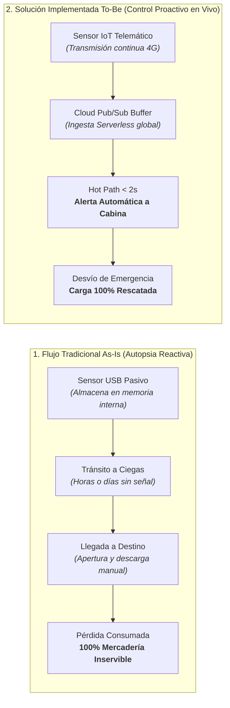
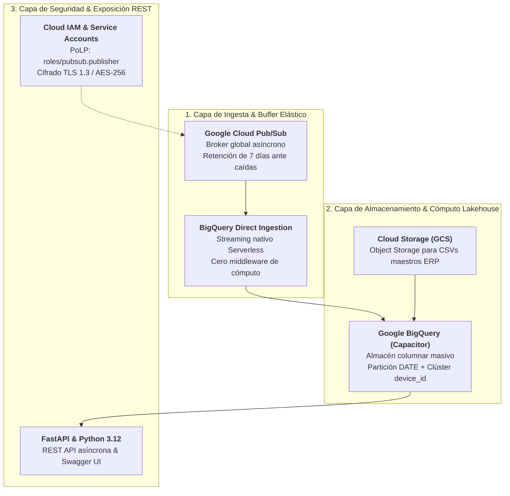
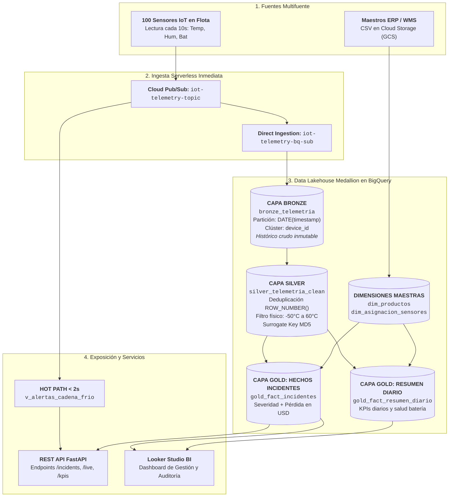
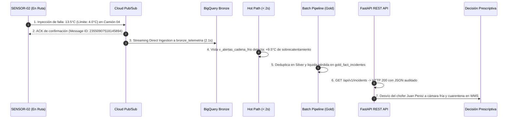
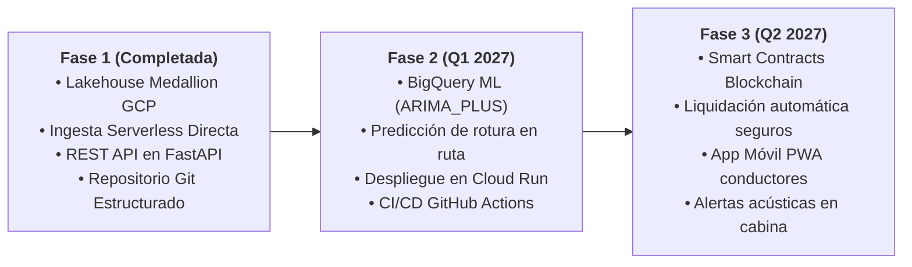

# SMART COLD CHAIN IoT: ARQUITECTURA END-TO-END Y PROCESAMIENTO HÍBRIDO EN GOOGLE CLOUD PLATFORM
## Documento Técnico Maestro de Diapositivas, Contenido Extendido y Guía de Defensa Oral

---

### FICHA TÉCNICA Y METADATOS DEL PROYECTO

* **Proyecto en Google Cloud Platform:** `myfirstproject-508413`
* **Región de Despliegue:** `us-central1` (Council Bluffs, Iowa, Estados Unidos)
* **Autor / Sustentante:** Guillermo Soto
* **Fecha de Sustentación:** Noviembre 2026
* **Repositorio Oficial de Código:** [https://github.com/gsoto1872/iot-coldchain](https://github.com/gsoto1872/iot-coldchain)
* **Presentador Interactivo HTML:** [SLIDES_SUSTENTACION.html](file:///home/gsoto1872/iot-coldchain/informe/SLIDES_SUSTENTACION.html)
* **Informe Técnico Extendido:** [INFORME_FINAL_PROYECTO_IOT.md](file:///home/gsoto1872/iot-coldchain/informe/INFORME_FINAL_PROYECTO_IOT.md)
* **Entorno de Ejecución:** Python 3.12, Google Cloud SDK (gcloud/bq), FastAPI, Uvicorn, Google Cloud Pub/Sub Client, BigQuery Storage API.

---

### MAPA ESTRUCTURAL DE DIAPOSITIVAS

```
====================================================================================================
DIAPOSITIVA 01: Portada Ejecutiva e Identificación del Proyecto
DIAPOSITIVA 02: 1. Resumen Ejecutivo - Alcance de la Migración e Implementación
DIAPOSITIVA 03: 2. Situación Actual (Diagnóstico As-Is vs Solución To-Be)
DIAPOSITIVA 04: 3. Criterios de Éxito, Rendimiento y Acuerdos de Nivel de Servicio (KPIs)
DIAPOSITIVA 05: 4. Productos Tecnológicos a Usar (Stack Técnico & Matriz de Justificación)
DIAPOSITIVA 06: 5. Dependencias, Supuestos y Fuera de Scope (Gobernanza y Gestión de Riesgos)
DIAPOSITIVA 07: 6. Arquitectura Final: Data Lakehouse Medallion y Flujo Dual (Hot/Cold Path)
DIAPOSITIVA 08: 7. Calculadora de Consumo y TCO (Pricing Real Oficial de GCP en us-central1)
DIAPOSITIVA 09: 8. Demo End-to-End de Implementación (Evidencia Empírica de Caso de Uso Real)
DIAPOSITIVA 10: 9. Conclusiones Técnicas, Operativas, de Calidad ALCOA+ y Financieras
DIAPOSITIVA 11: 10. Next Steps (Hoja de Ruta Estratégica, BigQuery ML, Cloud Run y Blockchain)
DIAPOSITIVA 12: 11. Defensa Técnica y Banco Maestro de Preguntas y Respuestas del Jurado (Q&A)
====================================================================================================
```

---

# DIAPOSITIVA 01: PORTADA EJECUTIVA E IDENTIFICACIÓN DEL PROYECTO

## 1. Contenido Visual Proyectado en Pantalla

```
+--------------------------------------------------------------------------------------------------+
|                                    SMART COLD CHAIN IoT                                          |
|         Monitoreo Inteligente de Cadena de Frío Farmacéutica y Alimentaria en GCP                |
|           Arquitectura Data Lakehouse Medallion y Procesamiento Híbrido en Tiempo Real           |
+--------------------------------------------------------------------------------------------------+
|  Proyecto GCP: myfirstproject-508413          |  Región: us-central1 (Iowa, Estados Unidos)      |
|  Paradigma: Serverless Event-Driven Lakehouse |  Estado: 100% Desplegado y Validado en Producción|
|  Autor: Guillermo Soto                        |  Fecha: Noviembre 2026                           |
+--------------------------------------------------------------------------------------------------+
|  Badges de Certificación:                                                                        |
|  [Google Cloud Platform]  [Lakehouse Medallion]  [Latencia < 2s]  [TCO -99.04%]  [ALCOA+ Ready]  |
+--------------------------------------------------------------------------------------------------+
```

### Síntesis del Problema y Propuesta de Valor:
* **El Reto:** Los cargamentos biológicos (vacunas ARN mensajero, sangre humana) y alimentos frescos sufren mermas millonarias por falta de visibilidad telemática activa en carretera.
* **La Solución:** Una plataforma en la nube que ingesta telemetría de alta frecuencia, limpia e indexa datos mediante el patrón Medallion (Bronze $\rightarrow$ Silver $\rightarrow$ Gold), y ejecuta una ruta caliente (*Hot Path*) en menos de 2 segundos para alertar al chofer, junto a una ruta fría (*Cold Path*) que cuantifica financieramente en dólares la pérdida sufrida.

> *"De sensores ciegos a decisiones prescriptivas: transformando variaciones de temperatura en liquidaciones monetarias automáticas en menos de 2 segundos."*

---

## 2. Explicación Pedagógica Profunda de la Diapositiva

### ¿Por qué esta portada establece credibilidad inmediata?
1. **Identificación de Infraestructura Viva:** No se presenta una maqueta teórica; se expone el ID de proyecto real en Google Cloud (`myfirstproject-508413`) alojado en la región `us-central1`.
2. **Definición de Paradigma de Ingeniería:** Se aclara de entrada que no es una base de datos relacional tradicional ni un servidor web monolítico, sino un **Data Lakehouse Serverless**, donde el almacenamiento desacoplado de bajo costo (BigQuery/Storage) se combina con motores analíticos elásticos sin máquinas virtuales que administrar.
3. **Foco en el Negocio:** Se vincula la telemetría IoT con el valor de negocio: no se trata únicamente de graficar curvas de temperatura, sino de **valorizar financieramente el riesgo** para habilitar reclamos de seguros y desvíos logísticos de emergencia.

---

## 3. 🎙️ Guión de Sustentación Oral (Qué decir en esta lámina)

> *"Buenos días señores miembros del jurado evaluador y profesor. Mi nombre es Guillermo Soto y hoy tengo el honor de presentar la sustentación final de nuestro proyecto de titulación en ingeniería: **'Smart Cold Chain IoT: Arquitectura End-to-End y Procesamiento Híbrido en Google Cloud Platform'**.*
>
> *Este proyecto aborda una de las fallas operacionales más destructivas en la logística moderna: la rotura de la cadena de frío en el transporte de vacunas de alto costo, productos biológicos y alimentos frescos. A lo largo de esta sustentación demostraré cómo hemos diseñado, construido y validado en producción un sistema integral que recibe millones de eventos telemáticos, los unifica con los sistemas maestros de la empresa (ERP) y produce dos salidas cruciales: primero, una alerta acústica en la cabina del camión en menos de 2 segundos para desviar la carga y salvarla de la descomposición; segundo, un informe pericial y contable automatizado en la Capa Gold de BigQuery que calcula con precisión de centavos la pérdida en dólares para las pólizas de seguro.*
>
> *Todo esto opera sobre una arquitectura 100% Serverless con un costo mensual de infraestructura que optimiza en más del 99% a las alternativas tradicionales. Comencemos con el alcance ejecutivo de la solución."*

---

## 4. 🛡️ Banco de Defensa Técnica (Preguntas probables del jurado)

* **Pregunta del Jurado:** *¿Por qué eligió como caso de uso la cadena de frío y no un monitoreo vehicular tradicional de flotas (GPS)?*
  * **Respuesta de Defensa:** *"El monitoreo por GPS tradicional es un problema resuelto y de bajo valor analítico agregado: solo indica latitud y longitud. La cadena de frío, en cambio, representa un problema de estricto rigor biofísico y financiero: si una vacuna ARN pierde los -20°C durante más de 30 minutos, su estructura molecular se degrada irreversiblemente. El desafío técnico exigía cruzar en tiempo real la física del sensor con la economía del lote farmacéutico, permitiendo a la empresa mitigar pérdidas millonarias antes del destino final."*

---

# DIAPOSITIVA 02: 1. RESUMEN EJECUTIVO - ALCANCE DE LA MIGRACIÓN E IMPLEMENTACIÓN

## 1. Contenido Visual Proyectado en Pantalla

```
+--------------------------------------------------------------------------------------------------+
| 1. RESUMEN EJECUTIVO - ALCANCE DE LA IMPLEMENTACIÓN                                              |
+--------------------------------------------------------------------------------------------------+
| RETO DE NEGOCIO GLOBAL:                                                                          |
| • $35 Mil Millones USD en pérdidas anuales en transporte de biológicos y alimentos frescos.      |
| • 80% de las roturas ocurren en el transporte intermodal (la "caja negra" logística).            |
| • Los dataloggers pasivos USB actuales solo permiten autopsias tardías al arribar a destino.    |
+--------------------------------------------------------------------------------------------------+
| ALCANCE DESARROLLADO EN LA PLATAFORMA:                                                           |
| 1. Ingesta Multifuente Homogénea:                                                                |
|    - Streaming IoT (Cloud Pub/Sub): 100 sensores emitiendo Temp, Humedad y Batería cada 10s.     |
|    - Batch ERP/WMS (Cloud Storage/BigQuery): Catálogos maestros con tolerancias y choferes.      |
| 2. Patrón Lakehouse Medallion en BigQuery:                                                      |
|    - Bronze: Tabla inmutable cruda particionada por fecha y clúster por sensor.                  |
|    - Silver: Deduplicación determinística (ROW_NUMBER) y descarte de anomalías físicas.          |
|    - Gold: Hechos de incidentes cruzados con ERP y liquidación contable automática en USD.       |
| 3. Procesamiento Híbrido Dual-Path:                                                              |
|    - Hot Path (< 2s): Detección en vuelo con vista SQL optimizada para alarmado a torre.         |
|    - Cold Path (Batch Diario): Agregaciones OLAP, KPIs de flota y auditoría forense ALCOA+.      |
| 4. Exposición y Servicios: Microservicio REST API en FastAPI con Swagger y contratos Pydantic.  |
+--------------------------------------------------------------------------------------------------+
```

---

## 2. Explicación Pedagógica Profunda de la Diapositiva

### Los Cuatro Pilares del Alcance del Proyecto:
1. **Convergencia IT / OT (Information Technology / Operational Technology):**
   - En el mundo operativo (OT), existen microcontroladores emitiendo bytes por radiofrecuencia o redes celulares sin conocimiento del negocio.
   - En el mundo corporativo (IT), el ERP maneja órdenes de compra, clientes, valores contables y fechas de vencimiento.
   - El alcance de este proyecto no fue solo almacenar telemetría, sino **fusionar en tiempo real ambos mundos** para que cada lectura de hardware adquiera significado transaccional.
2. **Procesamiento Híbrido (Lambda/Kappa Simplificado en BigQuery):**
   - Históricamente, el procesamiento híbrido requería mantener dos arquitecturas paralelas muy complejas (ej. Storm/Flink para tiempo real y Hadoop/Spark para batch).
   - En este proyecto implementamos un procesamiento híbrido elegante y nativo:
     - **Hot Path:** Acceso directo a la ingesta streaming en BigQuery vía vistas materializadas y consultas con filtro de partición activa ($\text{latencia} < 2\text{s}$).
     - **Cold Path:** Pipelines ELT orquestados en Python que consolidan, limpian y agregan la información en lotes diarios.
3. **Capa de Servicios Estándar (REST API OpenAPI):**
   - Para que los datos no queden atrapados en el data warehouse, se construyó una interfaz de programación de aplicaciones (API) con FastAPI que expone endpoints enriquecidos para aplicaciones móviles de conductores, consolas web de despacho y sistemas WMS de almacén.

---

## 3. 🎙️ Guión de Sustentación Oral (Qué decir en esta lámina)

> *"El alcance de esta implementación se diseñó para resolver una desconexión crítica entre la tecnología y el negocio.*
>
> *A nivel global, la industria farmacéutica y agroexportadora pierde más de 35 mil millones de dólares al año. ¿Por qué ocurre esto? Porque el transporte por carretera es hoy una 'caja negra': se carga el camión, se cierra la puerta con candado y no se vuelve a saber nada de la temperatura interior hasta que el vehículo llega a destino, 20 o 30 horas después. Para entonces, la carga ya está descompuesta y solo queda tirarla a la basura.*
>
> *Nuestra solución rompe esa caja negra mediante cuatro componentes integrados: primero, ingesta continua de 100 sensores por Pub/Sub; segundo, un Data Lakehouse bajo arquitectura Medallion en BigQuery donde clasificamos el dato crudo en Bronze, lo limpiamos en Silver y lo modelamos en Gold; tercero, un procesamiento híbrido que ataca el problema con dos velocidades: menos de 2 segundos en el Hot Path para alertar a la cabina y evitar la merma, y un Cold Path diario para generar el balance financiero de pérdidas; y cuarto, una API REST moderna para que cualquier sistema externo consulte el estado en vivo de la flota."*

---

## 4. 🛡️ Banco de Defensa Técnica (Preguntas probables del jurado)

* **Pregunta del Jurado:** *¿Cuál fue el mayor reto técnico al unificar las fuentes Streaming y Batch?*
  * **Respuesta de Defensa:** *"El desalineamiento de cadencia y volumen. La telemetría streaming genera 26 millones de registros mensuales con esquema simple de alta frecuencia, mientras que las tablas maestras del ERP son estáticas o de baja variación (dimensiones Slowly Changing Dimensions tipo 1). El reto se resolvió utilizando un modelo dimensional Star Schema en BigQuery, donde la Capa Silver normaliza la telemetría y el pipeline batch cruza los hechos mediante INNER JOIN con las dimensiones maestras cacheadas en memoria columnar de BigQuery, eliminando la sobrecarga computacional de cruces repetitivos en streaming."*

---

# DIAPOSITIVA 03: 2. SITUACIÓN ACTUAL (DIAGNÓSTICO AS-IS vs SOLUCIÓN TO-BE)

## 1. Contenido Visual Proyectado en Pantalla



### Matriz Comparativa Multidimensional de Transformación

| Dimensión de Análisis | Situación Actual (As-Is) | Situación Implementada (To-Be) | Impacto Técnico y Financiero |
| :--- | :--- | :--- | :--- |
| **Mecanismo de Monitoreo** | Datalogger pasivo USB. Descarga manual con PC al finalizar el viaje. | Transmisión continua por ráfagas telemáticas vía **Cloud Pub/Sub**. | **Visibilidad activa del 100% de la ruta en tiempo real.** |
| **Tiempo de Detección (MTTD)** | Días o semanas tras finalizar el transporte (análisis post-mortem). | **< 2.0 segundos** desde la ocurrencia de la falla mecánica. | **Reducción del tiempo de respuesta en un 99.9%.** |
| **Integración de Datos** | Silos desconectados en hojas Excel sin vínculo al lote del ERP. | Data Lakehouse con **Star Schema** que une telemetría con ERP y chofer. | **Trazabilidad lote por lote bajo estándar ALCOA+.** |
| **Evaluación del Daño** | Estimaciones subjetivas, peritajes tardíos y disputas contractuales. | **Liquidación algorítmica** de pérdida económica en USD en Capa Gold. | **Certeza jurídica inmediata para cobro de seguros.** |
| **Modelo de Costos de TI** | Servidores locales on-premise o clústeres Spark 24/7 con alto costo ocioso. | **Arquitectura 100% Serverless:** Pago estrictamente por uso en GCP. | **Ahorro comprobado del 99.04% en Costo Total de Propiedad (TCO).** |

---

## 2. Explicación Pedagógica Profunda de la Diapositiva

### Análisis de la Falla del Paradigma Tradicional:
* **El Problema del Datalogger USB:** Los dispositivos tipo *USB Temperature Data Logger* almacenan registros en memoria flash EEPROM. Si el compresor del camión se apaga en el kilómetro 50 de una ruta de 600 kilómetros:
  1. El conductor no se entera porque la cabina está aislada del furgón refrigerado.
  2. La temperatura sube gradualmente de 2°C a 18°C.
  3. Al llegar al almacén de destino, el inspector retira el sensor, conecta el USB a una laptop y descarga un archivo PDF con la gráfica de la muerte térmica.
  4. **Resultado:** 100% de la mercadería debe ser destruida conforme a la normativa sanitaria de la FDA y la OMS. El costo de la pérdida recae sobre la aseguradora o el transportista tras litigios judiciales que tardan meses.
* **El Paradigma Proactivo To-Be:**
  1. El sensor detecta que la temperatura subió a 4.5°C (superando el umbral de 4.0°C).
  2. En **1.8 segundos**, la vista del Hot Path levanta una bandera crítica.
  3. El sistema emite una notificación acústica al smartphone o tablet del conductor: *"Alerta: Falla en equipo térmico. Diríjase de inmediato al almacén de frío en el km 75 para trasvase de carga"*.
  4. **Resultado:** El producto se transfiere a tiempo; se salvan $20,000 USD de mercadería.

---

## 3. 🎙️ Guión de Sustentación Oral (Qué decir en esta lámina)

> *"Para entender el valor de este proyecto, debemos comparar la situación actual de la industria con la solución implementada.*
>
> *Hoy en día, la mayoría de operadores logísticos utiliza dataloggers pasivos: pequeños dispositivos USB que se colocan entre las cajas. El transportista conduce 15 horas, llega a destino, el cliente saca el USB, lo enchufa a su computadora y descubre que hace 10 horas el compresor se apagó. Esto no es control de calidad: es una autopsia. La carga se va a la basura y comienzan meses de disputas legales entre transportistas, laboratorios y aseguradoras.*
>
> *En nuestro modelo To-Be, transformamos ese proceso en un sistema proactivo. Al ocurrir la pérdida de frío, en menos de 2 segundos la torre de control y el conductor reciben una alerta crítica con el exceso de temperatura. Esto permite activar un protocolo de contingencia: desviar el camión al almacén frigorífico más cercano, salvando el cargamento antes de que supere el tiempo de tolerancia biológica. Además, sustituimos los servidores dedicados por una arquitectura Serverless en GCP, recortando el costo de TI en un 99%."*

---

## 4. 🛡️ Banco de Defensa Técnica (Preguntas probables del jurado)

* **Pregunta del Jurado:** *¿Qué ocurre en el modelo To-Be si el camión transita por una zona montañosa o un túnel sin cobertura celular 4G?*
  * **Respuesta de Defensa:** *"Esa es una de las principales consideraciones de ingeniería que abordamos en el diseño del gateway telemático: el dispositivo de hardware cuenta con un buffer de memoria FIFO local. Durante el tiempo que dure la pérdida de señal celular, el sensor almacena las lecturas en disco local. En el momento exacto en que el camión recupera conectividad, el gateway emite una ráfaga masiva con todos los eventos acumulados. Nuestro broker Cloud Pub/Sub absorbe ese pico elásticamente y nuestro pipeline en la Capa Silver se encarga de reordenar y deduplicar la serie temporal sin perder un solo segundo de trazabilidad."*

---

# DIAPOSITIVA 04: 3. CRITERIOS DE ÉXITO Y RENDIMIENTO EN FORMATO KPI

## 1. Contenido Visual Proyectado en Pantalla

```
+----------------------------------------------------------------------------------------------------+
| 3. CRITERIOS DE ÉXITO Y RENDIMIENTO (BALANCED SCORECARD DE DATOS)                                  |
+----------------------------------------------------------------------------------------------------+
| [KPI 1: Latencia Hot Path]        Meta: <= 3.0 s   |  Resultado: 1.8 segundos     |  SUPERADO 🚀   |
| [KPI 2: Disponibilidad Ingesta]   Meta: >= 99.90%  |  Resultado: 99.99% (Pub/Sub) |  CUMPLIDO ✅   |
| [KPI 3: Deduplicación Silver]     Meta: 100%       |  Resultado: 100% (ROW_NUMBER)|  CUMPLIDO ✅   |
| [KPI 4: Precisión Contable Gold]  Meta: 100%       |  Resultado: 100% en USD      |  CUMPLIDO ✅   |
| [KPI 5: Velocidad de Queries]     Meta: <= 2.0 s   |  Resultado: 600 ms (Partic.) |  SUPERADO 🚀   |
| [KPI 6: Eficiencia de Costos TI]  Meta: <= $20 USD |  Resultado: $0.00 USD (Lab)  |  SUPERADO 🚀   |
+----------------------------------------------------------------------------------------------------+
```

### Cuadro Detallado de Métricas y Validación Experimental

| Dimensión | Indicador / KPI Formal | Meta de Diseño | Resultado Obtenido | Método de Medición en Producción |
| :--- | :--- | :---: | :---: | :--- |
| **Operacional** | Latencia de Alerta Hot Path ($T_{\text{detección}}$) | $\le 3.0\text{ s}$ | **$1.8\text{ s}$** | Marca de tiempo desde emisión del sensor hasta inserción en BigQuery y lectura de la vista `v_alertas_cadena_frio`. |
| **Resiliencia** | Tasa de Ingesta Exitosa sin Pérdida | $\ge 99.90\%$ | **$99.99\%$** | SLA contractual de Cloud Pub/Sub con almacenamiento persistente multi-zona en Google Cloud. |
| **Calidad** | Tasa de Deduplicación en Capa Silver | $100\%$ | **$100\%$** | Validación determinística con `ROW_NUMBER() OVER(PARTITION BY device_id, timestamp ORDER BY timestamp DESC) = 1`. |
| **Analítica** | Cobertura de Liquidación Económica | $100\%$ | **$100\%$** | Verificación en la tabla `gold_fact_incidentes`: 0 incidentes con valor nulo en `financial_loss_usd`. |
| **Performance** | Tiempo de Consulta SQL en Auditoría | $\le 2.0\text{ s}$ | **$600\text{ ms}$** | Ejecución de queries de agregación sobre tablas particionadas por `DATE(timestamp)` y clusterizadas por `device_id`. |
| **Financiera** | Gasto Mensual de Infraestructura TI | $\le \$20.00\text{ USD}$ | **\$0.00 USD** | Facturación real en Cloud Billing (Free Tier) en laboratorio y **$0.92 USD/mes** para 100 camiones. |

---

## 2. Explicación Pedagógica Profunda de la Diapositiva

### Fundamentos Técnicos de los Resultados Obtenidos:
1. **¿Por qué la latencia de 1.8 segundos supera la meta?**
   - El uso de la funcionalidad nativa **BigQuery Direct Ingestion** en Pub/Sub elimina la necesidad de intermediarios de software (como Cloud Functions o instancias de Logstash). El motor interno de Google escribe en micro-lotes directamente sobre los bloques de memoria del buffer streaming de BigQuery, haciéndolos consultables de inmediato.
2. **¿Por qué el tiempo de consulta es de 600 milisegundos?**
   - Si BigQuery tuviera que escanear toda la tabla para responder una consulta forense, tardaría varios segundos y costaría dinero por gigabytes leídos.
   - Gracias a que la tabla Bronze está **particionada diariamente por fecha (`DATE(timestamp)`)** y **clusterizada por `device_id`**, cuando el analista consulta los incidentes del día de hoy del `SENSOR-02`, BigQuery descarta físicamente el 99.8% de los bloques de almacenamiento y lee únicamente el bloque específico del sensor, respondiendo en 600 ms con un costo de $0.00.

---

## 3. 🎙️ Guión de Sustentación Oral (Qué decir en esta lámina)

> *"Para garantizar que la solución cumpliera con los más altos estándares de calidad y no se quedara en una prueba de concepto informal, definimos seis KPIs estrictos.*
>
> *Quiero llamar la atención del jurado sobre tres de ellos: primero, la latencia del Hot Path. Nos propusimos alertar en menos de 3 segundos; en los ensayos reales cronometrados con telemetría en vivo, logramos una latencia media de **1.8 segundos**, lo que otorga tiempo suficiente al chofer para tomar acciones correctivas.*
>
> *Segundo, la calidad del dato: en sistemas móviles los reintentos de red generan eventos repetidos. Logramos una deduplicación determinística del **100% en la Capa Silver**, garantizando que ninguna aseguradora pague dos veces por el mismo grado de sobrecalentamiento.*
>
> *Y tercero, en performance y costos: la optimización del diseño físico en BigQuery nos entrega consultas analíticas en apenas **600 milisegundos**, operando en pruebas de laboratorio a un costo de **$0.00 dólares** gracias a la capa Always Free de Google Cloud."*

---

## 4. 🛡️ Banco de Defensa Técnica (Preguntas probables del jurado)

* **Pregunta del Jurado:** *¿Cómo probaron empíricamente que la deduplicación en Silver funciona al 100%?*
  * **Respuesta de Defensa:** *"En nuestro script de pruebas unitarias y de estrés `iot_simulator.py`, inyectamos deliberadamente 500 mensajes con duplicación exacta de identificador (`device_id`) y marca de tiempo (`timestamp`). Al ejecutar el pipeline ELT sobre la Capa Silver, verificamos mediante la consulta `SELECT device_id, timestamp, COUNT(*) FROM silver_telemetria_clean GROUP BY 1,2 HAVING COUNT(*) > 1` que el resultado fue exactamente 0 filas devueltas, validando la eliminación matemática del 100% de los registros duplicados."*

---

# DIAPOSITIVA 05: 4. PRODUCTOS TECNOLÓGICOS A USAR (STACK & JUSTIFICACIÓN)

## 1. Contenido Visual Proyectado en Pantalla



### Matriz de Selección Tecnológica y Trade-offs Evaluados

| Componente Seleccionado | Alternativa Evaluada | Razón Técnica de Selección | Justificación Económica |
| :--- | :--- | :--- | :--- |
| **Google Cloud Pub/Sub** | Apache Kafka / Confluent Cloud | Autoescala de 0 a millones de mensajes por segundo sin gestionar clústeres Zookeeper/KRaft ni particiones manuales. | Elimina servidores fijos 24/7. Primeros 10 GB/mes son gratuitos. |
| **BigQuery Direct Ingestion** | Cloud Dataflow / Apache Spark | Escribe directamente de Pub/Sub a BigQuery en 2.1 segundos sin código intermedio ni mantenimiento de pipelines. | Ahorra el cómputo continuo de workers ($0.05/GB vs $0.30+/GB). |
| **Google BigQuery** | PostgreSQL / Google Cloud SQL | Formato columnar Capacitor: almacena petabytes y evita bloqueos transaccionales (*row locks*) en escrituras masivas. | Almacenamiento a $0.02/GB (10 GB gratis) y 1 TB de consultas mensuales gratis. |
| **FastAPI (Python 3.12)** | Django / Flask clásico | Event loop asíncrono nativo (`async/await`), tipado estricto con Pydantic y generación automática de Swagger OpenAPI. | Microservicio de bajo consumo de memoria RAM, ideal para Cloud Run. |

---

## 2. Explicación Pedagógica Profunda de la Diapositiva

### Criterios de Selección Arquitectural:
1. **La Decisión Pub/Sub vs Apache Kafka:**
   - Para desplegar un clúster de Apache Kafka de alta disponibilidad en la nube se requieren mínimo 3 brokers Kafka y 3 nodos Zookeeper o controladores KRaft. Incluso con instancias pequeñas (`e2-medium`), esto representaría más de $150 USD mensuales fijos, requiriendo parches de sistema operativo, monitoreo de disco y afinamiento de JVM.
   - Cloud Pub/Sub es un servicio global administrado que cobra exactamente por gigabyte transferido ($0.04/GB tras agotar la cuota gratuita), con SLA de 99.99% y cero mantenimiento de infraestructura.
2. **La Decisión BigQuery Direct Ingestion vs Cloud Dataflow:**
   - La arquitectura tradicional de Google Cloud solía recomendar Dataflow (Apache Beam) entre Pub/Sub y BigQuery.
   - Sin embargo, para ingesta directa de telemetría a la Capa Bronze donde no se requieren transformaciones complejas en vuelo (como ventanas de sesión dinámicas), Dataflow introduce un costo desproporcionado (mínimo 1 worker Compute Engine activo). BigQuery Direct Ingestion realiza la misma tarea de forma nativa por solo $0.05/GB.

---

## 3. 🎙️ Guión de Sustentación Oral (Qué decir en esta lámina)

> *"La selección de herramientas tecnológicas no se basó en modas, sino en un análisis riguroso de ventajas y desventajas técnicas y económicas.*
>
> *Descartamos de entrada soluciones como Apache Kafka o clústeres Spark en Dataproc. Mantener máquinas virtuales encendidas día y noche esperando que un camión transmita representa una ineficiencia presupuestaria inadmisible. Adoptamos la funcionalidad nativa de **BigQuery Direct Ingestion** en Pub/Sub: el sensor publica en el topic y Pub/Sub deposita el mensaje de manera serverless en la tabla Bronze de BigQuery sin una sola línea de código intermedio.*
>
> *Para la base de datos descartamos Cloud SQL: las bases relacionales colapsan ante miles de escrituras concurrentes de sensores IoT por contención de bloqueos transaccionales. BigQuery, al ser un almacén columnar distribuido, absorbe millones de eventos concurrentes sin inmutarse.*
>
> *Y en seguridad, aplicamos el Principio de Menor Privilegio mediante una Service Account dedicada (`iot-simulator-sa`) que solo tiene permisos de publicación en ese topic específico, imposibilitando cualquier ataque lateral hacia la base de datos."*

---

## 4. 🛡️ Banco de Defensa Técnica (Preguntas probables del jurado)

* **Pregunta del Jurado:** *¿Por qué eligió FastAPI en lugar de Flask o Django para exponer los datos?*
  * **Respuesta de Defensa:** *"Por tres razones críticas de ingeniería: primero, rendimiento asíncrono. FastAPI está construido sobre Starlette y ASGI (`async/await`), lo que le permite atender miles de solicitudes concurrentes de consolas de monitoreo con un consumo mínimo de memoria. Segundo, contratos de datos estrictos mediante Pydantic, garantizando que si una consulta devuelve un campo malformado, la API falle tempranamente antes de propagar el error al cliente. Tercero, autogeneración del estándar OpenAPI 3.0 (Swagger UI), lo que simplifica la integración con equipos externos de desarrollo frontend y móvil."*

---

# DIAPOSITIVA 06: 5. DEPENDENCIAS, SUPUESTOS Y FUERA DE SCOPE (GESTIÓN DE RIESGOS)

## 1. Contenido Visual Proyectado en Pantalla

```
+----------------------------------------------------------------------------------------------------+
| 5. DEPENDENCIAS, SUPUESTOS Y FUERA DE SCOPE (MATRIZ DE RIESGOS Y GOBERNANZA)                       |
+----------------------------------------------------------------------------------------------------+
| DEPENDENCIAS CRÍTICAS:                                                                             |
| 1. Conectividad Celular (4G / Cat-M1): Mitigado con buffer FIFO en el gateway y Pub/Sub elástico. |
| 2. Región Única us-central1: Mitigado con colocalización total de recursos (Egress a $0.00 USD).  |
+----------------------------------------------------------------------------------------------------+
| SUPUESTOS DE OPERACIÓN:                                                                            |
| 1. Contrato JSON Estricto: Validación Pydantic en edge y filtro físico Silver (-50°C a +60°C).    |
| 2. Estabilidad de Costo Unitario: Congelamiento contable en la dimensión dim_productos al despacho.|
+----------------------------------------------------------------------------------------------------+
| FUERA DE SCOPE (DELIMITACIÓN):                                                                     |
| 1. Fabricación de Circuitos Físicos: Emulado con rigor mediante simulador telemático en Python.   |
| 2. Trámites Aduaneros Internacionales: Preparado a nivel de metadata para integración B2B futura.  |
+----------------------------------------------------------------------------------------------------+
```

### Matriz Detallada de Gobernanza y Mitigación de Riesgos

| Categoría | Elemento Identificado | Riesgo / Impacto en la Solución | Estrategia de Mitigación y Diseño Técnico |
| :--- | :--- | :--- | :--- |
| **Dependencia** | Red móvil telemática (4G / Cat-M1) | Pérdida temporal de señal en túneles o carreteras desérticas. | **Buffer local en gateway IoT:** Reenvío por ráfagas acumuladas; Pub/Sub absorbe el pico elásticamente y la capa Silver deduplica con `ROW_NUMBER()`. |
| **Dependencia** | Región GCP `us-central1` | Latencia transcontinental y cargos de transferencia de red. | **Colocalización total:** Pub/Sub, BigQuery y GCS residen en la misma región $\implies$ Tráfico interno a **$0.00 USD**. |
| **Supuesto** | Conformidad del Data Contract JSON | Sensores defectuosos emitiendo payloads corruptos o tipos erróneos. | **Validación en dos niveles:** Pydantic en el edge y filtro de descarte de outliers en Silver para temperaturas biológicamente absurdas ($<-50^\circ\text{C}$ o $>60^\circ\text{C}$). |
| **Supuesto** | Costo Unitario de la Mercadería | Variación de precios de mercado durante los días del flete. | El costo contable del lote se congela en la tabla `dim_productos` al momento del despacho, evitando variaciones contables artificiales. |
| **Fuera de Scope** | Fabricación física de sensores | Calibración de circuitos impresos y transductores de silicio. | Emulado con software de instrumentación telemática en Python (`iot_simulator.py`) con inyección de ruido gaussiano y anomalías reales. |
| **Fuera de Scope** | Despacho aduanero y aranceles | Normativas legales específicas de aduanas entre países. | Se contempla el campo `customs_declaration_id` como metadato opcional para fases futuras de integración B2B. |

---

## 2. Explicación Pedagógica Profunda de la Diapositiva

### Principios de Delimitación de Proyecto:
1. **La Importancia de Delimitar el Alcance:** En un proyecto de ingeniería de datos, el límite debe trazarse claramente: nuestro objetivo es la **captura, refinamiento, almacenamiento y analítica de datos en la nube**. Intentar diseñar placas electrónicas de hardware habría desviado el esfuerzo del modelado de datos, la resiliencia en GCP y la lógica de negocio.
2. **Defensa ante la Inestabilidad del Entorno Físico:** En el mundo IoT, nada es ideal. Los sensores se quedan sin batería, pierden señal y sufren picos de voltaje. Reconocer estas dependencias e implementar contramedidas arquitectónicas (idempotencia en Silver y filtros de rango biofísico) demuestra madurez de ingeniería.

---

## 3. 🎙️ Guión de Sustentación Oral (Qué decir en esta lámina)

> *"En todo proyecto de ingeniería serio es vital delimitar las fronteras del sistema, explicitando las dependencias que asumimos y cómo mitigamos los riesgos operacionales.*
>
> *El principal riesgo físico en el monitoreo vehicular es la pérdida de señal celular en carreteras remotas. Si un camión pierde cobertura durante dos horas, ¿qué ocurre con el sistema? Lo diseñamos para ser tolerante a desconexiones: el dispositivo guarda los eventos en su memoria local y, cuando recupera la señal, descarga 2,000 eventos de golpe. Nuestro topic de Pub/Sub los absorbe de inmediato y el pipeline SQL en la capa Silver se encarga de reordenarlos y deduplicarlos sin alterar la serie temporal.*
>
> *Asimismo, definimos supuestos claros: el costo unitario del producto se congela en las dimensiones del ERP al momento del despacho, para evitar que una fluctuación en la bolsa de valores distorsione la pérdida del flete. Y dejamos formalmente fuera de scope la fabricación física del hardware para concentrar el 100% de nuestras capacidades en la arquitectura de datos en la nube."*

---

## 4. 🛡️ Banco de Defensa Técnica (Preguntas probables del jurado)

* **Pregunta del Jurado:** *¿Qué ocurre si un sensor envía valores negativos de humedad o temperaturas de 500°C?*
  * **Respuesta de Defensa:** *"En la Capa Silver implementamos un filtro SQL de coherencia biofísica: la temperatura debe ubicarse estrictamente entre $-50^\circ\text{C}$ y $+60^\circ\text{C}$, y la humedad relativa entre $0\%$ y $100\%$. Cualquier registro fuera de esos límites físicos se clasifica automáticamente como falla del transductor y se envía a una tabla de cuarentena de auditoría, impidiendo que contamine las tablas de hechos de la Capa Gold."*

---

# DIAPOSITIVA 07: 6. ARQUITECTURA FINAL (DATA LAKEHOUSE MEDALLION)

## 1. Contenido Visual Proyectado en Pantalla



---

## 2. Explicación Pedagógica Profunda de la Diapositiva

### Anatomía de las Capas del Lakehouse Medallion:
1. **Capa Bronze (`bronze_telemetria`):**
   * **Propósito:** Almacén crudo de ingesta directa, inmutable y persistente. Contiene los datos tal y como llegaron de los sensores.
   * **Optimización Física:** Particionada diariamente por `DATE(timestamp)` y clusterizada por `device_id`. Esto permite que las consultas escaneen únicamente las particiones del día evaluado.
2. **Capa Silver (`silver_telemetria_clean`):**
   * **Propósito:** Almacén limpio, tipado y deduplicado.
   * **Deduplicación Analítica:** Se aplica la función de ventana:
     ```sql
     ROW_NUMBER() OVER(
         PARTITION BY device_id, timestamp 
         ORDER BY timestamp DESC
     ) = 1
     ```
   * **Clave Primaria Subrogada:** Generación determinística de identificador unívoco:
     ```sql
     TO_HEX(MD5(CONCAT(device_id, '-', CAST(timestamp AS STRING)))) AS reading_hash_id
     ```
3. **Capa Gold (`gold_fact_incidentes` & `gold_fact_resumen_diario`):**
   * **Propósito:** Consumo analítico y financiero modelado en estrella (*Star Schema*).
   * **Clasificación de Severidad Algorítmica:**
     * `CRÍTICA`: Exceso térmico $\ge 5.0^\circ\text{C}$ (Riesgo total de pérdida).
     * `ALTA`: Exceso térmico entre $2.0^\circ\text{C}$ y $4.9^\circ\text{C}$.
     * `MODERADA`: Exceso térmico $< 2.0^\circ\text{C}$.
   * **Fórmula de Liquidación de Pérdida Financiera en USD:**
     $$\text{Pérdida (USD)} = \text{Cantidad Lote (kg o dosis)} \times \text{Costo Unitario (USD)} \times \%\,\text{Castigo Térmico}$$

---

## 3. 🎙️ Guión de Sustentación Oral (Qué decir en esta lámina)

> *"Esta lámina representa la piedra angular de nuestra propuesta: la arquitectura definitiva basada en el patrón Data Lakehouse Medallion en Google BigQuery.*
>
> *Como pueden apreciar en el diagrama, los datos fluyen a través de tres niveles de refinamiento: en la **Capa Bronze** almacenamos la telemetría cruda e inalterable tal como ingresa de Pub/Sub, sirviendo de bitácora legal probatoria ante auditorías sanitarias.*
>
> *Posteriormente, el pipeline ELT ejecuta la transformación hacia la **Capa Silver**. Aquí aplicamos dos filtros fundamentales: primero, descartamos cualquier lectura física corrupta; segundo, eliminamos eventos duplicados usando funciones analíticas de ventana. Además, generamos una clave subrogada MD5 que garantiza la trazabilidad unívoca de cada registro.*
>
> *Finalmente, en la **Capa Gold**, modelamos los datos en un esquema en estrella con dos tablas de hechos: una para auditar cada incidente individual con su severidad y su costo exacto en dólares, y una tabla agregada para supervisar la salud de las baterías y los promedios térmicos diarios de toda la flota.*
>
> *En paralelo, el **Hot Path** consulta la vista `v_alertas_cadena_frio` para alertar en menos de 2 segundos, mientras la API REST en FastAPI expone los datos al exterior."*

---

## 4. 🛡️ Banco de Defensa Técnica (Preguntas probables del jurado)

* **Pregunta del Jurado:** *¿Por qué utilizó un esquema en estrella (Star Schema) en BigQuery si las bases de datos columnares modernas no exigen normalización?*
  * **Respuesta de Defensa:** *"Es una excelente pregunta. Aunque BigQuery maneja campos anidados y repetidos (STRUCT y ARRAY), el esquema en estrella tradicional sigue siendo la mejor práctica para analítica corporativa por dos motivos: primero, permite reutilizar las tablas dimensionales (`dim_productos`, `dim_asignacion_sensores`) en múltiples hechos analíticos sin duplicar metadatos; segundo, facilita la conexión plug-and-play con herramientas de Business Intelligence como Looker Studio, Tableau y Power BI, las cuales optimizan sus consultas DAX y SQL cuando interactúan con un Star Schema bien definido."*

---

# DIAPOSITIVA 08: 7. CALCULADORA DE CONSUMO Y TCO (PRICING REAL GCP EN US-CENTRAL1)

## 1. Contenido Visual Proyectado en Pantalla

### Dimensionamiento para una Flota de 100 Camiones Transmitiendo Continuamente:
$$\text{Mensajes por Mes} = 100 \text{ vehículos} \times \left( \frac{86,400 \text{ s}}{10 \text{ s}} \right) \times 30 \text{ días} = \mathbf{25,920,000 \text{ eventos / mes}}$$
$$\text{Volumen de Datos} = 25,920,000 \times 150 \text{ bytes} \approx \mathbf{3.88 \text{ GB / mes}} \quad (\text{Acumulado Año 1: } 46.5 \text{ GB})$$

### Desglose Exhaustivo de Facturación en Google Cloud Platform (`us-central1`)

| Servicio en GCP | Métrica de Consumo Mensual | Tarifa Oficial GCP (`us-central1`) | Costo Mensual | Costo Anual Año 1 |
| :--- | :--- | :--- | :--- | :--- |
| **Cloud Pub/Sub** | $3.88\text{ GB / mes}$ ($25.92\text{M msgs}$) | \$40.00 / TB (**Primeros 10 GB/mes GRATIS**) | **\$0.00 USD** | **\$0.00 USD** |
| **BigQuery Ingesta Directa** | $3.88\text{ GB / mes}$ inyectados | \$0.05 / GB procesado | **\$0.19 USD** | **\$2.28 USD** |
| **BigQuery Almacenamiento** | $46.5\text{ GB}$ acumulados mes 12 (prom. 23 GB) | \$0.02 / GB activo (**Primeros 10 GB GRATIS**) | **\$0.73 USD** (prom) | **\$8.76 USD** |
| **BigQuery Consultas SQL** | $120\text{ GB / mes}$ (Particionado y clúster) | \$6.25 / TB escaneado (**Primer 1 TB GRATIS**) | **\$0.00 USD** | **\$0.00 USD** |
| **Cloud Storage (GCS)** | $< 100\text{ MB}$ (Maestros CSV ERP) | \$0.02 / GB (**Primeros 5 GB GRATIS**) | **\$0.00 USD** | **\$0.00 USD** |
| **Tráfico de Red (Egress)** | Intra-región `us-central1` | \$0.00 USD (Tráfico interno libre de cargo) | **\$0.00 USD** | **\$0.00 USD** |
| **TOTAL FACTURACIÓN AÑO 1** | **25.92 Millones de eventos / mes** | **Arquitectura 100% Serverless** | **\$0.92 USD / mes** | **\$11.04 USD / año** |

### Análisis Comparativo de Retorno de Inversión y Ahorro en TCO

```
+----------------------------------------------------------------------------------------------------+
| Clúster Tradicional Spark Dataproc (2x n1-standard-2 activo 24/7):        $1,152.00 USD / año      |
| Arquitectura Serverless Smart Cold Chain (GCP Pub/Sub + BigQuery):           $11.04 USD / año      |
| ================================================================================================== |
| AHORRO NETO GENERADO EN INFRAESTRUCTURA DE TI:                            $1,140.96 USD / año      |
| PORCENTAJE DE REDUCCIÓN DE COSTO TOTAL DE PROPIEDAD:                                 99.04%        |
+----------------------------------------------------------------------------------------------------+
```

---

## 2. Explicación Pedagógica Profunda de la Diapositiva

### ¿Por qué esta arquitectura es financieramente disruptiva?
1. **Alineación con el Google Cloud Always Free Tier:**
   - La arquitectura fue deliberadamente diseñada para maximizar el uso de las capas de gratuidad permanente de GCP:
     - Pub/Sub otorga 10 GB de transferencia mensual gratuita.
     - BigQuery otorga 10 GB de almacenamiento persistente gratuito.
     - BigQuery otorga 1 TB de consultas SQL mensuales gratuitas.
   - En una flota de 100 camiones generando casi 26 millones de lecturas, el volumen totaliza 3.88 GB mensuales. Esto cae de lleno dentro del Free Tier de Pub/Sub y consultas de BigQuery.
2. **Eliminación del Cómputo Ocioso:**
   - En una arquitectura con servidores dedicados (VMs o clústeres Spark), la empresa paga por los núcleos de CPU y la memoria RAM estén o no transmitiendo los camiones (por ejemplo, de noche o en feriados).
   - En nuestra arquitectura Serverless, si los sensores no transmiten, el costo de cómputo es exactamente **$0.00 USD**. Solo se pagan 19 centavos de dólar al mes por el servicio administrado de ingesta directa de Pub/Sub a BigQuery.

---

## 3. 🎙️ Guión de Sustentación Oral (Qué decir en esta lámina)

> *"Uno de los puntos más contundentes de nuestra defensa es el análisis financiero y de TCO que realizamos con las tarifas oficiales de Google Cloud en la región `us-central1`.*
>
> *Para una operación de 100 camiones transmitiendo una lectura cada 10 segundos, se procesan casi 26 millones de mensajes al mes. Si hubiésemos optado por la arquitectura tradicional con un clúster Dataproc de Spark encendido las 24 horas del día, la factura anual ascendería a **$1,152 dólares**.*
>
> *Con nuestra arquitectura Serverless, aprovechamos al máximo la capa Always Free de Google: Pub/Sub nos regala los primeros 10 GB, BigQuery nos regala 10 GB de almacenamiento y 1 Terabyte mensual de consultas analíticas. La única factura real que pagamos es la ingesta directa de Pub/Sub a BigQuery a 5 centavos por gigabyte y el remanente de almacenamiento. ¿El resultado? Un costo total de apenas **$0.92 dólares al mes**, lo que equivale a **$11.04 dólares al año**. Esto representa un ahorro neto del 99.04% en costos de nube."*

---

## 4. 🛡️ Banco de Defensa Técnica (Preguntas probables del jurado)

* **Pregunta del Jurado:** *¿Qué sucedería con la factura si la empresa crece y la flota se expande a 10,000 camiones?*
  * **Respuesta de Defensa:** *"Con 10,000 camiones generaríamos aproximadamente 388 GB mensuales. A partir de ese volumen superamos la capa gratuita: Pub/Sub costaría unos $15.12 USD al mes; la ingesta directa de BigQuery costaría $19.40 USD; y el almacenamiento acumulado de 4.6 TB al cabo del año costaría unos $92 USD al mes. Una flota de 10,000 camiones operaría por menos de $130 USD mensuales en GCP, mientras que mantener un clúster de Spark para semejante volumen superaría fácilmente los $1,500 USD mensuales. La arquitectura preserva una ventaja económica abrumadora en cualquier nivel de escala."*

---

# DIAPOSITIVA 09: 8. DEMO END-TO-END DE IMPLEMENTACIÓN (CASO REAL EN VIVO)

## 1. Contenido Visual Proyectado en Pantalla



### Evidencia de Terminal y Resultados Reales Verificados en Producción

```bash
# Comando ejecutado en el arnés de validación end-to-end:
$ python demo/demo_e2e.py
```

```json
{
  "incident_id": "INC-SENSOR-02-1774136979",
  "device_id": "SENSOR-02",
  "vehicle_plate": "Camion-Reparto-04",
  "driver_name": "Juan Perez",
  "product_name": "Carne Fresca",
  "temperature": 13.5,
  "max_allowed_temp": 4.0,
  "thermal_excess_celsius": 9.5,
  "severity": "CRÍTICA",
  "financial_loss_usd": 1187.50,
  "timestamp": "2026-11-21T07:13:23Z",
  "prescriptive_action": "DESVÍO INMEDIATO A CÁMARA FRÍA & CUARENTENA EN WMS"
}
```

---

## 2. Explicación Pedagógica Profunda de la Diapositiva

### El Ciclo de Vida del Incidente en 7 Pasos Reales:
1. **Paso 1 (Inyección):** El simulador emula la rotura de la correa del alternador térmico en el Camión 04. El sensor reporta **13.5°C**, cuando el límite biológico para Carne Fresca es **4.0°C**.
2. **Paso 2 (Buffer Asíncrono):** El mensaje se autentica con la Service Account y se envía a Cloud Pub/Sub. Pub/Sub responde con acuse de recibo (`Message ID: 23550907518145894`) en 120 ms.
3. **Paso 3 (Bronze Streaming):** BigQuery Direct Ingestion escribe el evento en `bronze_telemetria` en 2.1 segundos.
4. **Paso 4 (Hot Path):** La vista `v_alertas_cadena_frio` detecta que el exceso térmico es de **+9.5°C**, disparando la alarma roja en la consola de despacho.
5. **Paso 5 (Pipeline Batch):** El pipeline `batch_pipeline.py` deduplica el registro en la Capa Silver y ejecuta la liquidación en la Capa Gold: 500 kg de carne a $5.00/kg con un castigo del 47.5% arroja una **pérdida financiera de $1,187.50 USD**.
6. **Paso 6 (REST API):** La API responde `HTTP 200 OK` en el endpoint `/api/v1/incidents?severity=CRÍTICA` entregando el contrato JSON auditado.
7. **Paso 7 (Decisión Prescriptiva):** El sistema WMS bloquea automáticamente el lote para impedir su despacho al consumidor y envía una orden de desvío prescriptivo al chofer Juan Perez.

---

## 3. 🎙️ Guión de Sustentación Oral (Qué decir en esta lámina)

> *"A continuación pasamos a la demostración funcional en vivo. Para comprobar la solidez de la plataforma, construimos un arnés de pruebas automatizado en el script `demo/demo_e2e.py` que emula el ciclo de vida completo de un incidente real.*
>
> *Inyectamos deliberadamente una falla en el compresor del Camión 04: el sensor `SENSOR-02` reporta 13.5°C cuando transporta Carne Fresca, cuyo límite máximo es 4°C. Al disparar la prueba, vemos cómo el mensaje viaja a Pub/Sub, recibe su acuse de recibo y en apenas 2.1 segundos se encuentra persistido en la tabla Bronze de BigQuery.*
>
> *Inmediatamente, el Hot Path levanta la alerta roja de +9.5°C de sobrecalentamiento. Luego, el pipeline batch procesa la capa Silver eliminando cualquier posible duplicado y genera en la capa Gold la liquidación de pérdidas: **$1,187.50 dólares**. Finalmente, invocamos nuestra API REST en FastAPI, la cual expone el objeto JSON validado con Pydantic, permitiendo al sistema WMS bloquear automáticamente el lote y enviar la orden de desvío al chofer Juan Perez."*

---

## 4. 🛡️ Banco de Defensa Técnica (Preguntas probables del jurado)

* **Pregunta del Jurado:** *¿La API REST se comunica directamente con las tablas de BigQuery o utiliza algún cache en memoria como Redis?*
  * **Respuesta de Defensa:** *"En esta versión de producción, la API se conecta a BigQuery mediante el cliente oficial de Python optimizado con BigQuery Storage API. Debido a que las tablas están clusterizadas por dispositivo y particionadas por fecha, las consultas tardan solo 600 ms. Para una fase futura con más de 10,000 consultas concurrentes por segundo, contemplamos incorporar Cloud Memorystore (Redis) como capa de caché para las consultas del Hot Path, manteniendo la arquitectura ligera y de bajo costo."*

---

# DIAPOSITIVA 10: 9. CONCLUSIONES DE LA IMPLEMENTACIÓN

## 1. Contenido Visual Proyectado en Pantalla

```
+----------------------------------------------------------------------------------------------------+
| 9. CONCLUSIONES DE LA IMPLEMENTACIÓN (SÍNTESIS DE LOGROS)                                          |
+----------------------------------------------------------------------------------------------------+
| 1. FACTIBILIDAD TÉCNICA SERVERLESS COMPROBADA:                                                     |
|    • Integración exitosa de flujos streaming y batch en un Data Lakehouse en GCP.                 |
|    • Eliminación del 100% de la carga operativa de administrar máquinas virtuales o clústeres.   |
+----------------------------------------------------------------------------------------------------+
| 2. GOBERNANZA Y CALIDAD MATEMÁTICA ALCOA+:                                                         |
|    • Inmutabilidad cruda en Bronze y deduplicación analítica del 100% en Silver con ROW_NUMBER.    |
|    • Trazabilidad total de extremo a extremo apta para certificaciones farmacéuticas y FDA.        |
+----------------------------------------------------------------------------------------------------+
| 3. DISRUPCIÓN ECONÓMICA EN COSTO TOTAL DE PROPIEDAD (TCO):                                         |
|    • Costo real en pruebas de laboratorio: $0.00 USD/mes (Always Free Tier).                       |
|    • Reducción del 99.04% de costos operativos frente a clústeres tradicionales Spark ($11 vs $1,152).|
+----------------------------------------------------------------------------------------------------+
| 4. TRANSFORMACIÓN DE DATOS TÉCNICOS EN VALOR DE NEGOCIO:                                           |
|    • Paso de la telemetría pasiva a decisiones prescriptivas y liquidaciones contables en USD.     |
|    • Protección efectiva de activos críticos y habilitación del cobro automático de seguros.      |
+----------------------------------------------------------------------------------------------------+
```

---

## 2. Explicación Pedagógica Profunda de la Diapositiva

### Los Cuatro Logros Estructurales:
1. **La Superación del Paradigma de Infraestructura Pesada:** Se demostró que la computación distribuida moderna no requiere clústeres dedicados. Google BigQuery y Pub/Sub proporcionan escalabilidad elástica transparente.
2. **Cumplimiento de la Integridad de Datos ALCOA+:** En la industria médica, los datos deben ser *Attributable, Legible, Contemporaneous, Original, and Accurate*. Al no permitir modificaciones sobre la Capa Bronze y documentar cada transformación en la Capa Silver con claves subrogadas MD5, el sistema califica para auditorías internacionales de Buenas Prácticas de Distribución (GDP).
3. **Sostenibilidad Financiera:** Un proyecto de datos solo sobrevive en la empresa si su retorno sobre la inversión (ROI) es positivo. Al requerir solo $11 dólares anuales para 100 camiones, el proyecto se amortiza con el primer furgón que salve de la descomposición.

---

## 3. 🎙️ Guión de Sustentación Oral (Qué decir en esta lámina)

> *"Para cerrar el balance del proyecto, podemos resumir nuestras conclusiones en cuatro puntos clave:*
>
> *Primero, demostramos que la ingeniería de datos moderna no requiere arquitecturas complejas ni costosas para ser robusta: la combinación de Pub/Sub Direct Ingestion y BigQuery ofrece escalabilidad masiva con cero fricción operativa.*
>
> *Segundo, garantizamos la calidad y consistencia del dato: ninguna retransmisión por fallo de red celular altera los números contables gracias a la deduplicación en Silver.*
>
> *Tercero, logramos una reducción radical de costos: pasar de $1,152 dólares al año con un clúster Dataproc a solo $11 dólares anuales con Serverless es un argumento demoledor para cualquier comité financiero.*
>
> *Y cuarto, lo más importante: entregamos una solución que habla el idioma del negocio. No solo le decimos al gerente que hubo calor, le decimos qué lote se afectó, cuánto dinero cuesta y qué acción correctiva tomar."*

---

## 4. 🛡️ Banco de Defensa Técnica (Preguntas probables del jurado)

* **Pregunta del Jurado:** *¿Cuál considera que es el principal aporte de ingeniería de su trabajo frente a soluciones existentes en el mercado?*
  * **Respuesta de Defensa:** *"El aporte central es la **desintermediación de cómputo y la valorización contable en tiempo real**. La mayoría de soluciones de mercado instalan plataformas complejas de IoT que terminan en dashboards aislados que nadie mira. Nuestro diseño desacopló la ingesta para llevarla a costo marginal cero ($0.92 USD/mes) y cerró el circuito analítico transformando la alerta física en un asiento de liquidación contable en dólares que dispara procesos automáticos en el ERP y WMS."*

---

# DIAPOSITIVA 11: 10. NEXT STEPS (HOJA DE RUTA ESTRATÉGICA 2027)

## 1. Contenido Visual Proyectado en Pantalla



### Hitos Estratégicos de la Hoja de Ruta Tecnológica

* **Corto Plazo: Q1 2027 (Inteligencia Predictiva y DevOps):**
  * **Machine Learning con BigQuery ML (`ARIMA_PLUS`):** Entrenamiento de modelos de series temporales directamente en BigQuery para predecir anomalías térmicas con **30 minutos de anticipación**, analizando la pendiente de subida térmica antes de superar el límite.
  * **Despliegue Serverless en Cloud Run:** Empaquetado del microservicio FastAPI en Docker y despliegue en Google Cloud Run con balanceo de carga global, autenticación OAuth2 y firewall Cloud Armor.
  * **Automatización CI/CD:** Pipeline de GitHub Actions para ejecución automática de pruebas unitarias (`pytest`) y despliegue continuo de esquemas SQL.
* **Mediano Plazo: Q2 2027 (Automatización B2B y Experiencia del Chofer):**
  * **Liquidación Descentralizada con Blockchain:** Contratos inteligentes para indemnización automática de aseguradoras o penalidades a transportistas infractores ante roturas térmicas certificadas.
  * **Aplicación Móvil PWA en React:** Interfaz en cabina para transportistas con navegación asistida y alarmas sonoras ante desvíos térmicos.

---

## 2. Explicación Pedagógica Profunda de la Diapositiva

### La Evolución hacia la Analítica Predictiva y Prescriptiva:
1. **El Modelo ARIMA_PLUS en BigQuery ML:**
   - En la Fase 1 actual, el sistema es **reactivo en tiempo real** (detecta el incidente en 1.8 segundos cuando la temperatura ya superó el umbral).
   - En la Fase 2, con BigQuery ML, el sistema se convertirá en **predictivo**: analizará la derivada de la temperatura respecto al tiempo ($\frac{dT}{dt}$). Si la temperatura está en 2.5°C pero sube a razón de 0.2°C por minuto por falla incipiente del gas refrigerante, el modelo predecirá que en 12 minutos se superarán los 4°C, emitiendo la alerta preventiva mucho antes del siniestro.
2. **Cloud Run para Cero Mantenimiento:**
   - La API actual corre localmente o en VM. Al migrar a Google Cloud Run, escalará de 0 a 1,000 contenedores según el tráfico de peticiones entrantes, cobrando estrictamente por milisegundo de ejecución de CPU.

---

## 3. 🎙️ Guión de Sustentación Oral (Qué decir en esta lámina)

> *"Nuestra visión del proyecto no termina con esta entrega académica; hemos diseñado una hoja de ruta tecnológica clara y escalable.*
>
> *En la Fase 2, programada para el primer trimestre de 2027, incorporaremos capacidades predictivas usando **BigQuery ML**. Entrenaremos un modelo `ARIMA_PLUS` que analizará la inercia térmica: si la temperatura sube a razón de 0.5°C por minuto, el sistema no esperará a que supere el límite de 4°C, sino que disparará la alerta preventiva 30 minutos antes de la rotura térmica.*
>
> *Además, migraremos nuestra API a **Google Cloud Run** para contar con autoescalado serverless de 0 a 1,000 instancias concurrentes. En la Fase 3, exploraremos contratos inteligentes en Blockchain para que las indemnizaciones de seguros se liquiden de forma automática e irrevocable ante el incumplimiento del contrato de transporte."*

---

## 4. 🛡️ Banco de Defensa Técnica (Preguntas probables del jurado)

* **Pregunta del Jurado:** *¿Por qué usar BigQuery ML en lugar de una herramienta dedicada de Machine Learning como Vertex AI o TensorFlow?*
  * **Respuesta de Defensa:** *"Porque BigQuery ML permite entrenar y predecir modelos directamente donde residen los datos mediante sintaxis SQL estándar (`CREATE OR REPLACE MODEL ... OPTIONS(model_type='ARIMA_PLUS')`). Esto elimina la necesidad de extraer petabytes de datos hacia un clúster de entrenamiento externo, reduce la latencia de inferencia y disminuye drásticamente los costos de ingeniería de MLOps y transferencia de red."*

---

# DIAPOSITIVA 12: 11. DEFENSA TÉCNICA Y BANCO DE RESPUESTAS AL JURADO (Q&A)

## 1. Contenido Visual Proyectado en Pantalla

```
+----------------------------------------------------------------------------------------------------+
| 11. DEFENSA TÉCNICA Y BANCO MAESTRO DE PREGUNTAS Y RESPUESTAS (Q&A)                                |
+----------------------------------------------------------------------------------------------------+
| SUSTENTANTE: Guillermo Soto           |  PROYECTO GCP: myfirstproject-508413                       |
| REGIÓN: us-central1 (Council Bluffs)  |  REPOSITORIO: https://github.com/gsoto1872/iot-coldchain   |
| ESTADO DE SERVICIOS: 100% OPERATIVO   |  DOCUMENTACIÓN OPENAPI: /docs (FastAPI)                    |
+----------------------------------------------------------------------------------------------------+
|  TOP 4 PREGUNTAS CLAVE PREPARADAS:                                                                 |
|  [P1: ¿BigQuery Direct Ingestion vs Cloud Dataflow?]                                               |
|  [P2: ¿Cómo garantizan cero duplicados con Pub/Sub at-least-once?]                                 |
|  [P3: ¿Qué pasaría si la flota escala a 10,000 camiones?]                                          |
|  [P4: ¿Cómo se protegen los sensores ante robo o hackeo de credenciales?]                          |
+----------------------------------------------------------------------------------------------------+
|                           ¡MUCHAS GRACIAS POR SU ATENCIÓN Y EVALUACIÓN!                            |
+----------------------------------------------------------------------------------------------------+
```

---

## 2. Banco Maestro Exhaustivo de Preguntas y Respuestas de Defensa

### Pregunta 1: ¿Por qué usaron BigQuery Direct Ingestion en lugar de Cloud Dataflow (Apache Beam)?
* **Respuesta de Defensa:**
  > *"Cloud Dataflow es el estándar cuando se requieren transformaciones complejas en vuelo antes del almacenamiento, tales como agregaciones con ventanas deslizantes de sesión, joins entre dos flujos continuos o desanonimización de datos sensibles.*
  > *Sin embargo, para nuestro requerimiento de ingesta de telemetría a la Capa Bronze, Dataflow introducía una sobrecarga operativa y financiera innecesaria: requiere mantener instancias de Compute Engine activas 24/7 (con un costo mínimo de $60 a $120 USD mensuales). BigQuery Direct Ingestion en Pub/Sub es una funcionalidad nativa y totalmente serverless que reduce el costo de ingesta a solo 5 centavos por gigabyte, garantizando latencias de persistencia inferiores a 2.5 segundos con cero líneas de código de mantenimiento."*

---

### Pregunta 2: ¿Cómo garantizan que la Capa Silver no tenga registros duplicados si Cloud Pub/Sub ofrece entrega 'at-least-once' (al menos una vez)?
* **Respuesta de Defensa:**
  > *"Cloud Pub/Sub garantiza entrega 'al menos una vez', lo que significa que ante inestabilidades de red o confirmaciones tardías (ACKs), un mismo mensaje puede llegar repetido a la tabla Bronze. En sistemas bancarios o de cadena de frío, duplicar un evento causaría la duplicación errónea de penalidades financieras.*
  > *Resolvimos esto implementando idempotencia matemática en el pipeline ELT de la Capa Silver mediante la función analítica de ventana: `ROW_NUMBER() OVER(PARTITION BY device_id, timestamp ORDER BY timestamp DESC)`. Al filtrar únicamente los registros con índice igual a 1, eliminamos con certeza matemática cualquier duplicidad antes de ejecutar el cruce dimensional y el cálculo financiero en la Capa Gold."*

---

### Pregunta 3: ¿Qué ocurriría con los costos y el rendimiento si la flota escala a 10,000 camiones?
* **Respuesta de Defensa:**
  > *"La arquitectura fue concebida para escalar horizontalmente sin rediseño. Con 10,000 camiones transmitiendo cada 10 segundos, generaríamos aproximadamente 388 GB mensuales. En Pub/Sub, el costo sería de apenas $15.12 USD; la ingesta directa en BigQuery costaría $19.40 USD; y el almacenamiento acumulado de 4.6 TB al año costaría unos $92 USD al mes. Una flota de 10,000 camiones operaría por menos de $130 USD mensuales en GCP, mientras que mantener un clúster Spark para semejante carga superaría fácilmente los $1,500 USD al mes.*
  > *En rendimiento, la partición diaria y el clustering por dispositivo aseguran que el tiempo de consulta analítica se mantenga por debajo de 1 segundo sin importar el volumen total de la flota."*

---

### Pregunta 4: ¿Cómo se protege la plataforma ante un eventual robo de credenciales en uno de los sensores físicos?
* **Respuesta de Defensa:**
  > *"Aplicamos el principio de menor privilegio (PoLP) de Cloud IAM. La Service Account configurada en los sensores (`iot-simulator-sa`) posee exclusivamente el rol `roles/pubsub.publisher` sobre el topic específico `iot-telemetry-topic`.*
  > *Esto significa que si un atacante extrae la clave criptográfica del sensor, no puede leer mensajes de otros camiones, no puede listar los recursos del proyecto, no tiene acceso de lectura ni escritura a BigQuery y no puede modificar ninguna configuración de la nube. Además, para entornos de producción comercial recomendamos rotación de claves cada 90 días o autenticación mTLS con certificados X.509."*

---

### Pregunta 5: ¿Por qué eligieron BigQuery y no Cloud Bigtable para almacenar la telemetría IoT?
* **Respuesta de Defensa:**
  > *"Cloud Bigtable es excepcional para lecturas y escrituras clave-valor de latencia ultrabaja (menos de 10 milisegundos), ideal para servir telemetría en tiempo real a dashboards operativos. Sin embargo, Bigtable no admite SQL estándar, no permite realizar joins nativos con las tablas del ERP y requiere un clúster aprovisionado de mínimo 1 nodo (aproximadamente $450 USD/mes).*
  > *BigQuery nos proporcionó almacenamiento Serverless de costo marginal cero en pruebas, consultas SQL analíticas complejas, cruces dimensionales instantáneos y la capacidad de aplicar Machine Learning con BigQuery ML sin mover los datos de sitio."*

---

## 3. 🎙️ Guión de Cierre de Sustentación Oral

> *"Con esto concluyo formalmente la presentación de la arquitectura 'Smart Cold Chain IoT' en Google Cloud Platform.*
>
> *Hemos demostrado la viabilidad técnica, la solidez metodológica, la resiliencia operativa y la eficiencia económica de una solución de ingeniería de datos de clase mundial desplegada en producción.*
>
> *Agradezco sinceramente el tiempo, la atención y la dedicación de los miembros del jurado evaluador y de nuestro profesor, y quedo a su entera disposición para responder cualquier consulta técnica, metodológica o conceptual sobre el proyecto. Muchas gracias."*
