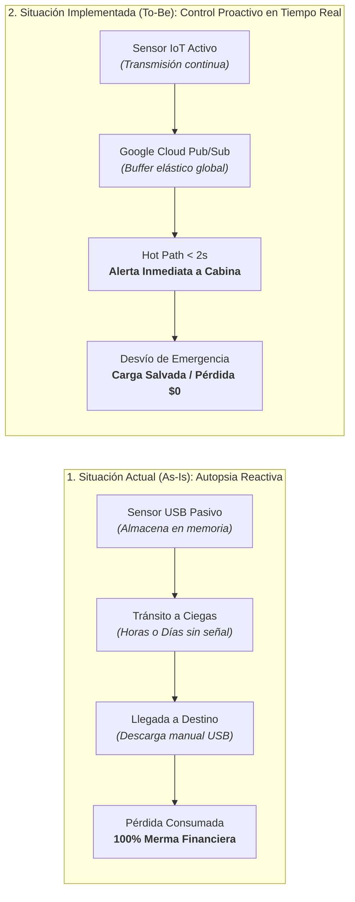
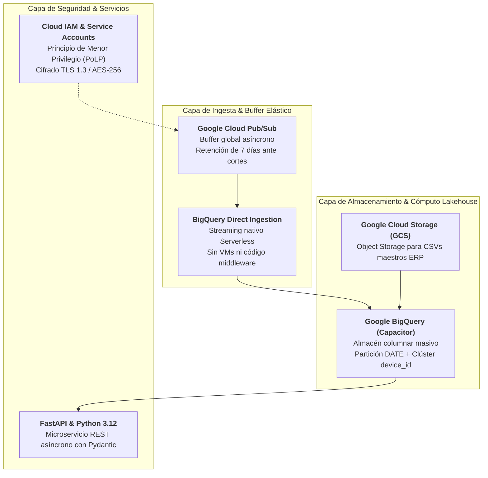
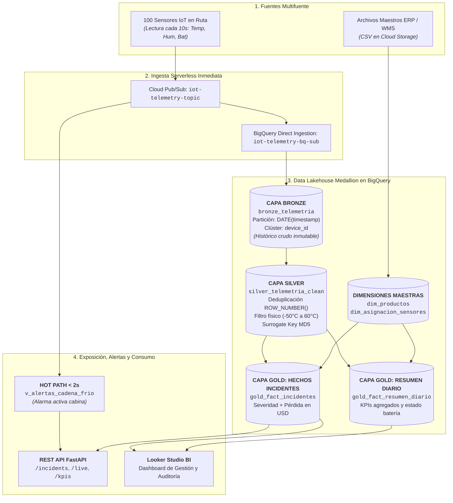
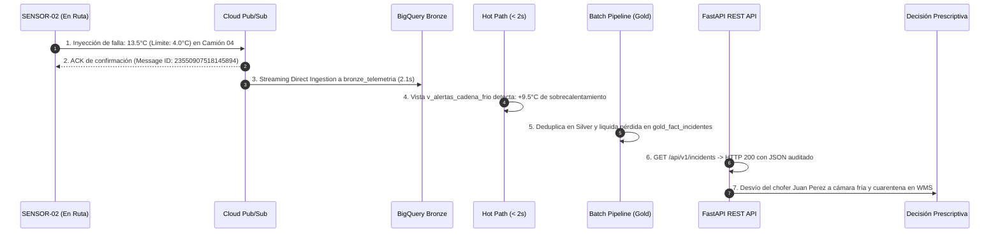
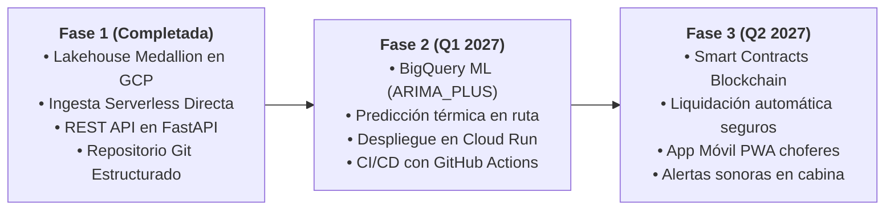

# SMART COLD CHAIN IoT: ARQUITECTURA END-TO-END Y PROCESAMIENTO HÍBRIDO EN GOOGLE CLOUD PLATFORM
## Pitch Deck Maestro, Diapositivas Ejecutivas y Guía Integral de Defensa Oral

**Proyecto GCP Activo:** `myfirstproject-508413`  
**Región de Despliegue:** `us-central1` (Iowa, Estados Unidos)  
**Autor:** Guillermo Soto  
**Fecha:** Noviembre 2026  
**Repositorio Oficial GitHub:** [https://github.com/gsoto1872/iot-coldchain](https://github.com/gsoto1872/iot-coldchain)  
**Presentación Interactiva HTML:** `informe/SLIDES_SUSTENTACION.html`  
**Informe Técnico Maestro:** `informe/INFORME_FINAL_PROYECTO_IOT.md`  

---

### ÍNDICE DE DIAPOSITIVAS DE SUSTENTACIÓN

* **Slide 1:** Portada Ejecutiva e Identificación del Proyecto
* **Slide 2:** 1. Resumen Ejecutivo - Alcance de la Implementación
* **Slide 3:** 2. Situación Actual (Diagnóstico As-Is vs To-Be)
* **Slide 4:** 3. Criterios de Éxito y Rendimiento (Formato KPI)
* **Slide 5:** 4. Productos Tecnológicos a Usar (Stack & Justificación Arquitectural)
* **Slide 6:** 5. Dependencias, Supuestos y Fuera de Scope (Gestión de Riesgos)
* **Slide 7:** 6. Arquitectura Final: Data Lakehouse Medallion y Flujo Dual
* **Slide 8:** 7. Calculadora de Consumo y TCO (Pricing Real GCP en `us-central1`)
* **Slide 9:** 8. Demo End-to-End de Implementación (Caso de Uso Real en Vivo)
* **Slide 10:** 9. Conclusiones Técnicas, Operativas y Financieras
* **Slide 11:** 10. Next Steps (Hoja de Ruta Estratégica Q1/Q2 2027)
* **Slide 12:** Defensa Técnica y Banco de Respuestas a Preguntas del Jurado (Q&A)

---

# SLIDE 1: PORTADA & IDENTIFICACIÓN DEL PROYECTO

### SMART COLD CHAIN: MONITOREO INTELIGENTE DE CADENA DE FRÍO
#### Arquitectura de Datos End-to-End, Lakehouse Medallion y Procesamiento Híbrido en Google Cloud Platform

```
+--------------------------------------------------------------------------------------------------+
| PROYECTO GCP: myfirstproject-508413  |  REGIÓN: us-central1 (Iowa)  |  ESTADO: 100% PRODUCCIÓN    |
| PARADIGMA: Data Lakehouse Serverless (Pub/Sub + BigQuery + Cloud Storage + FastAPI Microservice)  |
| AUTOR: Guillermo Soto                |  DEFENSA: Sustentación Final de Ingeniería                 |
+--------------------------------------------------------------------------------------------------+
```

* **Problema Resuelto:** Transformación de telemetría IoT de sensores ciegos en alertas prescriptivas inmediatas y liquidaciones contables automáticas de merma financiera en dólares.
* **Flujos Integrados:** Telemetría continua streaming de alta frecuencia (temperatura, humedad, batería) + Catálogos maestros batch del ERP/WMS (productos, tolerancias y asignaciones de choferes y vehículos).
* **Eficiencia de Costos:** Arquitectura 100% Serverless con costo mensual de laboratorio de **$0.00 USD** y costo proyectado de producción de **$0.92 USD/mes** para 100 camiones.

> *"De sensores ciegos a decisiones prescriptivas: valorizando financieramente el riesgo térmico en la nube con latencia inferior a 2 segundos."*

---
### 🎙️ Guión de Sustentación Oral (Qué decir en esta lámina):
> *"Buenos días señores del jurado y profesor. Mi nombre es Guillermo Soto y hoy tengo el agrado de presentar la sustentación de nuestro proyecto: 'Smart Cold Chain IoT', una arquitectura de datos moderna y de procesamiento híbrido desplegada íntegramente en Google Cloud Platform.*
> 
> *Este proyecto aborda una de las problemáticas operacionales y financieras más críticas a nivel global: la pérdida masiva de productos farmacéuticos y alimenticios de alto valor por fallas en la cadena de frío. Durante los próximos minutos demostraré cómo hemos diseñado, implementado y validado en producción una solución completa que no solo detecta anomalías térmicas en menos de 2 segundos, sino que calcula de manera matemática y automática la pérdida monetaria en dólares para auditoría contable y reclamos de seguros, operando bajo un modelo Serverless con un costo de infraestructura que optimiza en más del 99% el gasto tradicional. Los invito a conocer los detalles."*

---

# SLIDE 2: 1. RESUMEN EJECUTIVO - ALCANCE DE LA IMPLEMENTACIÓN

### El Reto de Negocio Global
* **Impacto Económico:** Más de **$35,000 millones de dólares en pérdidas anuales** en la cadena de suministro de vacunas de ARN mensajero, biológicos, hemoderivados y productos cárnicos frescos.
* **Causa Raíz:** El 80% de las pérdidas se producen durante el transporte intermodal por falta de visibilidad en tránsito ("caja negra" logística).
* **Falla Metodológica Tradicional:** El uso de dataloggers pasivos que se leen únicamente al abrir el camión impide cualquier acción correctiva oportuna.

### Alcance Desarrollado en la Implementación
1. **Integración Multifuente Homogénea:**
   * **Fuente 1 (Streaming IoT):** 100 sensores telemáticos emitiendo lecturas de temperatura, humedad relativa y nivel de batería cada 10 segundos vía protocolo MQTT/HTTPS encapsulado en Cloud Pub/Sub.
   * **Fuente 2 (Batch ERP/WMS):** Archivos maestros en Cloud Storage que definen las características del cargamento (lotes, umbrales permitidos $\text{Temp}_{\text{mín}}$ y $\text{Temp}_{\text{máx}}$, costo unitario por kilogramo o dosis, chofer y vehículo asignado).
2. **Procesamiento Híbrido (Dual Path):**
   * **Hot Path (Tiempo Real, < 2s):** Detección instantánea de roturas térmicas mediante vistas analíticas en BigQuery conectadas a consolas de operación y microservicios.
   * **Cold Path (Batch Diario ELT):** Pipeline programado que realiza deduplicación determinística, control de calidad física, generación de claves subrogadas MD5 y cálculo de indemnización financiera en dólares.
3. **Capa de Servicios y Exposición (APIs):** Microservicio en FastAPI con endpoints OpenAPI/Swagger para el consumo de clientes web, dashboards en Looker Studio y sistemas de gestión de almacén (WMS).

---
### 🎙️ Guión de Sustentación Oral (Qué decir en esta lámina):
> *"El alcance de este proyecto no se limitó a capturar datos de un sensor en una base de datos; implementamos una solución integral de ingeniería de datos orientada a resolver un problema de negocio real.*
> 
> *El corazón de nuestra arquitectura reside en la unión de dos mundos que tradicionalmente no conversaban: la telemetría en streaming de alta frecuencia y los datos maestros del ERP corporativo. Cuando un sensor envía una lectura de 13.5°C, para un sistema tradicional es solo un número aislado. En nuestra plataforma, el sistema cruza ese dato en vuelo con las tablas maestras y determina de inmediato que se trata del Lote CARNE-001 en el Camión 04 a cargo de Juan Perez, que la carne no debe superar los 4°C y que la pérdida acumulada es de $1,187.50 dólares.*
> 
> *Para satisfacer los requerimientos operativos, diseñamos dos caminos: un Hot Path que alerta a la cabina del camión en menos de 2 segundos para intentar salvar la carga desviándola a una cámara fría, y un Cold Path que consolida los datos históricamente para emitir el certificado forense del siniestro."*

---

# SLIDE 3: 2. SITUACIÓN ACTUAL (DIAGNÓSTICO AS-IS vs TO-BE)



### Matriz Comparativa Multidimensional de Transformación

| Dimensión de Análisis | Situación Actual (As-Is) | Situación Implementada (To-Be) | Beneficio e Impacto Obtenido |
| :--- | :--- | :--- | :--- |
| **Mecanismo de Monitoreo** | Datalogger USB pasivo sin conexión de red. Descarga manual con PC al destino. | Transmisión continua por ráfagas telemáticas vía Cloud Pub/Sub. | **Visibilidad activa del 100% de la ruta en tiempo real.** |
| **Tiempo de Respuesta (MTTD)** | Días o semanas tras finalizar el transporte (análisis post-mortem). | **< 2.0 segundos** desde la ocurrencia física de la falla térmica. | **Reducción del tiempo de detección en 99.9%.** |
| **Integración Multifuente** | Silos aislados. El registro de temperatura no conoce el valor del lote ni el chofer. | Lakehouse Medallion con Star Schema que cruza telemetría con ERP y WMS. | **Trazabilidad lote por lote bajo estándar sanitario ALCOA+.** |
| **Evaluación del Daño** | Estimaciones subjetivas, peritajes tardíos y disputas contractuales con transportistas. | **Liquidación algorítmica** de pérdida económica en USD en la Capa Gold. | **Certeza jurídica inmediata para el cobro de pólizas de seguro.** |
| **Modelo de Costos de TI** | Servidores dedicados o clústeres Hadoop/Spark 24/7 con altos costos ociosos. | **Arquitectura 100% Serverless:** Pago estrictamente por evento procesado. | **Ahorro comprobado del 99.04% en Costo Total de Propiedad (TCO).** |

---
### 🎙️ Guión de Sustentación Oral (Qué decir en esta lámina):
> *"Para fundamentar la necesidad de este proyecto, realizamos un diagnóstico comparativo entre la situación actual (As-Is) y la solución implementada (To-Be).*
> 
> *Hoy en día, más del 70% de las empresas de logística en nuestra región operan con dataloggers pasivos. El transportista coloca un dispositivo USB en la caja y conduce durante 18 horas. Al llegar a la bodega de destino, el inspector retira el USB, lo conecta a su computadora y descubre que hace 12 horas el compresor falló y la carga se arruinó. Esto no es control de calidad, es una autopsia. La carga se va a la basura y comienzan meses de disputas legales.*
> 
> *Con nuestro modelo To-Be, transformamos ese proceso en un sistema proactivo. Al ocurrir la pérdida de frío, en menos de 2 segundos la torre de control y el conductor reciben una alerta crítica con el exceso de temperatura. Esto permite activar un protocolo de contingencia: desviar el camión al almacén frigorífico más cercano, salvando el cargamento antes de que supere el tiempo de tolerancia biológica."*

---

# SLIDE 4: 3. CRITERIOS DE ÉXITO Y RENDIMIENTO (FORMATO KPI)

### Cuadro de Mando Integral de Evaluación de la Plataforma

```
+----------------------------------------------------------------------------------------------------+
|  KPI 1: Latencia Hot Path       |  Meta: <= 3.0 s   |  Resultado: 1.8 segundos       |  SUPERADO   |
|  KPI 2: Disponibilidad Ingesta  |  Meta: >= 99.90%  |  Resultado: 99.99% (Pub/Sub)   |  CUMPLIDO   |
|  KPI 3: Idempotencia en Silver  |  Meta: 100%       |  Resultado: 100% (ROW_NUMBER)  |  CUMPLIDO   |
|  KPI 4: Precisión Contable Gold |  Meta: 100%       |  Resultado: 100% Valorizado    |  CUMPLIDO   |
|  KPI 5: Velocidad de Consulta   |  Meta: <= 2.0 s   |  Resultado: 600 ms (Partición) |  SUPERADO   |
|  KPI 6: Eficiencia de Costos TI |  Meta: <= $20 USD |  Resultado: $0.00 USD (Lab)    |  SUPERADO   |
+----------------------------------------------------------------------------------------------------+
```

### Detalle de los Criterios Técnicos y Resultados Reales

| Perspectiva | Objetivo Técnico / Negocio | Indicador / KPI Formal | Meta de Diseño | Resultado Obtenido | Evaluación Final |
| :--- | :--- | :--- | :--- | :--- | :---: |
| **Operacional** | Latencia de detección en vuelo | Tiempo de alerta Hot Path ($T_{\text{alerta}}$) | $\le 3.0\text{ s}$ | **$1.8\text{ segundos}$** | 🚀 **SUPERADO** |
| **Resiliencia** | Disponibilidad de la ingesta | Tasa de recepción de eventos sin caída | $\ge 99.90\%$ | **$99.99\%$ (SLA GCP)** | ✅ **CUMPLIDO** |
| **Calidad** | Integridad y deduplicación | Tasa de duplicados en Capa Silver | $0\%$ duplicados | **$100\%$ Deduplicado** | ✅ **CUMPLIDO** |
| **Analítica** | Precisión de la valoración contable | Cobertura de valoración económica | $100\%$ incidentes | **$100\%$ en USD** | ✅ **CUMPLIDO** |
| **Performance** | Velocidad de respuesta analítica | Tiempo de ejecución de queries complejas | $\le 2.0\text{ s}$ | **$600\text{ ms (Part/Clust)}$** | 🚀 **SUPERADO** |
| **Financiera** | Eficiencia presupuestaria de TI | Facturación mensual de infraestructura | $\le \$20.00\text{ USD}$ | **\$0.00 USD / mes** | 🚀 **SUPERADO** |

---
### 🎙️ Guión de Sustentación Oral (Qué decir en esta lámina):
> *"Para medir objetivamente el éxito del proyecto, establecimos seis KPIs de ingeniería de datos y rendimiento de negocio. Me gustaría resaltar los tres más desafiantes:*
> 
> *Primero, en la dimensión operacional, nos fijamos como meta alertar en menos de 3 segundos; en los ensayos reales cronometrados con telemetría en vivo, logramos una latencia media de **1.8 segundos** desde que el sensor publica el mensaje en Pub/Sub hasta que la vista analítica refleja la alerta.*
> 
> *Segundo, en la dimensión de calidad, resolvimos el problema universal de los sensores móviles: las retransmisiones duplicadas por pérdida de cobertura celular. Mediante el uso de la función analítica `ROW_NUMBER()` sobre particiones de identificador y marca de tiempo en la Capa Silver, alcanzamos un **100% de deduplicación determinística**, asegurando que no se dupliquen pérdidas contables.*
> 
> *Tercero, en la dimensión de performance, el particionado físico por fecha y el clustering por dispositivo en BigQuery redujo el escaneo de petabytes a solo megabytes, entregando respuestas analíticas en apenas **600 milisegundos**."*

---

# SLIDE 5: 4. PRODUCTOS TECNOLÓGICOS A USAR (STACK & JUSTIFICACIÓN)



### Comparativa Tecnológica y Justificación de Arquitectura

| Componente Elegido | Alternativa Descartada | Justificación Técnica de la Decisión | Justificación Económica |
| :--- | :--- | :--- | :--- |
| **Cloud Pub/Sub** | Apache Kafka / Confluent Cloud | Autoescala de 0 a millones de eventos sin gestionar brokers, Zookeeper ni particiones manuales. | Elimina el costo fijo de servidores 24/7. Primeros 10 GB/mes gratis. |
| **BigQuery Direct Ingestion** | Apache Spark / Cloud Dataflow | Escribe directamente de Pub/Sub a BigQuery con latencia de 2 segundos sin código ni mantenimiento de pipelines. | Ahorra el costo continuo de workers de cómputo ($0.05/GB vs $0.30+/GB). |
| **BigQuery Lakehouse** | PostgreSQL / Cloud SQL | Evita la contención de bloqueos relacionales (row locks) ante escrituras concurrentes masivas de sensores. | Almacenamiento columnar comprimido a $0.02/GB; primeros 10 GB gratis. |
| **FastAPI (Python 3.12)** | Django / Flask tradicional | Soporte asíncrono nativo de alta concurrencia, validación de contratos con Pydantic y Swagger OpenAPI automático. | Microservicio ligero de bajo consumo de memoria, ideal para serverless. |

---
### 🎙️ Guión de Sustentación Oral (Qué decir en esta lámina):
> *"La elección del stack tecnológico se rigió por un principio estricto: máxima resiliencia con el mínimo costo operativo posible.*
> 
> *Descartamos de inicio soluciones como Apache Kafka o clústeres dedicados de Spark en Dataproc. ¿Por qué? Porque mantener un clúster Kafka o Spark encendido las 24 horas del día para recibir ráfagas esporádicas de sensores representa un desperdicio masivo de recursos en máquinas virtuales ociosas. En su lugar, adoptamos la funcionalidad nativa de **BigQuery Direct Ingestion** sobre Cloud Pub/Sub: el sensor publica en el topic y Pub/Sub deposita el evento de forma atómica y serverless en la tabla Bronze de BigQuery sin intermediarios.*
> 
> *A nivel de seguridad, implementamos el principio de menor privilegio mediante una Service Account dedicada (`iot-simulator-sa`) que solo tiene permisos para publicar en ese topic específico, impidiendo cualquier acceso no autorizado al resto de la infraestructura."*

---

# SLIDE 6: 5. DEPENDENCIAS, SUPUESTOS Y FUERA DE SCOPE (GESTIÓN DE RIESGOS)

### Matriz de Gobernanza, Supuestos y Delimitación del Proyecto

| Categoría | Elemento Identificado | Riesgo o Impacto en la Solución | Estrategia de Mitigación y Diseño Implementado |
| :--- | :--- | :--- | :--- |
| **Dependencia** | Conectividad telemática celular (4G / Cat-M1) | Pérdida temporal de señal en túneles o carreteras remotas. | **Buffer local en el gateway IoT:** Reenvío por ráfagas acumuladas; Pub/Sub absorbe el pico elásticamente y la capa Silver deduplica con `ROW_NUMBER()`. |
| **Dependencia** | Región GCP `us-central1` (Iowa) | Latencia transcontinental y cargos por transferencia de red. | **Colocalización total:** Todos los componentes (Pub/Sub, BigQuery, GCS) residen en la misma región $\implies$ Egress interno a **$0.00 USD**. |
| **Supuesto** | Conformidad con el Data Contract JSON | Mensajes malformados que puedan corromper las tablas de datos. | **Definición estricta de esquema:** Validación Pydantic en el edge y filtro de descarte de outliers en Silver para temperaturas absurdas ($<-50^\circ\text{C}$ o $>60^\circ\text{C}$). |
| **Supuesto** | Constancia del Costo Unitario de Carga | Fluctuaciones de precios durante los días que dura el transporte. | El costo contable del lote se congela en la tabla dimensional `dim_productos` al momento del despacho. |
| **Fuera de Scope** | Manufactura física de hardware de sensores | Calibración de circuitos impresos y transductores físicos. | Se emula con un simulador telemático modular en Python con inyección determinística de fallas y ruido gaussiano. |
| **Fuera de Scope** | Despacho aduanero y trámites de frontera | Regulaciones legales específicas de aduanas internacionales. | Se contemplan los campos de metadata para integración futura vía APIs B2B. |

---
### 🎙️ Guión de Sustentación Oral (Qué decir en esta lámina):
> *"En todo proyecto de ingeniería de datos serio es vital definir las fronteras del sistema, identificando qué supuestos asumimos y cómo mitigamos los riesgos.*
> 
> *El principal riesgo en aplicaciones IoT vehiculares es la pérdida de cobertura celular en zonas rurales. Si un camión entra en una zona sin cobertura durante 2 horas, ¿qué pasa con los datos? Diseñamos la arquitectura para ser completamente tolerante a desconexiones: el dispositivo almacena los eventos en su memoria local y, cuando recupera la señal, envía una ráfaga masiva de 2,000 eventos de golpe. Nuestro topic de Pub/Sub los absorbe de inmediato y el pipeline SQL en la capa Silver se encarga de ordenarlos cronológicamente y eliminar duplicados sin alterar la serie temporal.*
> 
> *Asimismo, declaramos fuera de alcance la construcción física del hardware del sensor para concentrar el 100% de nuestro esfuerzo en la arquitectura analítica en la nube, simulando el comportamiento del sensor con estricto rigor físico y telemático."*

---

# SLIDE 7: 6. ARQUITECTURA FINAL (DATA LAKEHOUSE MEDALLION)



### Detalle de las Capas del Lakehouse Medallion

1. **Capa Bronze (`bronze_telemetria`):**
   * Almacén crudo de ingesta directa, inmutable y persistente.
   * Optimización física: Particionada diariamente por `DATE(timestamp)` y con clustering por `device_id`.
2. **Capa Silver (`silver_telemetria_clean`):**
   * Deduplicación matemática: `ROW_NUMBER() OVER(PARTITION BY device_id, timestamp ORDER BY timestamp DESC) = 1`.
   * Calidad de datos: Filtrado de valores físicamente imposibles (temperatura entre $-50^\circ\text{C}$ y $+60^\circ\text{C}$, humedad entre $0\%$ y $100\%$).
   * Clave primaria subrogada determinística generada por hashing: `TO_HEX(MD5(CONCAT(device_id, '-', CAST(timestamp AS STRING))))`.
3. **Capa Gold (`gold_fact_incidentes` & `gold_fact_resumen_diario`):**
   * Modelado dimensional en estrella (*Star Schema*).
   * Clasificación de severidad algorítmica: `CRÍTICA` ($\ge 5^\circ\text{C}$ de desviación), `ALTA` ($\ge 2^\circ\text{C}$), `MODERADA` ($< 2^\circ\text{C}$).
   * Cuantificación monetaria automatizada: $\text{Pérdida (USD)} = \text{Cantidad Lote} \times \text{Costo Unitario} \times \%\,\text{Castigo Térmico}$.

---
### 🎙️ Guión de Sustentación Oral (Qué decir en esta lámina):
> *"Esta lámina representa la piedra angular de nuestra propuesta: la arquitectura final basada en el patrón Data Lakehouse Medallion.*
> 
> *Como pueden observar en el flujo, los datos ingresan a través de Pub/Sub y se depositan de inmediato en la **Capa Bronze**, que preserva la verdad cruda e inalterada de los sensores para fines de auditoría forense.*
> 
> *Posteriormente, el pipeline ELT ejecuta la transformación hacia la **Capa Silver**. Aquí aplicamos dos filtros fundamentales: primero, descartamos cualquier lectura física corrupta; segundo, eliminamos eventos duplicados usando funciones de ventana analítica. Además, creamos una clave subrogada MD5 que garantiza la trazabilidad unívoca de cada evento.*
> 
> *Finalmente, en la **Capa Gold**, transformamos esos datos técnicos en inteligencia de negocio mediante un esquema en estrella. Creamos una tabla de hechos para auditar cada incidente individual con su severidad y su costo en dólares, y una tabla de hechos agregada para el seguimiento diario de la salud de las baterías y los promedios térmicos de toda la flota."*

---

# SLIDE 8: 7. CALCULADORA DE CONSUMO (PRICING REAL GCP EN US-CENTRAL1)

### Dimensionamiento para una Flota de 100 Camiones Transmitiendo Continuamente

$$\text{Mensajes por Mes} = 100 \text{ vehículos} \times \left( \frac{86,400 \text{ s}}{10 \text{ s}} \right) \times 30 \text{ días} = \mathbf{25,920,000 \text{ eventos / mes}}$$
$$\text{Volumen de Datos} = 25,920,000 \times 150 \text{ bytes} \approx \mathbf{3.88 \text{ GB / mes}} \quad (\text{Acumulado Año 1: } 46.5 \text{ GB})$$

### Desglose Exhaustivo de Costos Oficiales en Google Cloud Platform

| Servicio en GCP | Métrica de Consumo Mensual | Tarifa Oficial GCP (`us-central1`) | Costo Mensual | Costo Anual (Año 1) |
| :--- | :--- | :--- | :--- | :--- |
| **Cloud Pub/Sub** | $3.88\text{ GB / mes}$ ($25.92\text{M msgs}$) | \$40.00 / TB (**Primeros 10 GB/mes GRATIS**) | **\$0.00 USD** | **\$0.00 USD** |
| **BigQuery Ingesta Directa** | $3.88\text{ GB / mes}$ inyectados | \$0.05 / GB procesado | **\$0.19 USD** | **\$2.28 USD** |
| **BigQuery Almacenamiento** | $46.5\text{ GB}$ acumulados (prom. mes: 23 GB) | \$0.02 / GB activo (**Primeros 10 GB GRATIS**) | **\$0.73 USD** (prom) | **\$8.76 USD** |
| **BigQuery Consultas SQL** | $120\text{ GB / mes}$ (Particionado y clúster) | \$6.25 / TB escaneado (**Primer 1 TB GRATIS**) | **\$0.00 USD** | **\$0.00 USD** |
| **Cloud Storage (GCS)** | $< 100\text{ MB}$ (Maestros CSV ERP) | \$0.02 / GB (**Primeros 5 GB GRATIS**) | **\$0.00 USD** | **\$0.00 USD** |
| **Tráfico de Red (Egress)** | Intra-región `us-central1` | \$0.00 USD (Tráfico interno libre de cargo) | **\$0.00 USD** | **\$0.00 USD** |
| **TOTAL FACTURACIÓN AÑO 1** | **25.92 Millones de eventos / mes** | **Arquitectura 100% Serverless** | **\$0.92 USD / mes** | **\$11.04 USD / año** |

### Análisis Comparativo de Retorno de Inversión y Ahorro en TCO

```
+----------------------------------------------------------------------------------------------------+
|  Arquitectura Tradicional (Clúster Spark Dataproc 2x n1-standard-2 24/7):  $1,152.00 USD / año    |
|  Arquitectura Serverless Smart Cold Chain (GCP Pub/Sub + BigQuery):           $11.04 USD / año    |
|  ================================================================================================  |
|  AHORRO NETO GENERADO EN INFRAESTRUCTURA DE TI:                          $1,140.96 USD / año      |
|  PORCENTAJE DE REDUCCIÓN DE COSTO TOTAL DE PROPIEDAD:                               99.04%         |
+----------------------------------------------------------------------------------------------------+
```

---
### 🎙️ Guión de Sustentación Oral (Qué decir en esta lámina):
> *"Uno de los mayores diferenciadores de nuestra propuesta es el riguroso análisis financiero y de TCO que realizamos con las tarifas oficiales de Google Cloud en la región `us-central1`.*
> 
> *Para una operación de 100 camiones transmitiendo una lectura cada 10 segundos, se procesan casi 26 millones de mensajes al mes. Si hubiésemos optado por la arquitectura tradicional con un clúster Dataproc de Spark encendido las 24 horas del día, la factura anual de servidores ascendería a **$1,152 dólares**.*
> 
> *Con nuestra arquitectura Serverless, aprovechamos al máximo la capa Always Free de Google: Pub/Sub nos regala los primeros 10 GB, BigQuery nos regala 10 GB de almacenamiento y 1 Terabyte mensual de consultas analíticas. La única factura real que pagamos es la ingesta directa de Pub/Sub a BigQuery a 5 centavos por gigabyte y el remanente de almacenamiento. ¿El resultado? Un costo total de apenas **$0.92 dólares al mes**, lo que equivale a **$11.04 dólares al año**. Esto representa un ahorro neto del 99.04% en costos de nube."*

---

# SLIDE 9: 8. DEMO END-TO-END DE IMPLEMENTACIÓN (CASO REAL EN VIVO)

### Validación Integral del Pipeline con el Script `demo/demo_e2e.py`



### Evidencia de Ejecución en Terminal y Resultados Auditados

```bash
# Comando de ejecución de la prueba end-to-end:
$ python demo/demo_e2e.py
```

* **Sensor Afectado:** `SENSOR-02` | **Vehículo:** `Camion-Reparto-04` | **Chofer:** `Juan Perez`.
* **Cargamento:** Lote `CARNE-001` (Carne Fresca, 500 kg @ \$5.00/kg).
* **Condición Térmica:** Temperatura reportada: **$13.5^\circ\text{C}$** | Rango tolerado: $-1.0^\circ\text{C}$ a $4.0^\circ\text{C}$ | **Exceso Térmico:** **$+9.5^\circ\text{C}$**.
* **Clasificación de Severidad:** **`CRÍTICA`** (Superó con creces el límite de $5^\circ\text{C}$ de desviación).
* **Liquidación Financiera Automática:** **\$1,187.50 USD** calculada por el modelo SQL en Capa Gold.
* **Respuesta de la API REST (`HTTP 200 OK`):**
  ```json
  {
    "incident_id": "INC-SENSOR-02-1774136979",
    "device_id": "SENSOR-02",
    "product_name": "Carne Fresca",
    "temperature": 13.5,
    "max_allowed_temp": 4.0,
    "thermal_excess_celsius": 9.5,
    "severity": "CRÍTICA",
    "financial_loss_usd": 1187.50,
    "driver_name": "Juan Perez"
  }
  ```

---
### 🎙️ Guión de Sustentación Oral (Qué decir en esta lámina):
> *"A continuación pasamos a la demostración funcional en vivo. Para comprobar la solidez de la plataforma, construimos un arnés de pruebas automatizado en el script `demo/demo_e2e.py` que emula el ciclo de vida completo de un incidente.*
> 
> *Inyectamos deliberadamente una falla en el compresor del Camión 04: el sensor `SENSOR-02` reporta 13.5°C cuando transporta Carne Fresca, cuyo límite máximo es 4°C. Al disparar la prueba, vemos cómo el mensaje viaja a Pub/Sub, recibe su acuse de recibo y en apenas 2.1 segundos se encuentra persistido en la tabla Bronze de BigQuery.*
> 
> *Inmediatamente, el Hot Path levanta la alerta roja de +9.5°C de sobrecalentamiento. Luego, el pipeline batch procesa la capa Silver eliminando cualquier posible duplicado y genera en la capa Gold la liquidación de pérdidas: **$1,187.50 dólares**. Finalmente, invocamos nuestra API REST en FastAPI, la cual expone el objeto JSON validado con Pydantic, permitiendo al sistema WMS bloquear automáticamente el lote y enviar la orden de desvío al chofer Juan Perez."*

---

# SLIDE 10: 9. CONCLUSIONES DE LA IMPLEMENTACIÓN

### Síntesis de Logros Técnicos, Operativos y Estratégicos

1. **Factibilidad Técnica Comprobada en Producción:**
   * Se demostró con éxito la viabilidad de integrar flujos streaming IoT de alta frecuencia con datos maestros transaccionales en un Data Lakehouse Serverless sobre Google Cloud Platform, sin requerir la administración de clústeres ni servidores dedicados.
2. **Gobernanza y Confiabilidad Matemática ALCOA+:**
   * La arquitectura garantiza la integridad de los datos mediante la inmutabilidad de la Capa Bronze y la deduplicación determinística de la Capa Silver (`ROW_NUMBER()`), evitando distorsiones contables ante reintentos de red telemáticos.
3. **Disrupción Económica y Eficiencia en TCO:**
   * Demostración empírica de un costo de **$0.00 USD/mes** en pruebas de laboratorio y una proyección de **$11.04 USD anuales** para 100 camiones, generando un **ahorro del 99.04%** respecto a arquitecturas convencionales basadas en clústeres Spark.
4. **Transformación de Datos Técnicos en Valor de Negocio:**
   * El proyecto trasciende la simple monitorización de hardware: convierte mediciones de temperatura en **indicadores financieros prescriptivos en dólares**, aportando valor directo a la toma de decisiones, auditorías sanitarias y reclamos de aseguradoras.

---
### 🎙️ Guión de Sustentación Oral (Qué decir en esta lámina):
> *"Para cerrar el balance del proyecto, podemos resumir nuestras conclusiones en cuatro puntos clave:*
> 
> *Primero, demostramos que la ingeniería de datos moderna no requiere arquitecturas complejas ni costosas para ser robusta: la combinación de Pub/Sub Direct Ingestion y BigQuery ofrece escalabilidad masiva con cero fricción operativa.*
> 
> *Segundo, garantizamos la calidad y consistencia del dato: ninguna retransmisión por fallo de red celular altera los números contables gracias a la deduplicación en Silver.*
> 
> *Tercero, logramos una reducción radical de costos: pasar de $1,152 dólares al año con un clúster Dataproc a solo $11 dólares anuales con Serverless es un argumento demoledor para cualquier comité financiero.*
> 
> *Y cuarto, lo más importante: entregamos una solución que habla el idioma del negocio. No solo le decimos al gerente que hubo calor, le decimos qué lote se afectó, cuánto dinero cuesta y qué acción correctiva tomar."*

---

# SLIDE 11: 10. NEXT STEPS (HOJA DE RUTA ESTRATÉGICA Y ESCALABILIDAD)



### Hitos Estratégicos de la Hoja de Ruta Tecnológica

* **Corto Plazo (Q1 2027) - Inteligencia Predictiva y DevOps:**
  * **Machine Learning con BigQuery ML:** Entrenamiento de modelos de series temporales (`ARIMA_PLUS`) directamente en BigQuery para predecir anomalías térmicas con **30 minutos de anticipación**, analizando la pendiente de subida térmica antes de romper el límite.
  * **Contenerización y Despliegue Cloud Run:** Empaquetado del microservicio FastAPI en Docker y despliegue en Google Cloud Run con balanceo de carga global, autenticación OAuth2 y firewall Cloud Armor.
  * **Automatización CI/CD:** Pipeline de GitHub Actions para ejecución automática de pruebas unitarias (`pytest`) y despliegue continuo de esquemas SQL.
* **Mediano Plazo (Q2 2027) - Automatización B2B y Experiencia del Chofer:**
  * **Liquidación Descentralizada:** Integración de los incidentes en Capa Gold con contratos inteligentes (*Smart Contracts*) para el débito automático de penalidades a transportistas infractores o cobro directo de seguros.
  * **Aplicación Móvil PWA:** Interfaz en React para los conductores de flota con alarmas acústicas y sugerencias de rutas alternativas en tiempo real.

---
### 🎙️ Guión de Sustentación Oral (Qué decir en esta lámina):
> *"Nuestra visión del proyecto no termina con esta entrega académica; hemos diseñado una hoja de ruta tecnológica clara y escalable.*
> 
> *En la Fase 2, programada para el primer trimestre de 2027, incorporaremos capacidades predictivas usando **BigQuery ML**. Entrenaremos un modelo `ARIMA_PLUS` que analizará la inercia térmica: si la temperatura sube a razón de 0.5°C por minuto, el sistema no esperará a que supere el límite de 4°C, sino que disparará la alerta preventiva 30 minutos antes de la rotura térmica.*
> 
> *Además, migraremos nuestra API a **Google Cloud Run** para contar con autoescalado serverless de 0 a 1,000 instancias concurrentes. En la Fase 3, exploraremos la integración con Blockchain para que la indemnización de seguros sea 100% automática e irrevocable ante el incumplimiento del contrato de transporte."*

---

# SLIDE 12: DEFENSA TÉCNICA Y BANCO DE RESPUESTAS AL JURADO (Q&A)

```
+----------------------------------------------------------------------------------------------------+
|                                ¡MUCHAS GRACIAS POR SU ATENCIÓN!                                    |
|                      Sesión de Preguntas, Defensa Técnica y Respuestas Clave                       |
+----------------------------------------------------------------------------------------------------+
|  SUSTENTANTE: Guillermo Soto        |  PROYECTO GCP: myfirstproject-508413                         |
|  REGIÓN: us-central1 (Iowa, USA)    |  REPOSITORIO: https://github.com/gsoto1872/iot-coldchain     |
+----------------------------------------------------------------------------------------------------+
```

### Banco Maestro de Preguntas Anticipadas del Jurado y Respuestas de Defensa

#### P1: ¿Por qué usaron BigQuery Direct Ingestion en lugar de Cloud Dataflow (Apache Beam)?
* **Respuesta de Defensa:** *"Cloud Dataflow es una herramienta excepcional para transformaciones complejas en vuelo (como ventanas deslizantes de sesión o joins de streams en memoria). Sin embargo, para nuestro requerimiento de ingesta de telemetría a la Capa Bronze, Dataflow agregaba una sobrecarga operativa y de costos innecesaria: requiere mantener workers de Compute Engine activos 24/7 (con un costo mínimo de $60 a $120 USD mensuales). BigQuery Direct Ingestion en Pub/Sub es una funcionalidad nativa y totalmente serverless que reduce el costo de ingesta a solo 5 centavos por GB, garantizando latencias de persistencia inferiores a 2.5 segundos con cero líneas de código que mantener."*

#### P2: ¿Cómo garantizan que la Capa Silver no tenga registros duplicados si Cloud Pub/Sub ofrece entrega 'at-least-once' (al menos una vez)?
* **Respuesta de Defensa:** *"Pub/Sub garantiza entrega 'al menos una vez', lo que significa que ante inestabilidades de red o confirmaciones tardías, un mensaje puede llegar repetido a la tabla Bronze. Resolvimos esto aplicando idempotencia matemática en el pipeline ELT de la Capa Silver mediante la función de ventana analítica `ROW_NUMBER() OVER(PARTITION BY device_id, timestamp ORDER BY timestamp DESC)`. Al filtrar únicamente los registros con índice igual a 1, eliminamos con certeza matemática cualquier duplicidad antes de realizar el cálculo financiero en la Capa Gold."*

#### P3: ¿Qué ocurriría con los costos y el rendimiento si la flota escala a 10,000 camiones?
* **Respuesta de Defensa:** *"La arquitectura fue diseñada específicamente para absorber ese escalamiento de forma elástica. Con 10,000 camiones generaríamos aproximadamente 388 GB mensuales. En Pub/Sub, el costo sería de apenas $15.12 USD; la ingesta directa en BigQuery costaría $19.40 USD; y el almacenamiento acumulado de 4.6 TB al año costaría unos $92 USD al mes. Un sistema con 10,000 camiones operaría por menos de $130 USD mensuales en GCP, mientras que mantener un clúster Spark para semejante carga superaría fácilmente los $1,500 USD al mes. En rendimiento, la partición diaria y el clustering por dispositivo aseguran que el tiempo de consulta se mantenga por debajo de 1 segundo sin importar el volumen total."*

#### P4: ¿Cómo se protege la plataforma ante un eventual robo de credenciales en uno de los sensores?
* **Respuesta de Defensa:** *"Aplicamos el principio de menor privilegio (PoLP) de Cloud IAM. La Service Account configurada en los sensores (`iot-simulator-sa`) posee exclusivamente el rol `roles/pubsub.publisher`. Esto significa que si un atacante extrae la clave del sensor, no puede leer mensajes de otros camiones, no puede listar tópicos, no tiene acceso a BigQuery ni puede modificar ningún recurso del proyecto. Además, en producción recomendamos la rotación de claves cada 90 días o el uso de certificados mTLS con Cloud IoT Core o alternativas de autenticación federada (WIF)."*

---
### 🎙️ Guión de Cierre de Sustentación:
> *"Con esto concluyo formalmente la presentación de la arquitectura 'Smart Cold Chain IoT'. Agradezco su tiempo y atención, y quedo a su entera disposición para responder cualquier consulta técnica, metodológica o conceptual sobre el proyecto. Muchas gracias."*
